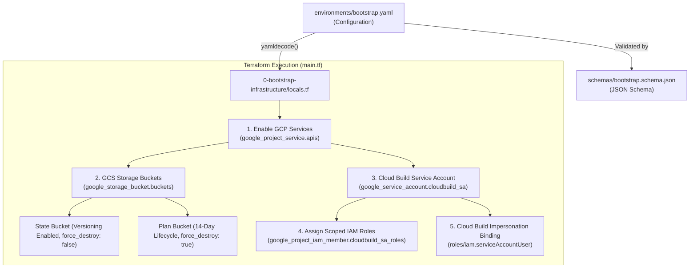

# GCP Platform Foundation - Bootstrap Infrastructure (Tier 0)

This directory contains the Terraform configuration for provisioning the **Bootstrap Infrastructure (Tier 0)** on **Google Cloud Platform (GCP)**. 

The bootstrap layer sets up the core foundation required to run secure, automated CI/CD pipelines (such as Cloud Build) and remote Terraform state management for subsequent platform layers (`1-network-infrastructure`, compute, security, etc.).

---

## Table of Contents

- [Overview](#overview)
- [Architecture & Workflow](#architecture--workflow)
- [Directory Structure](#directory-structure)
- [Core Infrastructure Components](#core-infrastructure-components)
  - [1. Dynamic API Enablement (`google_project_service`)](#1-dynamic-api-enablement-google_project_service)
  - [2. Unified GCS Storage Buckets (`google_storage_bucket`)](#2-unified-gcs-storage-buckets-google_storage_bucket)
  - [3. Dedicated CI/CD Service Account (`google_service_account`)](#3-dedicated-cicd-service-account-google_service_account)
  - [4. Granular IAM Roles Assignment (`google_project_iam_member`)](#4-granular-iam-roles-assignment-google_project_iam_member)
  - [5. Cloud Build Impersonation (`google_service_account_iam_member`)](#5-cloud-build-impersonation-google_service_account_iam_member)
- [Schema & YAML Configuration](#schema--yaml-configuration)
  - [JSON Schema Specification (`schemas/bootstrap.schema.json`)](#json-schema-specification-schemasbootstrapschemajson)
  - [YAML Configuration (`environments/bootstrap.yaml`)](#yaml-configuration-environmentsbootstrapyaml)
- [Terraform Specifications](#terraform-specifications)
  - [Requirements & Providers](#requirements--providers)
  - [Input Variables](#input-variables)
  - [Outputs](#outputs)
- [Deployment Guide](#deployment-guide)
- [Security & Operational Best Practices](#security--operational-best-practices)

---

## Overview

The bootstrap tier establishes foundational prerequisites before provisioning network or compute resources:
- **Centralized API Enablement**: Ensures all required GCP APIs are active and prevents race conditions with dependency chaining (`depends_on`).
- **Remote State & Plan Storage**: Provisions versioned GCS buckets for Terraform state locking/storage and plan reviews with automated lifecycle expiration.
- **Dedicated CI/CD Identity**: Creates a dedicated service account (`sa-cloudbuild-terraform`) with fine-grained, tier-specific IAM roles instead of using overly permissive project-wide editor/owner roles.
- **Service Account Impersonation**: Sets up IAM bindings allowing Cloud Build's default service agent to impersonate the dedicated Terraform executor service account.
- **Schema-Validated Config-as-Data**: Decouples project configuration into a readable `bootstrap.yaml` strictly validated by a draft-07 JSON Schema.

---

## Architecture & Workflow



---

## Directory Structure

```text
gcp-platform-foundation-terraform/
├── environments/
│   ├── bootstrap.yaml               # Bootstrap configuration parameters
│   └── dev/
│       └── network.yaml             # Tier 1 Network configuration
├── schemas/
│   └── bootstrap.schema.json        # JSON Schema validating bootstrap.yaml
└── 0-bootstrap-infrastructure/
    ├── locals.tf                    # Loads bootstrap.yaml and prepares locals
    ├── main.tf                      # Terraform resources (APIs, Buckets, SA, IAM)
    ├── outputs.tf                   # Exported bucket names and SA email
    ├── README.md                    # Bootstrap documentation
    └── variables.tf                 # Variable definitions (config_path)
```

---

## Core Infrastructure Components

### 1. Dynamic API Enablement (`google_project_service`)
Iterates over `local.apis` with `for_each` to activate the required GCP service APIs:
- **Core & Management**: `cloudresourcemanager.googleapis.com`, `serviceusage.googleapis.com`, `iam.googleapis.com`, `logging.googleapis.com`.
- **CI/CD & Storage**: `cloudbuild.googleapis.com`, `storage.googleapis.com`.
- **Networking & Compute**: `compute.googleapis.com`, `networkmanagement.googleapis.com`, `servicenetworking.googleapis.com`.
- **Security & Access**: `iap.googleapis.com`.

### 2. Unified GCS Storage Buckets (`google_storage_bucket`)
A single `google_storage_bucket.buckets` resource leverages `for_each` and dynamic blocks to manage both state and plan review buckets:
- **`state_bucket`**:
  - Purpose: Remote Terraform backend state storage.
  - Settings: `versioning { enabled = true }`, `force_destroy = false`, `uniform_bucket_level_access = true`.
- **`plan_bucket`**:
  - Purpose: Ephemeral Terraform binary plan files storage for pull request reviews.
  - Settings: `lifecycle_rule { condition { age = 14 } action { type = "Delete" } }`, `force_destroy = true`.

### 3. Dedicated CI/CD Service Account (`google_service_account`)
Creates `sa-cloudbuild-terraform` as the dedicated pipeline executor identity.

### 4. Granular IAM Roles Assignment (`google_project_iam_member`)
Dynamically assigns scoped IAM roles across platform tiers using `for_each`:
- **Storage**: `roles/storage.objectAdmin`
- **Logging & Pipelines**: `roles/logging.logWriter`
- **Tier 1 - Network Infrastructure**: `roles/compute.networkAdmin`
- **Tier 2 - Compute Infrastructure**: `roles/compute.instanceAdmin.v1`, `roles/iam.serviceAccountUser`
- **Tier 3 - Security & Cloud Armor**: `roles/compute.securityAdmin`
- **Tier 4 - Availability & Load Balancing**: `roles/compute.loadBalancerAdmin`
- **Inspection**: `roles/viewer`

### 5. Cloud Build Impersonation (`google_service_account_iam_member`)
Grants `roles/iam.serviceAccountUser` to the default Cloud Build Service Account (`<PROJECT_NUMBER>@cloudbuild.gserviceaccount.com`), allowing Cloud Build triggers to impersonate `sa-cloudbuild-terraform`.

---

## Schema & YAML Configuration

### JSON Schema Specification (`schemas/bootstrap.schema.json`)

The YAML configuration is strictly enforced using Draft-07 JSON Schema.

| Property | Type | Required | Description |
| :--- | :--- | :---: | :--- |
| `project_id` | `string` | Yes | Target GCP Project ID (min length: 4). |
| `region` | `string` | Yes | Default GCP Region (e.g. `asia-south1`). |
| `gcs_location` | `string` | Yes | Regional/Multi-regional location for GCS buckets (e.g. `ASIA-SOUTH1`). |
| `apis` | `array(string)` | Yes | List of GCP Service APIs to enable. |
| `buckets.state_bucket` | `object` | Yes | State bucket settings (`name`, `versioning`, `uniform_bucket_level_access`, `force_destroy`). |
| `buckets.plan_bucket` | `object` | Yes | Plan bucket settings (`name`, `lifecycle_days`, `uniform_bucket_level_access`, `force_destroy`). |
| `service_account` | `object` | Yes | Service Account configuration (`name`, `display_name`, `description`, `roles`). |

### YAML Configuration (`environments/bootstrap.yaml`)

```yaml
project_id: yuvaraj-internal-project
region: asia-south1
gcs_location: ASIA-SOUTH1

# -----------------------------------------------------------------------------
# Google Cloud APIs to Enable
# -----------------------------------------------------------------------------
apis:
  # Core & CI/CD
  - cloudbuild.googleapis.com
  - storage.googleapis.com
  - cloudresourcemanager.googleapis.com
  - iam.googleapis.com
  - logging.googleapis.com
  - serviceusage.googleapis.com

  # Networking & Connectivity
  - compute.googleapis.com
  - networkmanagement.googleapis.com
  - servicenetworking.googleapis.com

  # Security & Availability (Cloud Armor & Load Balancing)
  - iap.googleapis.com

# -----------------------------------------------------------------------------
# GCS Storage Buckets Configuration
# -----------------------------------------------------------------------------
buckets:
  state_bucket:
    name: gcp-remote-backend-tfstate-management-bucket
    force_destroy: false
    versioning: true
    uniform_bucket_level_access: true

  plan_bucket:
    name: gcp-tfplans-instancetemplate-strorage-bucket
    force_destroy: true
    versioning: false
    uniform_bucket_level_access: true
    lifecycle_days: 14

# -----------------------------------------------------------------------------
# Dedicated Cloud Build Service Account & IAM Roles
# -----------------------------------------------------------------------------
service_account:
  name: sa-cloudbuild-terraform
  display_name: "Terraform Cloud Build Executor SA"
  description: "Dedicated service account for running Terraform CI/CD pipelines"
  
  roles:
    # Storage Access
    - roles/storage.objectAdmin

    # Pipeline & Logging
    - roles/logging.logWriter

    # 1-Network Infrastructure (VPC, Subnets, Routers, NATs, Firewall)
    - roles/compute.networkAdmin

    # 2-Compute Infrastructure (VMs, Disks, Instance Groups)
    - roles/compute.instanceAdmin.v1
    - roles/iam.serviceAccountUser

    # 3-Security & Cloud Armor (Security Policies, Firewall Admin)
    - roles/compute.securityAdmin

    # 4-Availability & Load Balancing (Backend Services, URL Maps, Health Checks)
    - roles/compute.loadBalancerAdmin

    # Inspection
    - roles/viewer
```

---

## Terraform Specifications

### Requirements & Providers

| Name | Version |
| :--- | :--- |
| **terraform** | `>= 1.5.0` |
| **google** | `~> 6.0` |

### Input Variables

| Variable | Type | Default | Description |
| :--- | :--- | :--- | :--- |
| `config_path` | `string` | `"../environments/bootstrap.yaml"` | Relative or absolute path to the YAML configuration file. |

### Outputs

| Output | Type | Description |
| :--- | :--- | :--- |
| `terraform_state_bucket` | `string` | Name of the GCS bucket created for remote Terraform state management. |
| `terraform_plans_bucket` | `string` | Name of the GCS bucket created for plan review artifacts. |
| `cloudbuild_service_account_email` | `string` | Email address of the provisioned Cloud Build executor Service Account. |

---

## Deployment Guide

### 1. Authenticate with Google Cloud
Ensure your local identity has permission to enable APIs, create service accounts, and assign project IAM roles (e.g., `roles/owner` or `roles/resourcemanager.projectIamAdmin` + `roles/iam.serviceAccountAdmin`):

```bash
gcloud auth login
gcloud auth application-default login
```

### 2. Initialize and Validate
Navigate to `0-bootstrap-infrastructure`:

```bash
cd 0-bootstrap-infrastructure

# Initialize Terraform providers
terraform init

# Check syntax and formatting
terraform fmt -check
terraform validate
```

### 3. Review Plan and Apply
```bash
# Preview actions
terraform plan

# Apply infrastructure changes
terraform apply
```

### 4. Transitioning to Remote Backend
Once the state bucket (`terraform_state_bucket`) is created by Tier 0, downstream tiers (like `1-network-infrastructure`) can configure their `backend "gcs"` block:

```hcl
terraform {
  backend "gcs" {
    bucket = "gcp-remote-backend-tfstate-management-bucket"
    prefix = "network/dev"
  }
}
```

---

## Security & Operational Best Practices

1. **State Bucket Protection**: `force_destroy` is explicitly set to `false` and `versioning` is set to `true` on `state_bucket` to prevent accidental deletion and retain historical state snapshots.
2. **Plan File Ephemerality**: `plan_bucket` automatically prunes old plan files after 14 days via GCS lifecycle rules.
3. **Uniform Bucket-Level Access (UBLA)**: Enabled on all buckets to enforce centralized IAM access and disable legacy per-object ACLs.
4. **Least-Privilege CI/CD**: Avoid using broad project-level `Owner`/`Editor` roles in CI/CD. The bootstrap service account only receives permissions mapped directly to the active infrastructure tiers.
5. **No API Disable On Destroy**: `disable_on_destroy = false` prevents service disruptions on dependent cloud resources during teardown operations.

