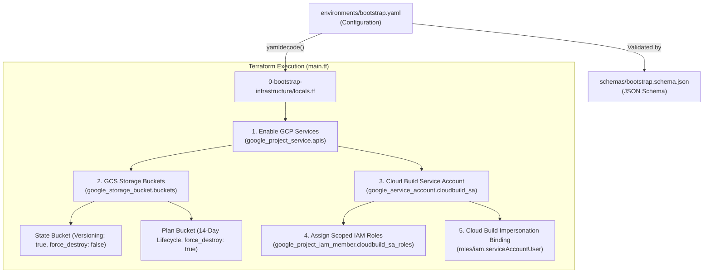

# 🚀 GCP Platform Foundation - Bootstrap Infrastructure (Layer 0)

This directory contains the Terraform configuration for provisioning the **Bootstrap Foundation (Layer 0)** on **Google Cloud Platform (GCP)**. 

The bootstrap layer establishes the core foundational prerequisites required to run automated, secure Cloud Build CI/CD pipelines, remote Terraform state locking, and project-level API enablement for all subsequent platform layers (`1-network-infrastructure`, `2-security-infrastructure`, `3-compute-infrastructure`, `4-availability-infrastructure`).

---

## 📑 Table of Contents

- [Overview](#overview)
- [Architecture & Workflow](#architecture--workflow)
- [Directory Structure](#directory-structure)
- [Core Infrastructure Components](#core-infrastructure-components)
  - [1. Dynamic API Enablement (`google_project_service`)](#1-dynamic-api-enablement-google_project_service)
  - [2. Unified GCS Storage Buckets (`google_storage_bucket`)](#2-unified-gcs-storage-buckets-google_storage_bucket)
  - [3. Dedicated CI/CD Service Account (`google_service_account`)](#3-dedicated-cicd-service-account-google_service_account)
  - [4. Granular IAM Roles Assignment (`google_project_iam_member`)](#4-granular-iam-roles-assignment-google_project_iam_member)
  - [5. Cloud Build Impersonation (`google_service_account_iam_member`)](#5-cloud-build-impersonation-google_service_account_iam_member)
- [Schema & YAML Configuration](#schema--yaml-configuration)
  - [JSON Schema Specification (`schemas/bootstrap.schema.json`)](#json-schema-specification-schemasbootstrapschemajson)
  - [YAML Configuration (`environments/bootstrap.yaml`)](#yaml-configuration-environmentsbootstrapyaml)
- [Terraform Specifications](#terraform-specifications)
  - [Requirements & Providers](#requirements--providers)
  - [Input Variables](#input-variables)
  - [Outputs](#outputs)
- [Deployment Guide](#deployment-guide)
- [Security & Operational Best Practices](#security--operational-best-practices)

---

## 🏛️ Overview

The bootstrap tier establishes foundational prerequisites before provisioning network, security, compute, or load balancing resources:
- **Centralized API Enablement**: Ensures all required GCP service APIs are activated idempotently and prevents race conditions with dependency chaining (`depends_on`).
- **Remote State & Plan Storage**: Provisions versioned GCS buckets for Terraform remote state locking and temporary plan reviews with automated lifecycle expiration.
- **Dedicated CI/CD Identity**: Creates a dedicated service account (`sa-cloudbuild-terraform`) with fine-grained, platform-specific IAM roles instead of using overly permissive project-wide editor/owner roles.
- **Service Account Impersonation**: Sets up IAM bindings allowing Cloud Build's default service agent to impersonate the dedicated Terraform executor service account.
- **Schema-Validated Config-as-Data**: Decouples project configuration into a readable `bootstrap.yaml` strictly validated by a Draft-07 JSON Schema.

---

## 📐 Architecture & Workflow



---

## 📁 Directory Structure

```text
0-bootstrap-infrastructure/
├── backend.hcl                  # Backend configuration for bootstrap state
├── locals.tf                    # Loads bootstrap.yaml, parses APIs, buckets, and roles
├── main.tf                      # Terraform resources (APIs, GCS Buckets, SA, IAM bindings)
├── outputs.tf                   # Exported bucket names and SA email
├── provider.tf                  # Google provider configuration (~> 6.0)
├── README.md                    # Layer 0 documentation
├── terraform.tfvars             # Local variable assignments
└── variables.tf                 # Variable declarations (config_path)
```

---

## 🧩 Core Infrastructure Components

### 1. Dynamic API Enablement (`google_project_service`)
Iterates over `local.apis` with `for_each` to activate the required GCP service APIs:
- **Core & Management**: `cloudresourcemanager.googleapis.com`, `serviceusage.googleapis.com`, `iam.googleapis.com`, `logging.googleapis.com`.
- **CI/CD & Storage**: `cloudbuild.googleapis.com`, `storage.googleapis.com`, `secretmanager.googleapis.com`.
- **Networking & Compute**: `compute.googleapis.com`, `networkmanagement.googleapis.com`, `servicenetworking.googleapis.com`.
- **Security & Access**: `iap.googleapis.com`.

### 2. Unified GCS Storage Buckets (`google_storage_bucket`)
Manages both state and ephemeral plan review storage buckets:
- **`state_bucket` (`gcp-remote-backend-tfstate-management-bucket`)**:
  - Purpose: Remote Terraform backend state storage across all layers and environments.
  - Settings: `versioning { enabled = true }`, `force_destroy = false`, `uniform_bucket_level_access = true`.
- **`plan_bucket` (`gcp-tfplans-instancetemplate-strorage-bucket`)**:
  - Purpose: Ephemeral Terraform binary plan files and plan JSON outputs for PR reviews.
  - Settings: `lifecycle_rule { age = 14 }`, `force_destroy = true`, `uniform_bucket_level_access = true`.

### 3. Dedicated CI/CD Service Account (`google_service_account`)
Creates `sa-cloudbuild-terraform@<project-id>.iam.gserviceaccount.com` to isolate automated execution from personal developer credentials.

### 4. Granular IAM Roles Assignment (`google_project_iam_member`)
Grants specific roles required across the 4 platform layers:
- `roles/storage.objectAdmin`: Read/write access to state and plan buckets.
- `roles/logging.logWriter`: Cloud Build execution logs.
- `roles/compute.networkAdmin`: Layer 1 VPC, subnets, routers, NATs, firewall rules.
- `roles/iam.serviceAccountAdmin` & `roles/resourcemanager.projectIamAdmin`: Layer 2 Service Account creation and role bindings.
- `roles/compute.instanceAdmin.v1` & `roles/iam.serviceAccountUser`: Layer 3 Instance Templates and Managed Instance Groups.
- `roles/compute.securityAdmin` & `roles/compute.loadBalancerAdmin`: Layer 4 Cloud Armor and Application Load Balancer.
- `roles/secretmanager.secretAccessor`: Accessing GitHub App secrets.

---

## 📄 Schema & YAML Configuration

### YAML Configuration (`environments/bootstrap.yaml`)

```yaml
project_id: yuvaraj-internal-project
region: asia-south1
gcs_location: ASIA-SOUTH1

apis:
  - cloudbuild.googleapis.com
  - storage.googleapis.com
  - cloudresourcemanager.googleapis.com
  - iam.googleapis.com
  - logging.googleapis.com
  - serviceusage.googleapis.com
  - compute.googleapis.com
  - networkmanagement.googleapis.com
  - servicenetworking.googleapis.com
  - iap.googleapis.com
  - secretmanager.googleapis.com

buckets:
  state_bucket:
    name: gcp-remote-backend-tfstate-management-bucket
    force_destroy: false
    versioning: true
    uniform_bucket_level_access: true

  plan_bucket:
    name: gcp-tfplans-instancetemplate-strorage-bucket
    force_destroy: true
    versioning: false
    uniform_bucket_level_access: true
    lifecycle_days: 14

service_account:
  name: sa-cloudbuild-terraform
  display_name: "Terraform Cloud Build Executor SA"
  description: "Dedicated service account for running Terraform CI/CD pipelines"
  roles:
    - roles/storage.objectAdmin
    - roles/logging.logWriter
    - roles/iam.serviceAccountAdmin
    - roles/resourcemanager.projectIamAdmin
    - roles/compute.networkAdmin
    - roles/compute.instanceAdmin.v1
    - roles/iam.serviceAccountUser
    - roles/compute.securityAdmin
    - roles/compute.loadBalancerAdmin
    - roles/secretmanager.secretAccessor
    - roles/viewer
```

---

## ⚙️ Terraform Specifications

### Requirements & Providers

| Name | Version |
| :--- | :--- |
| **terraform** | `>= 1.5.0` |
| **google** | `~> 6.0` |

### Input Variables

| Variable | Type | Default | Description |
| :--- | :--- | :--- | :--- |
| `config_path` | `string` | `"../environments/bootstrap.yaml"` | Path to the bootstrap YAML configuration file. |

### Outputs

| Output | Type | Description |
| :--- | :--- | :--- |
| `terraform_state_bucket` | `string` | Name of the GCS bucket created for remote Terraform state management. |
| `terraform_plans_bucket` | `string` | Name of the GCS bucket created for plan review artifacts. |
| `cloudbuild_service_account_email` | `string` | Email address of the provisioned Cloud Build executor Service Account. |

---

## 🚀 Deployment Guide

### 1. Authenticate with Google Cloud
Ensure your local identity has administrative permissions to enable APIs and assign project IAM roles:

```bash
gcloud auth login
gcloud auth application-default login
```

### 2. Initialize and Validate
```bash
cd 0-bootstrap-infrastructure

# Initialize Terraform providers
terraform init

# Validate syntax
terraform fmt -check
terraform validate
```

### 3. Review Plan and Apply
```bash
terraform plan
terraform apply
```

### 4. Transitioning Downstream Layers to Remote State
Once the state bucket is created, all downstream layers (`1-network`, `2-security`, `3-compute`, `4-availability`) reference the created bucket via `backend.hcl`:

```hcl
bucket = "gcp-remote-backend-tfstate-management-bucket"
prefix = "<layer>/<env>"
```

---

## 🛡️ Security & Operational Best Practices

1. **State Bucket Deletion Protection**: `force_destroy` is set to `false` and `versioning` is set to `true` on the state bucket to retain historical snapshots and prevent catastrophic data loss.
2. **Ephemeral Plan Files**: The plan review bucket prunes files older than 14 days via native GCS lifecycle management.
3. **Uniform Bucket-Level Access (UBLA)**: Enforces centralized IAM access across all buckets.
4. **Least-Privilege CI/CD**: Only the specific IAM roles required for platform management are bound to `sa-cloudbuild-terraform`.
5. **Idempotent API Enablement**: `disable_on_destroy = false` prevents service disruptions on active cloud infrastructure during teardown.
