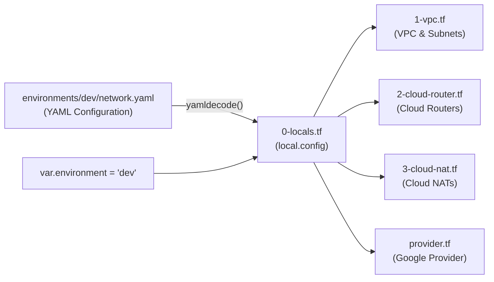

# GCP Platform Foundation - Multi-Region Network Infrastructure (YAML-Driven)

This directory contains the Terraform configuration for provisioning enterprise-grade, multi-region foundational networking on **Google Cloud Platform (GCP)**. 

The configuration uses a **YAML-driven approach** (`environments/<env>/network.yaml`), separating environment-specific configuration data from the underlying Terraform infrastructure code. It deploys a custom Virtual Private Cloud (VPC) spanning two regions (**Mumbai - `asia-south1`** and **Singapore - `asia-southeast1`**), subnetworks, dynamic Cloud Routers with BGP, Cloud NAT gateways for secure outbound connectivity, and ingress/egress firewall rules.

---

## Table of Contents

- [Overview](#overview)
- [YAML-Driven Architecture](#yaml-driven-architecture)
- [Architecture Diagram](#architecture-diagram)
- [Directory Structure](#directory-structure)
- [Infrastructure Components](#infrastructure-components)
  - [1. Configuration Loader & Firewall Processing (`0-locals.tf`)](#1-configuration-loader--firewall-processing-0-localstf)
  - [2. Multi-Region VPC & Subnetworks (`1-vpc.tf`)](#2-multi-region-vpc--subnetworks-1-vpctf)
  - [3. Cloud Routers (`2-cloud-router.tf`)](#3-cloud-routers-2-cloud-routertf)
  - [4. Cloud NAT Gateways (`3-cloud-nat.tf`)](#4-cloud-nat-gateways-3-cloud-nattf)
- [Prerequisites](#prerequisites)
- [Requirements](#requirements)
  - [Terraform & Providers](#terraform--providers)
  - [Verified Modules](#verified-modules)
- [Terraform Input Variables](#terraform-input-variables)
- [YAML Configuration Schema (`network.yaml`)](#yaml-configuration-schema-networkyaml)
  - [Top-Level YAML Attributes](#top-level-yaml-attributes)
  - [`network.vpc` Schema](#networkvpc-schema)
  - [`network.router` Schema](#networkrouter-schema)
  - [`network.nat` Schema](#networknat-schema)
- [Outputs](#outputs)
- [Getting Started & Deployment](#getting-started--deployment)
- [Sample Configuration Files](#sample-configuration-files)
  - [`environments/dev/network.yaml`](#environmentsdevnetworkyaml)
  - [`1-network-infrastructure/terraform.tfvars`](#1-network-infrastructureterraformtfvars)
- [Security & Architecture Best Practices](#security--architecture-best-practices)

---

## Overview

The infrastructure deployed by this module forms the core multi-region network layer for workloads running in GCP:
- **YAML-Based Configuration Management**: Centralizes all infrastructure variables into environment-specific YAML files (`environments/dev/network.yaml`), enabling clean GitOps workflows, version-controlled parameters, and DRY Terraform code.
- **Custom Mode Multi-Region VPC**: Disables automatic default subnets to enforce least-privilege IP addressing and network segregation across regions.
- **Global Dynamic Routing**: Configured with `GLOBAL` dynamic routing mode to allow seamless cross-region BGP route exchange and private communication between regions.
- **Multi-Region Footprint**:
  - **Mumbai (`asia-south1`)**: Primary app subnet (`10.20.1.0/24`), Cloud Router (`router-mumbai`, ASN: 65001), and Cloud NAT (`nat-mumbai`).
  - **Singapore (`asia-southeast1`)**: Secondary app subnet (`10.30.1.0/24`), Cloud Router (`router-singapore`, ASN: 65002), and Cloud NAT (`nat-singapore`).
- **Private Google Access**: Enabled on all subnets to allow private workloads without public IPs to securely interact with Google APIs and Cloud services.
- **Isolated Regional Egress**: Independent Cloud NAT gateways per region providing managed, high-availability outbound internet access without cross-region dependencies.
- **Declarative Firewall Rules**: Ingress and egress rules defined in YAML and transformed into GCP firewall specifications automatically.

---

## YAML-Driven Architecture

Instead of declaring large, complex HCL objects in `terraform.tfvars`, all configuration is maintained in structured YAML files under `environments/<env>/network.yaml`.



### Key Benefits:
1. **Separation of Concerns**: Infrastructure logic (`*.tf`) is decoupled from environmental data (`*.yaml`).
2. **Environment Portability**: Creating a new environment (e.g. `sit`, `uat`, `prod`) simply involves adding a new folder under `environments/` (e.g., `environments/prod/network.yaml`) without modifying any Terraform code.
3. **Readability & Governance**: Non-Terraform engineers and audit teams can easily review and edit networking parameters in pure YAML.

---

## Architecture Diagram


---

## Directory Structure

```text
gcp-platform-foundation-terraform/
├── environments/
│   ├── dev/
│   │   └── network.yaml     # Dev environment configuration in YAML
│   ├── sit/                 # (Optional) Future SIT configuration
│   ├── uat/                 # (Optional) Future UAT configuration
│   └── prod/                # (Optional) Future PROD configuration
│
└── 1-network-infrastructure/
    ├── 0-locals.tf          # Loads YAML via yamldecode() and processes firewall rules
    ├── 1-vpc.tf             # Multi-region VPC, subnets, secondary ranges
    ├── 2-cloud-router.tf    # Regional Cloud Routers dynamically loaded from YAML
    ├── 3-cloud-nat.tf       # Regional Cloud NAT gateways dynamically loaded from YAML
    ├── output.tf            # Exported VPC, subnet, router, and NAT outputs
    ├── provider.tf          # Provider settings taking project & region from local.config
    ├── README.md            # Module documentation
    ├── terraform.tfvars     # Sets target environment (e.g., environment = "dev")
    └── variables.tf         # Declares 'environment' input variable with validation
```

---

## Infrastructure Components

### 1. Configuration Loader & Firewall Processing (`0-locals.tf`)
- **YAML Loader**: Reads the environment YAML file based on `var.environment`:
  ```hcl
  locals {
    config = yamldecode(
      file("${path.root}/../environments/${var.environment}/network.yaml")
    )
  }
  ```
- **Firewall Processing**:
  - `local.ingress_rules`: Transforms `local.config.network.vpc.firewall_rules.ingress` into GCP module format (protocol `tcp`, allowed ports, source ranges).
  - `local.egress_rules`: Transforms `local.config.network.vpc.firewall_rules.egress` into GCP module format (protocol `tcp`, allowed ports, destination ranges).

### 2. Multi-Region VPC & Subnetworks (`1-vpc.tf`)
- **Module Source**: `terraform-google-modules/network/google` (`~> 18.3`)
- **Conditional Creation**: Evaluated via `count = try(local.config.network.vpc, null) != null ? 1 : 0`.
- Provisions the shared VPC across regions with custom subnets (`asia-south1` and `asia-southeast1`), IP ranges, optional secondary ranges (for GKE Pods & Services), and static routes.
- References `local.config.project_id`, `local.config.network.vpc.network_name`, etc.

### 3. Cloud Routers (`2-cloud-router.tf`)
- **Module Source**: `terraform-google-modules/cloud-router/google` (`~> 9.1`)
- Dynamically iterates over `local.config.network.router` list using `for_each`.
- Creates regional routers (`router-mumbai` in `asia-south1` and `router-singapore` in `asia-southeast1`) attached to the VPC with distinct BGP ASNs (65001 and 65002).

### 4. Cloud NAT Gateways (`3-cloud-nat.tf`)
- **Module Source**: `terraform-google-modules/cloud-nat/google` (`~> 7.1.0`)
- Dynamically iterates over `local.config.network.nat` list using `for_each`.
- Links each NAT gateway to its regional Cloud Router (`module.cloud_router[each.value.router_name].router.name`).
- Manages automatic NAT IP allocation, minimum/maximum ports per VM, and endpoint-independent mapping independently in each region.

---

## Prerequisites

Before deploying, ensure you have:
1. **Terraform CLI** installed (`>= 1.5.0`).
2. **Google Cloud SDK (`gcloud`)** installed and authenticated:
   ```bash
   gcloud auth login
   gcloud auth application-default login
   ```
3. A GCP Project with billing enabled and the Compute Engine API enabled:
   ```bash
   gcloud services enable compute.googleapis.com --project <YOUR_PROJECT_ID>
   ```

---

## Requirements

### Terraform & Providers

| Name | Version |
| :--- | :--- |
| **terraform** | `>= 1.5.0` |
| **google** | `~> 6.0` |

### Verified Modules

| Module | Source | Version |
| :--- | :--- | :--- |
| `vpc` | `terraform-google-modules/network/google` | `~> 18.3` |
| `cloud_router` | `terraform-google-modules/cloud-router/google` | `~> 9.1` |
| `nat` | `terraform-google-modules/cloud-nat/google` | `~> 7.1.0` |

---

## Terraform Input Variables

With the YAML approach, Terraform only requires a single input variable to identify the deployment environment:

| Variable | Type | Description | Allowed Values | Required |
| :--- | :--- | :--- | :---: | :---: |
| `environment` | `string` | Target deployment environment name used to locate `environments/<env>/network.yaml`. | `dev`, `sit`, `uat`, `prod` | Yes |

*Note: The environment variable is protected by Terraform validation ensuring only supported environments can be targeted.*

---

## YAML Configuration Schema (`network.yaml`)

Each environment configuration file located at `environments/<env>/network.yaml` follows this schema:

### Top-Level YAML Attributes

| Attribute | Type | Description | Required |
| :--- | :--- | :--- | :---: |
| `project_id` | `string` | The GCP Project ID where resources will be provisioned. | Yes |
| `region` | `string` | The primary GCP region for provider operations. | Yes |
| `network` | `map` | Root container object for VPC, router, and NAT definitions. | Yes |

### `network.vpc` Schema

| Attribute | Type | Default | Description |
| :--- | :--- | :--- | :--- |
| `network_name` | `string` | - | Name of the VPC network. |
| `routing_mode` | `string` | `"GLOBAL"` | Routing mode: `"GLOBAL"` or `"REGIONAL"`. |
| `auto_create_subnetworks` | `bool` | `false` | Whether to automatically create subnets across all regions. |
| `delete_default_routes` | `bool` | `false` | If true, deletes default `0.0.0.0/0` route via default internet gateway. |
| `subnets` | `list(map)` | `[]` | List of subnet definitions (`subnet_name`, `subnet_ip`, `subnet_region`, `subnet_private_access`). |
| `secondary_ranges` | `map(list)` | `{}` | Secondary IP CIDR allocations per subnet (e.g., GKE pods & services). |
| `routes` | `list(map)` | `[]` | Custom static routes. |
| `firewall_rules` | `map` | `{}` | Ingress and egress firewall rule definitions. |

### `network.router` Schema

List of objects under `network.router`:

| Field | Type | Default | Description |
| :--- | :--- | :--- | :--- |
| `name` | `string` | - | Name of the Cloud Router. |
| `region` | `string` | - | GCP Region for the router. |
| `bgp.asn` | `string` | - | BGP Autonomous System Number (ASN) (e.g., `"65001"`). |
| `bgp.advertise_mode` | `string` | `"DEFAULT"` | Route advertisement mode (`"DEFAULT"` or `"CUSTOM"`). |
| `bgp.advertised_groups` | `list(string)` | `[]` | Advertised route groups (e.g., `["ALL_SUBNETS"]`). |
| `bgp.advertised_ip_ranges`| `list(map)` | `[]` | Custom prefixes to advertise. |
| `bgp.keepalive_interval`| `number` | `null` | BGP heartbeat interval in seconds. |

### `network.nat` Schema

List of objects under `network.nat`:

| Field | Type | Default | Description |
| :--- | :--- | :--- | :--- |
| `name` | `string` | - | Name of the Cloud NAT gateway. |
| `region` | `string` | - | GCP Region for Cloud NAT. |
| `router_name` | `string` | - | Name of the Cloud Router to attach this NAT gateway to. |
| `source_subnetwork_ip_ranges_to_nat` | `string` | `"ALL_SUBNETWORKS_ALL_IP_RANGES"` | Subnet IP range selection for NAT translation. |
| `min_ports_per_vm` | `number` | `64` | Minimum number of ports allocated to a VM. |
| `max_ports_per_vm` | `number` | `2048` | Maximum number of ports allocated to a VM. |
| `enable_endpoint_independent_mapping` | `bool` | `true` | Allows connections to reuse mapped NAT IP and port endpoints. |

---

## Outputs

| Name | Description | Source |
| :--- | :--- | :--- |
| `network_name` | Name of the provisioned VPC network. | `module.vpc` |
| `network_id` | ID of the provisioned VPC network. | `module.vpc` |
| `network_self_link` | URI self-link of the VPC network. | `module.vpc` |
| `subnets` | Full map of created subnet resources and attributes. | `module.vpc` |
| `subnet_names` | List of subnet names created in the VPC. | `module.vpc` |
| `subnet_ids` | List of subnet IDs. | `module.vpc` |
| `subnet_self_links` | List of subnet self-links. | `module.vpc` |
| `subnet_cidrs` | List of primary IP CIDR blocks for subnets. | `module.vpc` |
| `secondary_ranges` | Map of secondary ranges allocated to subnets. | `module.vpc` |
| `router_names` | Map of deployed Cloud Router names. | `module.cloud_router` |
| `router_self_links`| Map of Cloud Router self-links. | `module.cloud_router` |
| `nat_names` | Map of deployed Cloud NAT gateway names. | `module.nat` |
| `route_names` | List of static route names configured on the VPC. | `module.vpc` |

---

## Getting Started & Deployment

### Step 1: Navigate to the Directory
```bash
cd 1-network-infrastructure
```

### Step 2: Initialize Terraform
```bash
terraform init
```

### Step 3: Validate Configuration & Formatting
Verify syntax and formatting:
```bash
terraform fmt -check
terraform validate
```

### Step 4: Plan Deployment for an Environment
By default, `terraform.tfvars` specifies `environment = "dev"`. You can also override it on the CLI:

```bash
# Plan for Dev environment
terraform plan -var="environment=dev"

# Plan for SIT environment (requires environments/sit/network.yaml)
terraform plan -var="environment=sit"

# Plan for PROD environment (requires environments/prod/network.yaml)
terraform plan -var="environment=prod"
```

### Step 5: Apply Configuration
```bash
terraform apply -var="environment=dev"
```

### Step 6: Adding a New Environment
To create a new environment (e.g. `prod`):
1. Create directory `environments/prod/`.
2. Add `environments/prod/network.yaml` with the production CIDR ranges, project IDs, and router ASNs.
3. Run `terraform apply -var="environment=prod"`.

---

## Sample Configuration Files

### `environments/dev/network.yaml`

```yaml
project_id: yuvaraj-internal-project
region: asia-south1

network:
  vpc:
    # VPC Configuration
    network_name: platform-foundation-vpc

    # Multi-Region Subnet Configuration
    subnets:
      - subnet_name: private-app-mumbai
        subnet_ip: 10.20.1.0/24
        subnet_region: asia-south1
        subnet_private_access: true
      - subnet_name: private-app-singapore
        subnet_ip: 10.30.1.0/24
        subnet_region: asia-southeast1
        subnet_private_access: true

    # Firewall Rules
    firewall_rules:
      ingress:
        - name: allow-management
          source_ranges:
            - 10.0.0.0/8
          ports:
            - "22"
        - name: allow-web
          source_ranges:
            - 0.0.0.0/0
          ports:
            - "80"
            - "443"
      egress:
        - name: allow-internet
          destination_ranges:
            - 0.0.0.0/0
          ports:
            - "80"
            - "443"

  # Cloud Routers
  router:
    - name: router-mumbai
      region: asia-south1
      bgp:
        asn: "65001"
    - name: router-singapore
      region: asia-southeast1
      bgp:
        asn: "65002"

  # Cloud NATs
  nat:
    - name: nat-mumbai
      region: asia-south1
      router_name: router-mumbai
    - name: nat-singapore
      region: asia-southeast1
      router_name: router-singapore
```

### `1-network-infrastructure/terraform.tfvars`

```hcl
environment = "dev"
```

---

## Security & Architecture Best Practices

1. **Config-as-Data Separation**: Keep environment variables inside YAML files and infrastructure definitions inside Terraform files. Never hardcode project IDs or CIDR ranges in the Terraform module.
2. **Regional Fault Isolation**: Cloud NAT and Cloud Routers are deployed independently in each region (`asia-south1` and `asia-southeast1`). Outbound traffic from one region does not depend on the other region's networking components.
3. **Private Subnets by Default**: VMs inside private subnets across both regions do not receive public IP addresses. Outbound internet access is handled locally per region via the regional Cloud NAT.
4. **Private Google Access**: Always set `subnet_private_access: true` so private compute instances can reach Google APIs (Cloud Storage, BigQuery, Artifact Registry) privately using Google's backbone network without public egress charges.
5. **Least-Privilege Firewalls**: Keep administrative ports (e.g., SSH port 22) restricted to private RFC 1918 addresses or GCP Identity-Aware Proxy (IAP) CIDR `35.235.240.0/20`.
6. **State Management**: For multi-environment production workflows, configure a remote Google Cloud Storage (GCS) backend with environment-based prefixes (e.g., `prefix = "network/${var.environment}"`).
