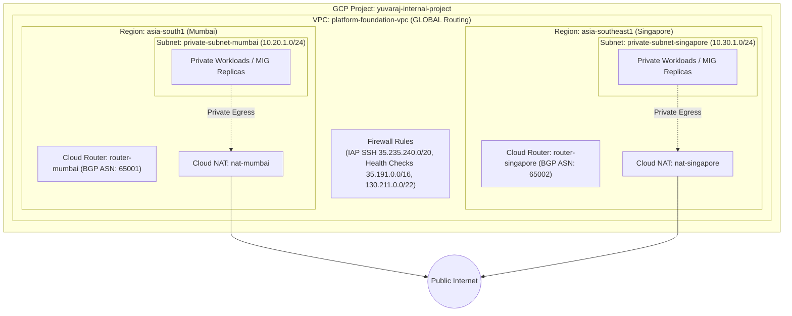

# 🌐 GCP Platform Foundation - Network Infrastructure (Layer 1)

This directory contains the Terraform configuration for provisioning enterprise-grade, multi-region foundational networking on **Google Cloud Platform (GCP)**. 

The configuration uses a **YAML-driven architecture** (`environments/<env>/network.yaml`), separating environment-specific configuration data from the underlying Terraform infrastructure code. It deploys a custom Virtual Private Cloud (VPC) spanning two regions (**Mumbai - `asia-south1`** and **Singapore - `asia-southeast1`**), private subnetworks, dynamic Cloud Routers, independent Cloud NAT gateways for secure outbound connectivity, and ingress/egress firewall rules.

---

## 📑 Table of Contents

- [Overview](#overview)
- [YAML-Driven Architecture](#yaml-driven-architecture)
- [Architecture Diagram](#architecture-diagram)
- [Directory Structure](#directory-structure)
- [Infrastructure Components](#infrastructure-components)
  - [1. Configuration Loader & Firewall Processing (`0-locals.tf`)](#1-configuration-loader--firewall-processing-0-localstf)
  - [2. Multi-Region VPC & Subnetworks (`1-vpc.tf`)](#2-multi-region-vpc--subnetworks-1-vpctf)
  - [3. Cloud Routers (`2-cloud-router.tf`)](#3-cloud-routers-2-cloud-routertf)
  - [4. Cloud NAT Gateways (`3-cloud-nat.tf`)](#4-cloud-nat-gateways-3-cloud-nattf)
- [Terraform Specifications](#terraform-specifications)
  - [Requirements & Providers](#requirements--providers)
  - [Verified Modules](#verified-modules)
  - [Input Variables](#input-variables)
  - [Outputs](#outputs)
- [YAML Configuration Contract (`network.yaml`)](#yaml-configuration-contract-networkyaml)
- [Deployment Guide](#deployment-guide)
  - [Local CLI Deployment](#local-cli-deployment)
  - [Automated GitOps CI/CD Deployment](#automated-gitops-cicd-deployment)
- [Downstream Layer Consumption](#downstream-layer-consumption)
- [Security & Operational Best Practices](#security--operational-best-practices)

---

## 🏛️ Overview

The infrastructure deployed by this module forms the core multi-region network layer for workloads running in GCP:
- **YAML-Based Configuration Management**: Centralizes all infrastructure variables into environment-specific YAML files (`environments/dev/network.yaml`), enabling clean GitOps workflows and DRY Terraform code.
- **Custom Mode Multi-Region VPC**: Disables automatic default subnets to enforce least-privilege IP addressing and network segregation across regions.
- **Global Dynamic Routing**: Configured with `GLOBAL` dynamic routing mode to allow seamless cross-region BGP route exchange and private communication between regions.
- **Multi-Region Footprint**:
  - **Mumbai (`asia-south1`)**: Subnet `private-subnet-mumbai` (`10.20.1.0/24`), Cloud Router (`router-mumbai`, ASN: `65001`), and Cloud NAT (`nat-mumbai`).
  - **Singapore (`asia-southeast1`)**: Subnet `private-subnet-singapore` (`10.30.1.0/24`), Cloud Router (`router-singapore`, ASN: `65002`), and Cloud NAT (`nat-singapore`).
- **Private Google Access**: Enabled on all subnets to allow private workloads without public IPs to securely interact with Google APIs and Cloud services.
- **Isolated Regional Egress**: Independent Cloud NAT gateways per region providing managed, high-availability outbound internet access without cross-region dependencies.
- **Declarative Firewall Rules**: Ingress and egress rules defined in YAML and transformed into GCP firewall specifications automatically (e.g., IAP SSH access, Health Check probes, and Load Balancer proxy traffic).

---

## 📐 Architecture Diagram



---

## 📁 Directory Structure

```text
1-network-infrastructure/
├── 0-locals.tf              # Loads network.yaml, transforms firewall rules & subnets
├── 1-vpc.tf                 # VPC, subnets, and firewall rules via terraform-google-modules/network/google
├── 2-cloud-router.tf        # Regional Cloud Routers via terraform-google-modules/cloud-router/google
├── 3-cloud-nat.tf           # Regional Cloud NATs via terraform-google-modules/cloud-nat/google
├── backend.hcl              # Backend configuration (bucket & prefix)
├── output.tf                # Exported VPC name, IDs, subnets map, and router outputs
├── provider.tf              # Google provider requirements (~> 6.0)
├── README.md                # Layer 1 documentation
├── terraform.tfvars         # Local variable values (environment = "dev")
└── variables.tf             # Variable declarations (environment)
```

---

## 🧩 Infrastructure Components

### 1. Multi-Region VPC & Subnetworks (`1-vpc.tf`)
Utilizes `terraform-google-modules/network/google` to provision custom VPC and regional subnets with Private Google Access enabled.

### 2. Cloud Routers (`2-cloud-router.tf`)
Deploys regional Cloud Routers configured with private Autonomous System Numbers (ASNs) (`65001` for Mumbai, `65002` for Singapore) to support dynamic egress and BGP routing.

### 3. Cloud NAT Gateways (`3-cloud-nat.tf`)
Provisions managed Cloud NAT instances per region to enable outbound internet access for private Compute Engine instances (e.g., OS updates, package installation, telemetry reporting).

### 4. Declarative Firewall Rules (`0-locals.tf`)
Transforms declarative YAML firewall ingress/egress specifications into Terraform rules:
- **`allow-iap-ssh`**: Authorizes Google Identity-Aware Proxy (`35.235.240.0/20`) on TCP port 22.
- **`allow-health-check` & `allow-load-balancer`**: Authorizes Google Cloud Load Balancer probe ranges (`35.191.0.0/16`, `130.211.0.0/22`) on backend port `8080`.

---

## 📄 YAML Configuration Contract (`environments/<env>/network.yaml`)

```yaml
project_id: yuvaraj-internal-project
region: asia-south1

tags:
  provisioned_by: terraform
  environment: dev
  project: gcp-platform-foundation-terraform

network:
  vpc:
    network_name: platform-foundation-vpc

    subnets:
      - subnet_name: private-subnet-mumbai
        subnet_ip: 10.20.1.0/24
        subnet_region: asia-south1
        subnet_private_access: true
      - subnet_name: private-subnet-singapore
        subnet_ip: 10.30.1.0/24
        subnet_region: asia-southeast1
        subnet_private_access: true

    firewall_rules:
      ingress:
        - name: allow-iap-ssh
          source_ranges: ["35.235.240.0/20"]
          target_tags: ["allow-iap-ssh"]
          ports: ["22"]
        - name: allow-health-check
          source_ranges: ["130.211.0.0/22", "35.191.0.0/16"]
          target_tags: ["allow-health-check"]
          ports: ["8080"]
        - name: allow-load-balancer
          source_ranges: ["130.211.0.0/22", "35.191.0.0/16"]
          target_tags: ["allow-load-balancer"]
          ports: ["8080"]

  routers:
    - name: router-mumbai
      region: asia-south1
      asn: 65001
      nats:
        - name: nat-mumbai
          source_subnetwork_ip_ranges_to_nat: ALL_SUBNETWORKS_ALL_IP_RANGES
    - name: router-singapore
      region: asia-southeast1
      asn: 65002
      nats:
        - name: nat-singapore
          source_subnetwork_ip_ranges_to_nat: ALL_SUBNETWORKS_ALL_IP_RANGES
```

---

## ⚙️ Terraform Specifications

### Requirements & Providers

| Name | Type | Source | Version |
| :--- | :--- | :--- | :--- |
| **terraform** | Core | `hashicorp/terraform` | `>= 1.5.0` |
| **google** | Provider | `hashicorp/google` | `~> 6.0` |
| **google-beta** | Provider | `hashicorp/google-beta` | `~> 6.0` |

### Verified Modules

| Module | Source | Version |
| :--- | :--- | :--- |
| **VPC & Subnets** | `terraform-google-modules/network/google` | `~> 10.0` |
| **Cloud Router** | `terraform-google-modules/cloud-router/google` | `~> 6.2` |
| **Cloud NAT** | `terraform-google-modules/cloud-nat/google` | `~> 5.3` |

### Outputs

| Output Name | Type | Description |
| :--- | :--- | :--- |
| `network_name` | `string` | The name of the VPC network (`platform-foundation-vpc`). |
| `network_id` | `string` | The URI ID of the VPC network. |
| `network_self_link` | `string` | The URI self link of the VPC network. |
| `subnets_names` | `list(string)` | Names of all created subnets. |
| `subnets_ips` | `list(string)` | IP CIDRs of all created subnets. |

---

## 🚀 Deployment Guide

### Local CLI Deployment

1. **Navigate to the layer directory**:
   ```bash
   cd 1-network-infrastructure
   ```

2. **Configure Remote Backend**:
   ```hcl
   # backend.hcl
   bucket = "gcp-remote-backend-tfstate-management-bucket"
   prefix = "network/dev"
   ```

3. **Initialize & Validate**:
   ```bash
   terraform init -backend-config="backend.hcl" -reconfigure
   terraform fmt -check
   terraform validate
   ```

4. **Plan & Apply**:
   ```bash
   terraform plan -var="environment=dev"
   terraform apply -var="environment=dev"
   ```

---

## 🔗 Downstream Layer Consumption

Layer 3 (`3-compute-infrastructure`) reads the network topology via `data.terraform_remote_state`:

```hcl
# 3-compute-infrastructure/data.tf
data "terraform_remote_state" "network" {
  backend = "gcs"
  config = {
    bucket = local.config.state_bucket
    prefix = "network/${var.environment}"
  }
}
```

---

## 🛡️ Security & Operational Best Practices

1. **No Default Auto-Subnetting**: `auto_create_subnetworks = false` prevents unpredictable default CIDR allocation.
2. **Private IP Only for Workload VMs**: All workload instances remain private with zero external IPs, communicating via Cloud NAT and Cloud IAP.
3. **Restricted Ingress**: SSH is restricted strictly to the Google IAP CIDR (`35.235.240.0/20`), eliminating exposure to open internet brute-force attacks.
4. **Independent Regional Egress**: Failure in one regional NAT gateway does not impact outbound traffic for other regions.
