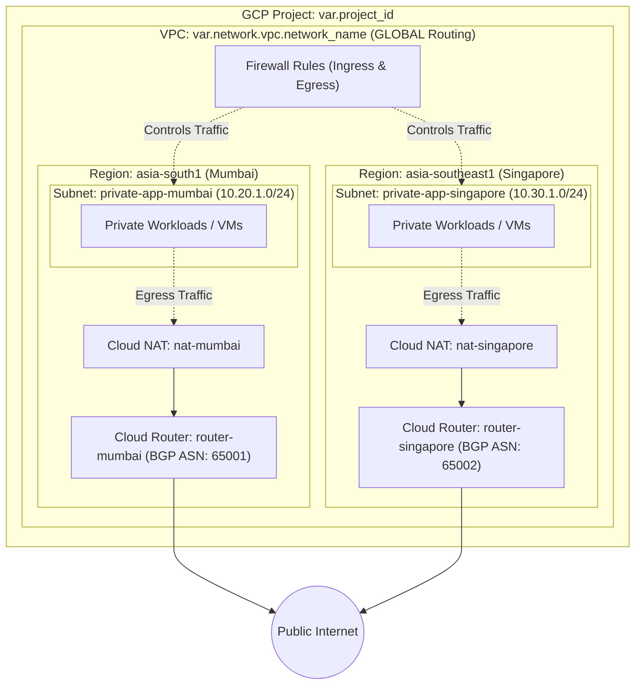

# GCP Platform Foundation - Multi-Region Network Infrastructure

This directory contains the Terraform configuration for provisioning enterprise-grade, multi-region foundational networking on **Google Cloud Platform (GCP)**. It sets up a custom Virtual Private Cloud (VPC) spanning two regions (**Mumbai - `asia-south1`** and **Singapore - `asia-southeast1`**), subnetworks, dynamic Cloud Routers with BGP, Cloud NAT gateways for secure outbound connectivity, and ingress/egress firewall rules.

---

## Table of Contents

- [Overview](#overview)
- [Architecture Diagram](#architecture-diagram)
- [Directory Structure](#directory-structure)
- [Infrastructure Components](#infrastructure-components)
  - [1. Multi-Region VPC & Subnetworks (`1-vpc.tf`)](#1-multi-region-vpc--subnetworks-1-vpctf)
  - [2. Firewall Rules Processing (`0-locals.tf`)](#2-firewall-rules-processing-0-localstf)
  - [3. Cloud Routers (`2-cloud-router.tf`)](#3-cloud-routers-2-cloud-routertf)
  - [4. Cloud NAT Gateways (`3-cloud-nat.tf`)](#4-cloud-nat-gateways-3-cloud-nattf)
- [Prerequisites](#prerequisites)
- [Requirements](#requirements)
  - [Terraform & Providers](#terraform--providers)
  - [Verified Modules](#verified-modules)
- [Input Variables](#input-variables)
  - [Top-Level Variables](#top-level-variables)
  - [`network.vpc` Schema](#networkvpc-schema)
  - [`network.router` Schema](#networkrouter-schema)
  - [`network.nat` Schema](#networknat-schema)
- [Outputs](#outputs)
- [Getting Started & Deployment](#getting-started--deployment)
- [Configuration Example (`terraform.tfvars`)](#configuration-example-terraformtfvars)
- [Security & Architecture Best Practices](#security--architecture-best-practices)

---

## Overview

The infrastructure deployed by this module forms the core multi-region network layer for workloads running in GCP:
- **Custom Mode Multi-Region VPC**: Disables automatic default subnets to enforce least-privilege IP addressing and network segregation across regions.
- **Global Dynamic Routing**: Configured with `GLOBAL` dynamic routing mode to allow seamless cross-region BGP route exchange and private communication between regions.
- **Multi-Region Footprint**:
  - **Mumbai (`asia-south1`)**: Primary app subnet (`10.20.1.0/24`), Cloud Router (`router-mumbai`, ASN: 65001), and Cloud NAT (`nat-mumbai`).
  - **Singapore (`asia-southeast1`)**: Secondary app subnet (`10.30.1.0/24`), Cloud Router (`router-singapore`, ASN: 65002), and Cloud NAT (`nat-singapore`).
- **Private Google Access**: Enabled on all subnets to allow private workloads without public IPs to securely interact with Google APIs and Cloud services.
- **Isolated Egress Gateways**: Independent Cloud NAT gateways per region providing managed, high-availability outbound internet access.
- **Declarative Firewall Rules**: Managed through structured objects for predictable traffic filtering.

---

## Architecture Diagram



---

## Directory Structure

```text
1-network-infrastructure/
├── 0-locals.tf          # Pre-processes firewall configurations into module format
├── 1-vpc.tf             # VPC, subnets, secondary ranges & base routing module
├── 2-cloud-router.tf    # Dynamic deployment of Cloud Routers with BGP settings
├── 3-cloud-nat.tf       # Dynamic deployment of Cloud NAT gateways
├── output.tf            # VPC, subnet, router, and NAT outputs
├── provider.tf          # Terraform version & Google provider requirements
├── README.md            # Module documentation
├── terraform.tfvars     # Multi-region input values (Mumbai & Singapore)
└── variables.tf         # Variable declarations and object type definitions
```

---

## Infrastructure Components

### 1. Multi-Region VPC & Subnetworks (`1-vpc.tf`)
- **Module Source**: `terraform-google-modules/network/google` (`~> 18.3`)
- **Conditional Creation**: Evaluated via `count = try(var.network.vpc, null) != null ? 1 : 0`.
- Provisions the shared VPC across regions with custom subnets (`asia-south1` and `asia-southeast1`), IP ranges, optional secondary ranges (for GKE Pods & Services), and static routes.
- Supports deletion of default internet gateway routes (`delete_default_routes`) for zero-trust architectures.

### 2. Firewall Rules Processing (`0-locals.tf`)
- Transforms custom user-friendly rule definitions in `var.network.vpc.firewall_rules` into the exact object structure expected by the Google network module.
- Generates `ingress_rules` with source CIDR ranges and TCP ports.
- Generates `egress_rules` with destination CIDR ranges and TCP ports.

### 3. Cloud Routers (`2-cloud-router.tf`)
- **Module Source**: `terraform-google-modules/cloud-router/google` (`~> 9.1`)
- Dynamically iterates over `var.network.router` list using `for_each`.
- Creates regional routers (`router-mumbai` in `asia-south1` and `router-singapore` in `asia-southeast1`) attached to the VPC with distinct BGP ASNs (65001 and 65002).

### 4. Cloud NAT Gateways (`3-cloud-nat.tf`)
- **Module Source**: `terraform-google-modules/cloud-nat/google` (`~> 7.1.0`)
- Dynamically iterates over `var.network.nat` list using `for_each`.
- Links each NAT gateway to its regional Cloud Router (`module.cloud_router[each.value.router_name].router.name`).
- Manages automatic NAT IP allocation, minimum/maximum ports per VM, and endpoint-independent mapping independently in each region.

---

## Prerequisites

Before deploying, ensure you have:
1. **Terraform CLI** installed (`>= 1.5.0`).
2. **Google Cloud SDK (`gcloud`)** installed and authenticated:
   ```bash
   gcloud auth login
   gcloud auth application-default login
   ```
3. A GCP Project with billing enabled and the following APIs enabled:
   - Compute Engine API (`compute.googleapis.com`)
   ```bash
   gcloud services enable compute.googleapis.com --project <YOUR_PROJECT_ID>
   ```

---

## Requirements

### Terraform & Providers

| Name | Version |
| :--- | :--- |
| **terraform** | `>= 1.5.0` |
| **google** | `~> 6.0` |

### Verified Modules

| Module | Source | Version |
| :--- | :--- | :--- |
| `vpc` | `terraform-google-modules/network/google` | `~> 18.3` |
| `cloud_router` | `terraform-google-modules/cloud-router/google` | `~> 9.1` |
| `nat` | `terraform-google-modules/cloud-nat/google` | `~> 7.1.0` |

---

## Input Variables

### Top-Level Variables

| Variable | Type | Description | Required |
| :--- | :--- | :--- | :---: |
| `project_id` | `string` | The GCP Project ID where resources will be provisioned. | Yes |
| `region` | `string` | The default GCP region for provider operations. | Yes |
| `network` | `object` | Comprehensive configuration object containing VPC, Routers, and NAT specs. | Yes |

### `network.vpc` Schema

| Attribute | Type | Default | Description |
| :--- | :--- | :--- | :--- |
| `network_name` | `string` | - | Name of the VPC network. |
| `routing_mode` | `string` | `"GLOBAL"` | Routing mode: `"GLOBAL"` or `"REGIONAL"`. |
| `auto_create_subnetworks` | `bool` | `false` | Whether to automatically create subnets across all regions. |
| `delete_default_routes` | `bool` | `false` | If true, deletes default `0.0.0.0/0` route via default internet gateway. |
| `subnets` | `list(any)` | `[]` | List of subnet definitions (subnet_name, subnet_ip, subnet_region, etc.). |
| `secondary_ranges` | `map(list(object))` | `{}` | Secondary IP CIDR allocations per subnet (e.g., GKE pods & services). |
| `routes` | `list(any)` | `[]` | Custom static routes. |
| `firewall_rules` | `object` | `{}` | Ingress and egress firewall rule definitions. |

### `network.router` Schema

List of objects for Cloud Router creation:

| Field | Type | Default | Description |
| :--- | :--- | :--- | :--- |
| `name` | `string` | - | Name of the Cloud Router. |
| `region` | `string` | - | GCP Region for the router. |
| `bgp.asn` | `string` | - | BGP Autonomous System Number (ASN) (e.g. 64512-65534). |
| `bgp.advertise_mode` | `string` | `"DEFAULT"` | Route advertisement mode (`"DEFAULT"` or `"CUSTOM"`). |
| `bgp.advertised_groups` | `list(string)` | `[]` | Advertised route groups (e.g., `["ALL_SUBNETS"]`). |
| `bgp.advertised_ip_ranges`| `list(object)` | `[]` | Custom prefixes to advertise. |
| `bgp.keepalive_interval`| `number` | `null` | BGP heartbeat interval in seconds. |

### `network.nat` Schema

List of objects for Cloud NAT creation:

| Field | Type | Default | Description |
| :--- | :--- | :--- | :--- |
| `name` | `string` | - | Name of the Cloud NAT gateway. |
| `region` | `string` | - | GCP Region for Cloud NAT. |
| `router_name` | `string` | - | Name of the Cloud Router to attach this NAT gateway to. |
| `source_subnetwork_ip_ranges_to_nat` | `string` | `"ALL_SUBNETWORKS_ALL_IP_RANGES"` | Subnet IP range selection for NAT translation. |
| `min_ports_per_vm` | `number` | `64` | Minimum number of ports allocated to a VM. |
| `max_ports_per_vm` | `number` | `2048` | Maximum number of ports allocated to a VM. |
| `enable_endpoint_independent_mapping` | `bool` | `true` | Allows connections to reuse mapped NAT IP and port endpoints. |

---

## Outputs

| Name | Description | Source |
| :--- | :--- | :--- |
| `network_name` | Name of the provisioned VPC network. | `module.vpc` |
| `network_id` | ID of the provisioned VPC network. | `module.vpc` |
| `network_self_link` | URI self-link of the VPC network. | `module.vpc` |
| `subnets` | Full map of created subnet resources and attributes. | `module.vpc` |
| `subnet_names` | List of subnet names created in the VPC. | `module.vpc` |
| `subnet_ids` | List of subnet IDs. | `module.vpc` |
| `subnet_self_links` | List of subnet self-links. | `module.vpc` |
| `subnet_cidrs` | List of primary IP CIDR blocks for subnets. | `module.vpc` |
| `secondary_ranges` | Map of secondary ranges allocated to subnets. | `module.vpc` |
| `router_names` | Map of deployed Cloud Router names. | `module.cloud_router` |
| `router_self_links`| Map of Cloud Router self-links. | `module.cloud_router` |
| `nat_names` | Map of deployed Cloud NAT gateway names. | `module.nat` |
| `route_names` | List of static route names configured on the VPC. | `module.vpc` |

---

## Getting Started & Deployment

### Step 1: Navigate to the Directory
```bash
cd 1-network-infrastructure
```

### Step 2: Initialize Terraform
Downloads the required Google provider and modules:
```bash
terraform init
```

### Step 3: Validate Configuration & Formatting
Verify syntax and format the files:
```bash
terraform fmt -check
terraform validate
```

### Step 4: Review Execution Plan
Inspect the resources that Terraform will create across both regions:
```bash
terraform plan
```

### Step 5: Apply Configuration
Provision the multi-region network infrastructure to GCP:
```bash
terraform apply
```

To clean up and destroy all provisioned infrastructure:
```bash
terraform destroy
```

---

## Configuration Example (`terraform.tfvars`)

```hcl
project_id = "yuvaraj-internal-project"
region     = "asia-south1"

# Networking infrastructure Values:
network = {

  vpc = {
    # VPC Configuration
    network_name = "platform-foundation-vpc"

    # Multi-Region Subnet Configuration
    subnets = [
      {
        subnet_name           = "private-app-mumbai"
        subnet_ip             = "10.20.1.0/24"
        subnet_region         = "asia-south1"
        subnet_private_access = "true"
      },
      {
        subnet_name           = "private-app-singapore"
        subnet_ip             = "10.30.1.0/24"
        subnet_region         = "asia-southeast1"
        subnet_private_access = "true"
      }
    ]

    # Firewall Rules
    firewall_rules = {
      ingress = [
        {
          name          = "allow-management"
          source_ranges = ["10.0.0.0/8"]
          ports         = ["22"]
        },
        {
          name          = "allow-web"
          source_ranges = ["0.0.0.0/0"]
          ports         = ["80", "443"]
        }
      ]
      egress = [
        {
          name               = "allow-internet"
          destination_ranges = ["0.0.0.0/0"]
          ports              = ["80", "443"]
        }
      ]
    }
  }

  # Multi-Region Cloud Routers
  router = [
    {
      name   = "router-mumbai"
      region = "asia-south1"
      bgp = {
        asn = "65001"
      }
    },
    {
      name   = "router-singapore"
      region = "asia-southeast1"
      bgp = {
        asn = "65002"
      }
    }
  ]

  # Multi-Region Cloud NATs
  nat = [
    {
      name        = "nat-mumbai"
      region      = "asia-south1"
      router_name = "router-mumbai"
    },
    {
      name        = "nat-singapore"
      region      = "asia-southeast1"
      router_name = "router-singapore"
    }
  ]
}
```

---

## Security & Architecture Best Practices

1. **Regional Fault Isolation**: Cloud NAT and Cloud Routers are deployed independently in each region (`asia-south1` and `asia-southeast1`). Outbound traffic from one region does not depend on the other region's networking components.
2. **Private Subnets by Default**: VMs inside private subnets across both regions do not receive public IP addresses. Outbound internet access is handled locally per region via the regional Cloud NAT.
3. **Private Google Access**: Always set `subnet_private_access = "true"` so private compute instances can reach Google APIs (Cloud Storage, BigQuery, Artifact Registry) privately using Google's backbone network without public egress charges.
4. **Least-Privilege Firewalls**: Keep administrative ports (e.g., SSH port 22) restricted to private RFC 1918 addresses or GCP Identity-Aware Proxy (IAP) CIDR `35.235.240.0/20`.
5. **State Management**: For production environments, configure a remote Google Cloud Storage (GCS) backend in `provider.tf` with object versioning enabled.
