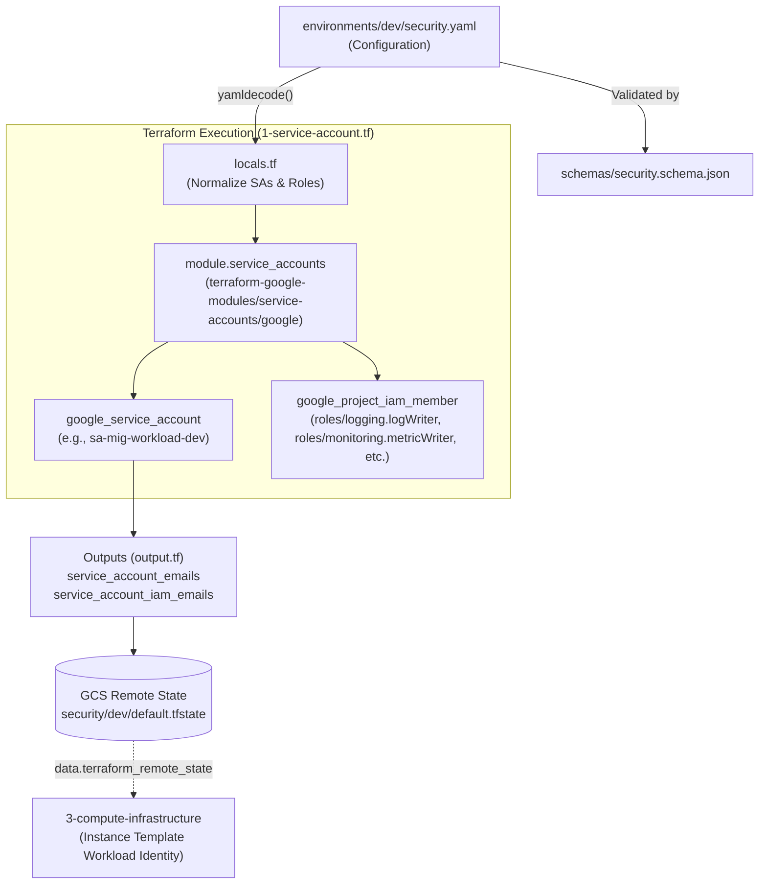

# 🔐 GCP Platform Foundation - Security Infrastructure (Layer 2)

This directory contains the Terraform configuration for provisioning the **Security Infrastructure (Layer 2)** on **Google Cloud Platform (GCP)**.

The security layer establishes least-privilege identity access management (IAM), creates dedicated workload service accounts for downstream compute tiers (such as Compute Engine Managed Instance Groups), and manages security policies.

---

## 📑 Table of Contents

- [Overview](#overview)
- [Architecture & Workflow](#architecture--workflow)
- [Directory Structure](#directory-structure)
- [Core Infrastructure Components](#core-infrastructure-components)
  - [1. Workload Service Accounts (`terraform-google-modules/service-accounts/google`)](#1-workload-service-accounts-terraform-google-modulesservice-accountsgoogle)
  - [2. Granular IAM Least Privilege Role Bindings](#2-granular-iam-least-privilege-role-bindings)
  - [3. Dynamic Tagging & Metadata Propagation](#3-dynamic-tagging--metadata-propagation)
- [YAML-Driven Configuration (`environments/<env>/security.yaml`)](#yaml-driven-configuration-environmentsenvsecurityyaml)
- [Terraform Specifications](#terraform-specifications)
  - [Providers & Modules](#providers--modules)
  - [Input Variables](#input-variables)
  - [Outputs](#outputs)
- [Deployment Guide](#deployment-guide)
  - [Local CLI Deployment](#local-cli-deployment)
  - [Automated GitOps CI/CD Deployment](#automated-gitops-cicd-deployment)
- [Downstream Layer Consumption](#downstream-layer-consumption)
- [Security & Operational Best Practices](#security--operational-best-practices)

---

## 🛡️ Overview

The Security Infrastructure layer provides foundational security primitives required by runtime compute workloads and availability services:
- **Least-Privilege Workload Identities**: Eliminates the use of the default Compute Engine service account (`<project-number>-compute@developer.gserviceaccount.com`), creating dedicated, purpose-built identities (e.g. `sa-mig-workload-dev`).
- **Granular IAM Project Roles**: Binds only strictly necessary IAM roles (`roles/logging.logWriter`, `roles/monitoring.metricWriter`, `roles/secretmanager.secretAccessor`, `roles/compute.osLogin`).
- **Declarative YAML Contract**: All service accounts and their associated IAM roles are defined in `environments/<env>/security.yaml` and validated against `schemas/security.schema.json`.
- **Reusable HCL Engine**: Employs Google's verified `terraform-google-modules/service-accounts/google` module to ensure idempotent provisioning and clean role mapping.

---

## 📐 Architecture & Workflow



---

## 📁 Directory Structure

```text
2-security-infrastructure/
├── 1-service-account.tf     # Service account creation & IAM role bindings module
├── backend.hcl              # Backend configuration (bucket & prefix)
├── locals.tf                # YAML parser, environment merging, and data normalization
├── output.tf                # Exported service account emails and IAM identifiers
├── provider.tf              # Google provider requirements (~> 6.0)
├── README.md                # Layer 2 documentation
├── terraform.tfvars         # Local variable values (environment = "dev")
└── variables.tf             # Variable declarations (environment)
```

---

## 🧩 Core Infrastructure Components

### 1. Workload Service Accounts (`terraform-google-modules/service-accounts/google`)
Iterates over all service accounts defined in `local.service_accounts` using `for_each`:

```hcl
module "service_accounts" {
  for_each = local.service_accounts

  source  = "terraform-google-modules/service-accounts/google"
  version = "~> 5.1.0"

  project_id    = local.project_id
  prefix        = ""
  names         = [each.value.account_id]
  display_name  = each.value.display_name
  description   = each.value.description
  project_roles = each.value.project_roles
}
```

### 2. Granular IAM Least Privilege Role Bindings
Roles assigned to workload identities are strictly scoped:
- `roles/logging.logWriter`: Allows instances to write structured access and error logs to Cloud Logging.
- `roles/monitoring.metricWriter`: Allows instances to push custom and system metrics to Cloud Monitoring.
- `roles/stackdriver.resourceMetadata.writer`: Enables metadata synchronization with Cloud Operations suite.
- `roles/secretmanager.secretAccessor`: Enables secure retrieval of application secrets at runtime without hardcoded credentials.
- `roles/compute.osLogin`: Enforces centralized SSH authentication via Google Workspace / Cloud IAM identities.

### 3. Dynamic Tagging & Metadata Propagation
Labels and metadata tags defined in `security.yaml` are formatted and appended to the service account description:
```text
MIG Compute Workload Service Account [environment:dev, project:gcp-platform-foundation-terraform, provisioned_by:terraform]
```

---

## 📄 YAML-Driven Configuration (`environments/<env>/security.yaml`)

```yaml
project_id: yuvaraj-internal-project
region: asia-south1
state_bucket: gcp-remote-backend-tfstate-management-bucket

tags:
  provisioned_by: terraform
  environment: dev
  project: gcp-platform-foundation-terraform

security:
  # Workload Service Accounts & Scoped IAM Roles
  service_accounts:
    - name: sa-mig-workload
      display_name: "MIG Compute Workload Service Account"
      description: "Least privilege identity for Managed Instance Group VMs"
      roles:
        - roles/logging.logWriter
        - roles/monitoring.metricWriter
        - roles/stackdriver.resourceMetadata.writer
        - roles/secretmanager.secretAccessor
        - roles/compute.osLogin
```

---

## ⚙️ Terraform Specifications

### Providers & Modules

| Name | Type | Source | Version |
| :--- | :--- | :--- | :--- |
| **google** | Provider | `hashicorp/google` | `~> 6.0` |
| **google-beta** | Provider | `hashicorp/google-beta` | `~> 6.0` |
| **service_accounts** | Module | `terraform-google-modules/service-accounts/google` | `~> 5.1.0` |

### Input Variables

| Name | Type | Default | Description |
| :--- | :--- | :--- | :--- |
| `environment` | `string` | `"dev"` | Target deployment environment (`dev`, `qat`, `prod`). Used to load `environments/${var.environment}/security.yaml`. |

### Outputs

| Output Name | Type | Description |
| :--- | :--- | :--- |
| `service_account_emails` | `map(string)` | Map of logical SA name to full email address (e.g. `sa-mig-workload` => `sa-mig-workload-dev@yuvaraj-internal-project.iam.gserviceaccount.com`). |
| `service_account_iam_emails` | `map(string)` | Map of logical SA name to IAM member format (e.g. `sa-mig-workload` => `serviceAccount:sa-mig-workload-dev@...`). |

---

## 🚀 Deployment Guide

### Local CLI Deployment

1. **Navigate to the layer directory**:
   ```bash
   cd 2-security-infrastructure
   ```

2. **Configure Remote Backend**:
   Create or verify `backend.hcl`:
   ```hcl
   bucket = "gcp-remote-backend-tfstate-management-bucket"
   prefix = "security/dev"
   ```

3. **Initialize Terraform**:
   ```bash
   terraform init -backend-config="backend.hcl" -reconfigure
   ```

4. **Validate & Plan**:
   ```bash
   terraform fmt -check
   terraform validate
   terraform plan -var="environment=dev"
   ```

5. **Apply Configuration**:
   ```bash
   terraform apply -var="environment=dev"
   ```

---

### Automated GitOps CI/CD Deployment

In the automated Cloud Build workflow:
1. **CI Pipeline** runs `terraform plan` during Pull Requests and validates against `schemas/security.schema.json`.
2. **CD Pipeline** automatically applies changes to `2-security-infrastructure` when merged to the `main` branch before proceeding to `3-compute-infrastructure`.

---

## 🔗 Downstream Layer Consumption

Layer 3 (`3-compute-infrastructure`) consumes the outputs of this security layer via `data.terraform_remote_state`:

```hcl
# 3-compute-infrastructure/data.tf
data "terraform_remote_state" "security" {
  backend = "gcs"
  config = {
    bucket = local.config.state_bucket
    prefix = "security/${var.environment}"
  }
}

# 3-compute-infrastructure/locals.tf
locals {
  sa_email = data.terraform_remote_state.security.outputs.service_account_emails[template.service_account_ref]
}
```

---

## 🛡️ Security & Operational Best Practices

1. **No Shared Default SAs**: Never attach the default Compute Engine SA; default identities have broad Editor-equivalent privileges.
2. **Explicit IAM De-duplication**: Roles are de-duplicated using `distinct(try(sa.roles, []))` in `locals.tf` to prevent duplicate binding API errors.
3. **Environment Isolation**: Service account IDs are postfixed with `-${var.environment}` to ensure complete multi-tenant separation across GCP environments.
4. **Audit Logging**: All service account authentication and token generation activities are recorded in Cloud Audit Logs.
