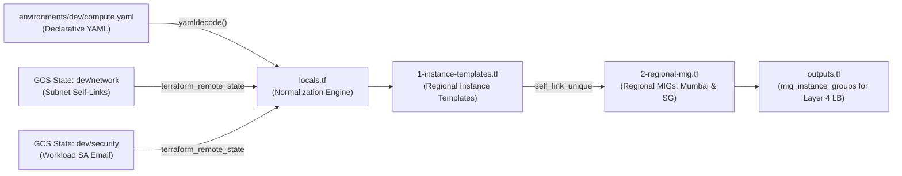
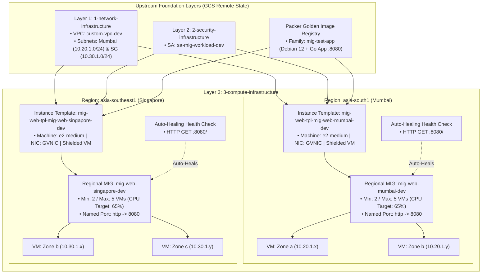

# GCP Platform Foundation - Multi-Region Compute Infrastructure (YAML-Driven)

This directory contains the **Layer 3 (`3-compute-infrastructure`)** Terraform configuration for provisioning enterprise-grade, multi-region compute workloads on **Google Cloud Platform (GCP)**.

The configuration uses a **YAML-driven approach** (`environments/<env>/compute.yaml`), separating environment-specific configuration data from the underlying Terraform infrastructure code. It deploys regional **Instance Templates** powered by **Packer Golden Images** (`mig-test-app`) and multi-zone **Regional Managed Instance Groups (MIGs)** across **Mumbai (`asia-south1`)** and **Singapore (`asia-southeast1`)** with CPU-based autoscaling, auto-healing health checks, Shielded VM security, and zero-downtime rolling updates.

---

## Table of Contents

- [Overview](#overview)
- [YAML-Driven Architecture & Upstream State Integration](#yaml-driven-architecture--upstream-state-integration)
- [Architecture Diagram](#architecture-diagram)
- [Directory Structure](#directory-structure)
- [Infrastructure Components](#infrastructure-components)
  - [1. Provider & Remote State Data Sources (`provider.tf`)](#1-provider--remote-state-data-sources-providertf)
  - [2. Configuration Loader & Normalization (`locals.tf`)](#2-configuration-loader--normalization-localstf)
  - [3. Regional Instance Templates (`1-instance-templates.tf`)](#3-regional-instance-templates-1-instance-templatestf)
  - [4. Multi-Region Managed Instance Groups (`2-regional-mig.tf`)](#4-multi-region-managed-instance-groups-2-regional-migtf)
- [Prerequisites](#prerequisites)
- [Requirements](#requirements)
  - [Terraform & Providers](#terraform--providers)
  - [Verified Cloud Foundation Toolkit (CFT) Modules](#verified-cloud-foundation-toolkit-cft-modules)
- [Terraform Input Variables](#terraform-input-variables)
- [YAML Configuration Schema (`compute.yaml`)](#yaml-configuration-schema-computeyaml)
  - [Top-Level YAML Attributes](#top-level-yaml-attributes)
  - [`compute.instance_template` Schema](#computeinstance_template-schema)
  - [`compute.migs[]` Schema](#computemigs-schema)
- [Outputs](#outputs)
- [Getting Started & Deployment](#getting-started--deployment)
- [Live Verification Commands](#live-verification-commands)
- [Security & Architecture Best Practices](#security--architecture-best-practices)

---

## Overview

The compute layer forms the resilient, self-healing application execution tier of the platform:

- **Single Shared Template Definition, Regional Instantiation**: The `instance_template` block is defined once in `compute.yaml` and automatically instantiated per regional subnet (`private-subnet-mumbai` and `private-subnet-singapore`).
- **Packer Golden Image Integration**: Bootstraps immutable VMs directly from pre-baked Packer images (`mig-test-app` family running a Golang web/API service on port `8080`), eliminating slow runtime package installations.
- **100% Private Compute Nodes**: VMs are provisioned without external public IPv4 addresses; outbound internet traffic routes via Regional Cloud NAT (`1-network-infrastructure`) and administrative SSH uses **Identity-Aware Proxy (IAP)** tunnels.
- **Least-Privilege Workload Identity**: Dynamically attaches the dedicated service account (`sa-mig-workload-<env>`) from `2-security-infrastructure` via GCS remote state.
- **Multi-Zone Regional High Availability**: Regional MIGs distribute instances evenly across availability zones in **Mumbai (`asia-south1`)** and **Singapore (`asia-southeast1`)**.
- **Autoscaling & Auto-Healing**: Automatically scales between `min_replicas` and `max_replicas` based on CPU utilization (`65%`) and replaces unhealthy VMs via dedicated regional HTTP health checks on port `8080`.
- **Zero-Downtime Rolling Updates**: Uses `PROACTIVE` `SUBSTITUTE` rolling replacement policies with `max_unavailable_fixed = 0`.

---

## YAML-Driven Architecture & Upstream State Integration



---

## Architecture Diagram



---

## Directory Structure

```text
gcp-platform-foundation-terraform/
├── environments/
│   └── dev/
│       └── compute.yaml              # Declarative Compute & MIG configuration
├── schemas/
│   └── compute.schema.json           # JSON Schema validating compute.yaml in CI/CD
└── 3-compute-infrastructure/
    ├── 1-instance-templates.tf       # Regional Instance Templates module invocation
    ├── 2-regional-mig.tf             # Regional Managed Instance Groups (MIG) module invocation
    ├── backend.hcl                   # Local GCS backend configuration (dev/compute)
    ├── locals.tf                     # YAML decoding, remote state resolution, & normalization
    ├── outputs.tf                    # Exported MIG instance_group URLs & test commands
    ├── provider.tf                   # Google Provider (~> 6.0) & upstream remote state data sources
    ├── README.md                     # Module documentation
    ├── terraform.tfvars              # Local CLI helper comments
    └── variables.tf                  # Declares 'environment' input variable
```

---

## Infrastructure Components

### 1. Provider & Remote State Data Sources (`provider.tf`)
- Configures the `hashicorp/google` (`~> 6.0`) provider with `default_labels` derived from `local.common_tags`.
- Queries upstream GCS state files:
  - `data.terraform_remote_state.network`: Retrieves regional subnet `self_link` URLs (`<env>/network`).
  - `data.terraform_remote_state.security`: Retrieves the workload Service Account email (`<env>/security`).

### 2. Configuration Loader & Normalization (`locals.tf`)
- Reads `environments/${var.environment}/compute.yaml` via `yamldecode()`.
- Merges the shared `compute.instance_template` block with each entry in `compute.migs[]` so every regional MIG automatically gets a regionally-scoped Instance Template bound to its regional subnetwork and the least-privilege Service Account.
- Normalizes all 13 required attributes of the `health_check` object and rolling `update_policy` settings for strict module compatibility.

### 3. Regional Instance Templates (`1-instance-templates.tf`)
- **Module Source**: `terraform-google-modules/vm/google//modules/instance_template` (`~> 13.2.4`)
- Provisions immutable regional instance templates with:
  - Packer Golden Image (`source_image_family = "mig-test-app"` / `source_image`)
  - `GVNIC` network interface and network tags (`allow-health-check`, `allow-iap-ssh`, `allow-web`)
  - Shielded VM protection (`enable_secure_boot`, `enable_vtpm`, `enable_integrity_monitoring`)

### 4. Multi-Region Managed Instance Groups (`2-regional-mig.tf`)
- **Module Source**: `terraform-google-modules/vm/google//modules/mig` (`~> 13.2.4`)
- Provisions multi-zone regional MIGs (`mig-web-mumbai-dev` and `mig-web-singapore-dev`) linked via `self_link_unique` to trigger zero-downtime rolling replacements whenever the Golden Image or template changes.
- Exposes named port `http: 8080` for attachment to the Global Load Balancer in Layer 4 (`4-availability-infrastructure`).

---

## Prerequisites

1. **Layer 1 (`1-network-infrastructure`) Deployed**: VPC, Mumbai & Singapore subnets, Cloud NATs, and firewall rules must exist in remote state.
2. **Layer 2 (`2-security-infrastructure`) Deployed**: Workload Service Account (`sa-mig-workload-<env>`) must exist in remote state.
3. **Packer Golden Image Built**: Image family `mig-test-app` must exist in the target GCP project.

---

## Requirements

### Terraform & Providers

| Name | Version |
| :--- | :--- |
| **terraform** | `>= 1.5.0` |
| **google** | `~> 6.0` |

### Verified Cloud Foundation Toolkit (CFT) Modules

| Module Name | Source | Version |
| :--- | :--- | :--- |
| `instance_template` | `terraform-google-modules/vm/google//modules/instance_template` | `~> 13.2.4` |
| `mig` | `terraform-google-modules/vm/google//modules/mig` | `~> 13.2.4` |

---

## Terraform Input Variables

| Name | Description | Type | Required | Allowed Values |
| :--- | :--- | :--- | :---: | :--- |
| `environment` | Target deployment environment (maps to `environments/<environment>/compute.yaml`) | `string` | Yes | `dev`, `sit`, `uat`, `prod` |

---

## YAML Configuration Schema (`compute.yaml`)

Validated automatically in CI/CD against [`schemas/compute.schema.json`](../schemas/compute.schema.json).

### Top-Level YAML Attributes

| Attribute | Type | Required | Description |
| :--- | :--- | :---: | :--- |
| `project_id` | `string` | Yes | Target GCP Project ID |
| `region` | `string` | Yes | Default GCP region (e.g., `asia-south1`) |
| `state_bucket` | `string` | No | GCS bucket storing upstream Terraform remote state |
| `tags` | `map(string)` | No | Common labels applied to all compute resources |
| `compute` | `object` | Yes | Root compute configuration block |

### `compute.instance_template` Schema

| Attribute | Type | Required | Default | Description |
| :--- | :--- | :---: | :--- | :--- |
| `name_prefix` | `string` | Yes | `"mig-tpl"` | Prefix for regional instance template names |
| `machine_type` | `string` | Yes | `"e2-medium"` | GCE machine type |
| `disk_size_gb` | `number` | No | `10` | Boot disk size in GB (`>= 10`) |
| `disk_type` | `string` | No | `"pd-balanced"` | Boot disk type (`pd-standard`, `pd-balanced`, `pd-ssd`, `pd-extreme`) |
| `auto_delete` | `bool` | No | `true` | Delete boot disk when VM terminates |
| `enable_shielded_vm` | `bool` | No | `true` | Enable Shielded VM security features |
| `nic_type` | `string` | No | `"GVNIC"` | Network interface type (`GVNIC` or `VIRTIO_NET`) |
| `service_account_name` | `string` | Yes | — | Logical SA name from `2-security-infrastructure` |
| `source_image_project` | `string` | Yes | — | Project ID hosting the Packer Golden Image |
| `source_image_family` | `string` | No | `"mig-test-app"` | Golden Image family name |
| `source_image` | `string` | No | `""` | Specific Golden Image version name |
| `tags` | `list(string)` | No | `[]` | Network firewall target tags |

### `compute.migs[]` Schema

| Attribute | Type | Required | Description |
| :--- | :--- | :---: | :--- |
| `name` | `string` | Yes | Logical MIG name (e.g., `mig-web-mumbai`) |
| `region` | `string` | Yes | Target region (`asia-south1`, `asia-southeast1`) |
| `subnet_name` | `string` | Yes | Logical subnet name from `1-network-infrastructure` |
| `named_ports` | `list(object)` | No | List of `{ name, port }` mappings for Load Balancing (`http: 8080`) |
| `autoscaling` | `object` | No | `{ enabled, min_replicas, max_replicas, cooldown_period, cpu_target }` |
| `health_check` | `object` | No | `{ type, port, request_path, check_interval_sec, healthy_threshold, unhealthy_threshold, timeout_sec, initial_delay_sec, enable_logging }` |
| `update_policy` | `object` | No | `{ type, minimal_action, replacement_method, max_surge_fixed, max_unavailable_fixed, min_ready_sec }` |

---

## Outputs

| Output Name | Description |
| :--- | :--- |
| `instance_template_names` | Map of MIG logical names to their created Instance Template names |
| `instance_template_self_links` | Map of MIG logical names to their unique Instance Template self-links |
| `mig_names` | Map of MIG logical names to their deployed GCP MIG names |
| `mig_regions` | Map of MIG logical names to their deployed GCP regions |
| `mig_instance_groups` | **Consumed by Layer 4**: Map of MIG logical names to their `instance_group` URLs for Load Balancer attachment |
| `mig_self_links` | Map of MIG logical names to their MIG manager self-links |
| `mig_health_check_self_links` | Map of MIG logical names to their auto-healing health check self-links |
| `test_list_mig_private_ips` | Ready-to-run `gcloud` commands to inspect instances in each MIG |
| `test_vm_private_ips_command` | Ready-to-run `gcloud` command to list all spawned VM names, zones, and private IPs |
| `test_app_via_iap_command` | Template command to test the application on port `8080` via IAP SSH tunnel |

---

## Getting Started & Deployment

```powershell
cd 3-compute-infrastructure

# 1. Initialize GCS Remote Backend
terraform init -backend-config="backend.hcl" -reconfigure

# 2. Validate Syntax & Configuration
terraform fmt -check
terraform validate

# 3. Review Execution Plan
terraform plan -var="environment=dev"

# 4. Apply Changes
terraform apply -var="environment=dev"
```

---

## Live Verification Commands

```powershell
# List all running MIG VMs across Mumbai and Singapore with their Private IPs
gcloud compute instances list `
  --filter="name~'mig-web-'" `
  --format="table(name, zone, networkInterfaces[0].networkIP:label=PRIVATE_IP, status)" `
  --project=yuvaraj-internal-project

# Verify application response on port 8080 inside a private VM via IAP Tunnel
gcloud compute ssh <VM_NAME> `
  --zone=<ZONE> `
  --tunnel-through-iap `
  --project=yuvaraj-internal-project `
  --command="curl -i http://localhost:8080/health"
```

---

## Security & Architecture Best Practices

1. **Zero External IPs**: Compute instances are isolated on private subnets (`10.20.1.0/24` and `10.30.1.0/24`) with no public IP exposure.
2. **Shielded VMs**: Enforces Secure Boot, virtual Trusted Platform Module (vTPM), and integrity monitoring across all instances.
3. **Immutable Infrastructure**: Updates are rolled out by baking a new Packer Golden Image and updating `source_image` in `compute.yaml`, triggering an automated zero-downtime `PROACTIVE` replacement.
4. **Least-Privilege Service Account**: Uses a dedicated workload identity (`sa-mig-workload-dev`) scoped strictly to logging, monitoring, OS Login, and secret access.
