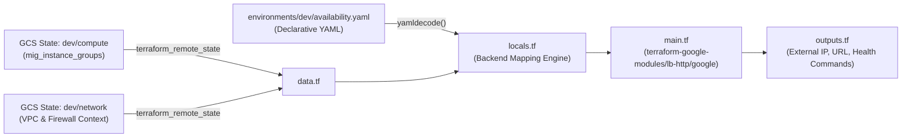
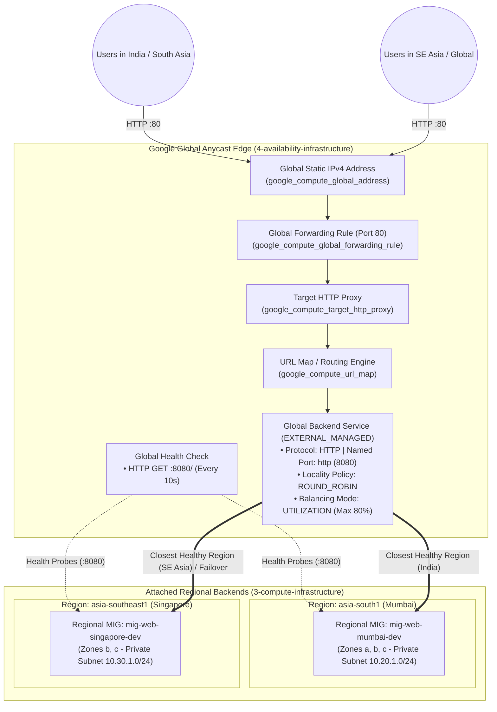

# GCP Platform Foundation - Global Availability & Load Balancing Infrastructure (YAML-Driven)

This directory contains the **Layer 4 (`4-availability-infrastructure`)** Terraform configuration for provisioning enterprise-grade global traffic management and high availability on **Google Cloud Platform (GCP)**.

The configuration uses a **YAML-driven approach** (`environments/<env>/availability.yaml`), separating environment-specific configuration data from the underlying Terraform code. It provisions a **Global External Application Load Balancer (`EXTERNAL_MANAGED`)** with a global Anycast static IPv4 address, global HTTP forwarding rule, Target HTTP Proxy, URL Map, Global Health Check, and a Global Backend Service that distributes traffic across multi-region **Managed Instance Groups (Mumbai - `asia-south1` and Singapore - `asia-southeast1`)** deployed in `3-compute-infrastructure`.

---

## Table of Contents

- [Overview](#overview)
- [YAML-Driven Architecture & Upstream State Integration](#yaml-driven-architecture--upstream-state-integration)
- [Architecture Diagram](#architecture-diagram)
- [Two-Tier Load Balancing & Failover Algorithm](#two-tier-load-balancing--failover-algorithm)
- [Directory Structure](#directory-structure)
- [Infrastructure Components](#infrastructure-components)
  - [1. Providers & GCS Backend (`provider.tf`)](#1-providers--gcs-backend-providertf)
  - [2. Upstream Remote State Data Sources (`data.tf`)](#2-upstream-remote-state-data-sources-datatf)
  - [3. Configuration Loader & Backend Mapping (`locals.tf`)](#3-configuration-loader--backend-mapping-localstf)
  - [4. Global HTTP/S Load Balancer (`main.tf`)](#4-global-https-load-balancer-maintf)
- [Prerequisites](#prerequisites)
- [Requirements](#requirements)
  - [Terraform & Providers](#terraform--providers)
  - [Verified Cloud Foundation Toolkit (CFT) Modules](#verified-cloud-foundation-toolkit-cft-modules)
- [Terraform Input Variables](#terraform-input-variables)
- [YAML Configuration Schema (`availability.yaml`)](#yaml-configuration-schema-availabilityyaml)
  - [Top-Level YAML Attributes](#top-level-yaml-attributes)
  - [`availability.load_balancer` Schema](#availabilityload_balancer-schema)
  - [`availability.load_balancer.backend` Schema](#availabilityload_balancerbackend-schema)
- [Outputs](#outputs)
- [Getting Started & Deployment](#getting-started--deployment)
- [Live Multi-Region Verification & Failover Testing](#live-multi-region-verification--failover-testing)
- [Security & Architecture Best Practices](#security--architecture-best-practices)

---

## Overview

The availability layer serves as the single global public ingress point for the entire platform:

- **Global Anycast Entry Point**: Allocates a dedicated Global Static IPv4 address that advertises from Google's worldwide Edge Points of Presence (PoPs).
- **Modern Envoy-Based Application Load Balancer (`EXTERNAL_MANAGED`)**: Supports advanced traffic management, locality load balancing policies (`ROUND_ROBIN`), connection draining, and session affinity.
- **Dynamic Multi-Region Backend Attachment**: Automatically reads `mig_instance_groups` from `3-compute-infrastructure` remote state and attaches both **Mumbai (`asia-south1`)** and **Singapore (`asia-southeast1`)** MIGs to the Global Backend Service.
- **Port Translation (`80 -> 8080`)**: Public clients connect on standard HTTP Port `80`, while the Load Balancer forwards traffic privately to named port `http` (`8080`) on the backend VMs.
- **Dedicated Global Health Check**: Continuously probes `/` on port `8080` across all regional MIG instances to route live traffic exclusively to healthy VMs and perform instant cross-region failover.

---

## YAML-Driven Architecture & Upstream State Integration



---

## Architecture Diagram



---

## Two-Tier Load Balancing & Failover Algorithm

1. **Tier 1 — Geo-Proximity Routing (Cross-Region)**:
   - Incoming requests hit the nearest Google Edge PoP via Anycast IP and are routed to the **geographically closest healthy region** (`asia-south1` for India, `asia-southeast1` for Southeast Asia) with available capacity (`max_utilization <= 0.8`).
   - If a region becomes unhealthy or exceeds capacity, traffic automatically spills over to the healthy peer region with zero manual intervention.
2. **Tier 2 — Locality Load Balancing (Within-Region)**:
   - Configured with `locality_lb_policy: ROUND_ROBIN` and `session_affinity: NONE`, distributing requests evenly across healthy VM instances across availability zones within the selected region.

---

## Directory Structure

```text
gcp-platform-foundation-terraform/
├── environments/
│   └── dev/
│       └── availability.yaml         # Declarative Load Balancer & Health Check config
├── schemas/
│   └── availability.schema.json      # JSON Schema validating availability.yaml in CI/CD
└── 4-availability-infrastructure/
    ├── backend.hcl                   # Local GCS backend configuration (dev/availability)
    ├── data.tf                       # Remote state data sources (dev/network & dev/compute)
    ├── locals.tf                     # YAML decoding & multi-region MIG backend group builder
    ├── main.tf                       # Global HTTP/S Load Balancer module invocation
    ├── outputs.tf                    # Public IP, URL, Backend Service & verification outputs
    ├── provider.tf                   # Google & Google-Beta providers (~> 6.0)
    ├── README.md                     # Module documentation
    ├── terraform.tfvars              # Local CLI helper comments
    └── variables.tf                  # Declares 'environment' input variable
```

---

## Infrastructure Components

### 1. Providers & GCS Backend (`provider.tf`)
- Configures both `hashicorp/google` (`~> 6.0`) and `hashicorp/google-beta` (`~> 6.0`) required by the CFT HTTP Load Balancer module.
- Applies `default_labels` (`provisioned_by`, `environment`, `project`) to all supported resources.

### 2. Upstream Remote State Data Sources (`data.tf`)
- Reads `data.terraform_remote_state.compute` (`<env>/compute`) to dynamically fetch the `mig_instance_groups` map containing the regional MIG instance group URLs for Mumbai and Singapore.
- Reads `data.terraform_remote_state.network` (`<env>/network`).

### 3. Configuration Loader & Backend Mapping (`locals.tf`)
- Parses `environments/${var.environment}/availability.yaml`.
- Maps the target MIG names (`mig-web-mumbai`, `mig-web-singapore`) to their actual instance group URLs from Layer 3 remote state and constructs the `groups` list with `balancing_mode`, `max_utilization`, and `capacity_scaler`.

### 4. Global HTTP/S Load Balancer (`main.tf`)
- **Module Source**: `terraform-google-modules/lb-http/google` (`~> 12.0`)
- Sets `firewall_networks = []` to avoid duplicate firewall creation (since Google LB/Health Check firewall rules are centrally managed in `1-network-infrastructure`).

---

## Prerequisites

1. **Layer 1 (`1-network-infrastructure`) Deployed**: Firewall rules `allow-health-check` and `allow-load-balancer` (`130.211.0.0/22`, `35.191.0.0/16` on TCP port `8080`) must be active.
2. **Layer 3 (`3-compute-infrastructure`) Deployed**: Regional MIGs (`mig-web-mumbai-dev` and `mig-web-singapore-dev`) must be deployed with named port `http: 8080` and exported in `mig_instance_groups` remote state.

---

## Requirements

### Terraform & Providers

| Name | Version |
| :--- | :--- |
| **terraform** | `>= 1.5.0` |
| **google** | `~> 6.0` |
| **google-beta** | `~> 6.0` |

### Verified Cloud Foundation Toolkit (CFT) Modules

| Module Name | Source | Version |
| :--- | :--- | :--- |
| `load_balancer` | `terraform-google-modules/lb-http/google` | `~> 12.0` |

---

## Terraform Input Variables

| Name | Description | Type | Required | Allowed Values |
| :--- | :--- | :--- | :---: | :--- |
| `environment` | Target deployment environment (maps to `environments/<environment>/availability.yaml`) | `string` | Yes | `dev`, `sit`, `uat`, `prod` |

---

## YAML Configuration Schema (`availability.yaml`)

Validated automatically in CI/CD against [`schemas/availability.schema.json`](../schemas/availability.schema.json).

### Top-Level YAML Attributes

| Attribute | Type | Required | Description |
| :--- | :--- | :---: | :--- |
| `project_id` | `string` | Yes | Target GCP Project ID |
| `region` | `string` | Yes | Default GCP region (e.g., `asia-south1`) |
| `state_bucket` | `string` | No | GCS bucket storing upstream Terraform remote state |
| `tags` | `map(string)` | No | Common labels applied to Load Balancer resources |
| `availability` | `object` | Yes | Root availability configuration block |

### `availability.load_balancer` Schema

| Attribute | Type | Required | Default | Description |
| :--- | :--- | :---: | :--- | :--- |
| `name` | `string` | Yes | `"glb-web"` | Base name of the Global Load Balancer |
| `load_balancing_scheme` | `string` | No | `"EXTERNAL_MANAGED"` | Scheme (`EXTERNAL_MANAGED` or `EXTERNAL`) |
| `create_address` | `bool` | No | `true` | Allocate a new Global Static External IPv4 address |
| `http_forward` | `bool` | No | `true` | Enable HTTP forwarding rule on Port `80` |
| `ssl` | `bool` | No | `false` | Enable HTTPS forwarding rule on Port `443` |
| `https_redirect` | `bool` | No | `false` | Redirect HTTP requests to HTTPS |
| `backend` | `object` | Yes | — | Backend service, health check, and MIG groups configuration |

### `availability.load_balancer.backend` Schema

| Attribute | Type | Required | Default | Description |
| :--- | :--- | :---: | :--- | :--- |
| `description` | `string` | No | — | Human-readable backend service description |
| `protocol` | `string` | Yes | `"HTTP"` | Backend communication protocol (`HTTP`, `HTTPS`, `HTTP2`) |
| `port` | `number` | Yes | `8080` | Backend target port |
| `port_name` | `string` | Yes | `"http"` | Named port matching the MIG configuration in Layer 3 |
| `timeout_sec` | `number` | No | `30` | Backend response timeout in seconds |
| `enable_cdn` | `bool` | No | `false` | Enable Cloud CDN caching |
| `connection_draining_timeout_sec` | `number` | No | `30` | Time in seconds to drain existing connections during scale-in |
| `session_affinity` | `string` | No | `"NONE"` | Session affinity (`NONE`, `CLIENT_IP`, `GENERATED_COOKIE`) |
| `locality_lb_policy` | `string` | No | `"ROUND_ROBIN"` | Intra-region LB algorithm (`ROUND_ROBIN`, `LEAST_REQUEST`, `MAGLEV`, etc.) |
| `balancing_mode` | `string` | No | `"UTILIZATION"` | Capacity mode (`UTILIZATION` or `RATE`) |
| `max_utilization` | `number` | No | `0.8` | Max backend CPU utilization threshold before cross-region spillover |
| `capacity_scaler` | `number` | No | `1.0` | Traffic scaling factor (`0.0` to `1.0`) |
| `target_migs` | `list(string)` | No | All Layer 3 MIGs | List of logical MIG keys (`mig-web-mumbai`, `mig-web-singapore`) |
| `health_check` | `object` | Yes | — | `{ request_path, port, check_interval_sec, timeout_sec, healthy_threshold, unhealthy_threshold, logging }` |
| `log_config` | `object` | No | `{ enable: true, sample_rate: 1.0 }` | Cloud Logging sampling configuration for HTTP traffic |

---

## Outputs

| Output Name | Description |
| :--- | :--- |
| `load_balancer_name` | Deployed name of the Global External Application Load Balancer |
| `external_ip` | Global Static Public IPv4 address assigned to the Load Balancer |
| `load_balancer_url` | Public HTTP URL (`http://<external_ip>`) |
| `http_proxy` | Target HTTP Proxy self-link |
| `url_map` | URL Map self-link |
| `backend_service_self_link` | Global Backend Service self-link |
| `attached_mig_backends` | List of regional MIG `instance_group` URLs attached as backends |
| `test_load_balancer_curl` | Ready-to-run `curl` command to test live traffic routing |
| `test_backend_health_gcloud` | Ready-to-run `gcloud` command to check backend health across Mumbai and Singapore |

---

## Getting Started & Deployment

```powershell
cd 4-availability-infrastructure

# 1. Initialize GCS Remote Backend
terraform init -backend-config="backend.hcl" -reconfigure

# 2. Validate Syntax & Configuration
terraform fmt -check
terraform validate

# 3. Review Execution Plan
terraform plan -var="environment=dev"

# 4. Apply Changes
terraform apply -var="environment=dev"
```

---

## Live Multi-Region Verification & Failover Testing

### 1. Check Global Backend Health (Mumbai & Singapore)
```powershell
gcloud compute backend-services get-health glb-web-dev-backend-default `
  --global `
  --project=yuvaraj-internal-project
```

### 2. Test Traffic from India (Routes to Mumbai `asia-south1`)
```powershell
curl -i http://<LOAD_BALANCER_EXTERNAL_IP>/api
```

### 3. Test Traffic from Singapore (Routes to Singapore `asia-southeast1`)
```powershell
gcloud compute ssh <SINGAPORE_VM_NAME> `
  --zone=asia-southeast1-b `
  --tunnel-through-iap `
  --project=yuvaraj-internal-project `
  --command="curl -i http://<LOAD_BALANCER_EXTERNAL_IP>/api"
```

### 4. Simulate Regional Outage / Live Failover (Drain Mumbai -> Traffic Shifts to Singapore)
```powershell
# Drain Mumbai backend (0% capacity)
gcloud compute backend-services update-backend glb-web-dev-backend-default `
  --instance-group=mig-web-mumbai-dev `
  --instance-group-region=asia-south1 `
  --capacity-scaler=0.0 `
  --global `
  --project=yuvaraj-internal-project

# Restore Mumbai backend (100% capacity)
gcloud compute backend-services update-backend glb-web-dev-backend-default `
  --instance-group=mig-web-mumbai-dev `
  --instance-group-region=asia-south1 `
  --capacity-scaler=1.0 `
  --global `
  --project=yuvaraj-internal-project
```

---

## Security & Architecture Best Practices

1. **Private Backend Isolation**: Backend VMs have no public IPs; they only accept traffic on port `8080` from Google Front End (GFE) / Envoy proxy ranges (`130.211.0.0/22` and `35.191.0.0/16`).
2. **Centralized Firewall Governance**: Sets `firewall_networks = []` on the Load Balancer module so all VPC firewall rules remain strictly governed in `1-network-infrastructure`.
3. **Full Traffic Observability**: Enables 100% Cloud Logging (`sample_rate: 1.0`) on both the Global Backend Service and the Global Health Check for end-to-end latency and failover auditing.
