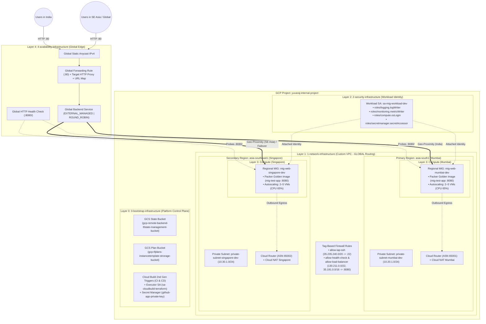
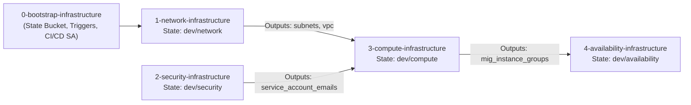
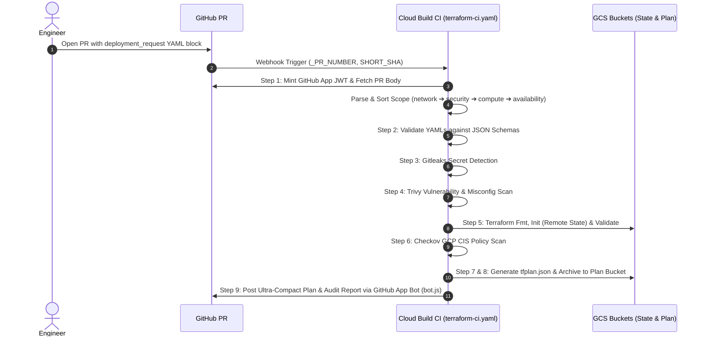
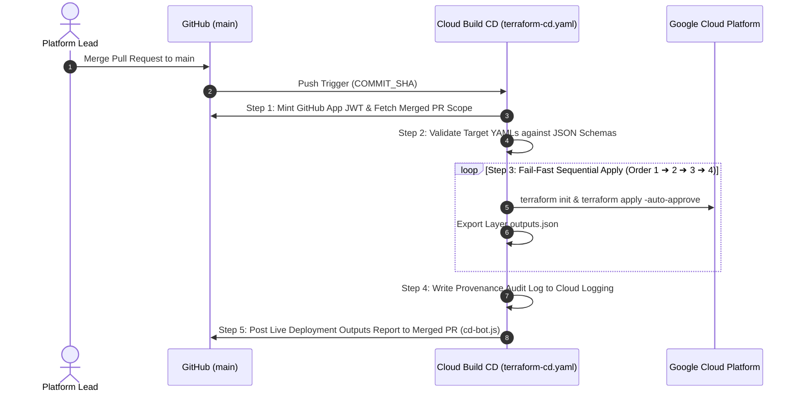

# GCP Platform Foundation — Enterprise Multi-Region Terraform & GitOps CI/CD Platform

An enterprise-grade, **YAML-driven, 5-Layer Infrastructure-as-Code (IaC) Platform** on **Google Cloud Platform (GCP)** built with **Terraform**, official **Google Cloud Foundation Toolkit (CFT)** modules, **JSON Schema validation**, **DevSecOps policy scanning**, and **GitHub App-powered Google Cloud Build CI/CD pipelines**.

---

## Table of Contents

- [1. Executive Overview](#1-executive-overview)
- [2. End-to-End Platform Architecture](#2-end-to-end-platform-architecture)
  - [High-Level Infrastructure Topology](#high-level-infrastructure-topology)
  - [Cross-Layer Dependency & Remote State Flow](#cross-layer-dependency--remote-state-flow)
- [3. Repository Directory Structure](#3-repository-directory-structure)
- [4. Deep Dive: The 5 Infrastructure Layers](#4-deep-dive-the-5-infrastructure-layers)
  - [Layer 0: Bootstrap Infrastructure (`0-bootstrap-infrastructure`)](#layer-0-bootstrap-infrastructure-0-bootstrap-infrastructure)
  - [Layer 1: Network Infrastructure (`1-network-infrastructure`)](#layer-1-network-infrastructure-1-network-infrastructure)
  - [Layer 2: Security Infrastructure (`2-security-infrastructure`)](#layer-2-security-infrastructure-2-security-infrastructure)
  - [Layer 3: Compute Infrastructure (`3-compute-infrastructure`)](#layer-3-compute-infrastructure-3-compute-infrastructure)
  - [Layer 4: Availability Infrastructure (`4-availability-infrastructure`)](#layer-4-availability-infrastructure-4-availability-infrastructure)
- [5. Declarative YAML & JSON Schema Governance](#5-declarative-yaml--json-schema-governance)
- [6. GitOps CI/CD Pipelines & DevSecOps Automation](#6-gitops-cicd-pipelines--devsecops-automation)
  - [CI Pipeline (`terraform-ci.yaml`) — Pull Request Validation](#ci-pipeline-terraform-ciyaml--pull-request-validation)
  - [CD Pipeline (`terraform-cd.yaml`) — Sequential Merge Deployment](#cd-pipeline-terraform-cdyaml--sequential-merge-deployment)
  - [GitHub App Bot Reporting (`bot.js` & `cd-bot.js`)](#github-app-bot-reporting-botjs--cd-botjs)
- [7. GCS Remote State Isolation Matrix](#7-gcs-remote-state-isolation-matrix)
- [8. End-to-End Deployment & Operations Guide](#8-end-to-end-deployment--operations-guide)
  - [Phase 1: One-Time Bootstrap Setup](#phase-1-one-time-bootstrap-setup)
  - [Phase 2: GitOps Pull Request Workflow](#phase-2-gitops-pull-request-workflow)
  - [Phase 3: Local CLI Execution (Per Layer)](#phase-3-local-cli-execution-per-layer)
- [9. Live Multi-Region Verification & Regional Failover Testing](#9-live-multi-region-verification--regional-failover-testing)
- [10. Enterprise Security & Architecture Best Practices](#10-enterprise-security--architecture-best-practices)

---

## 1. Executive Overview

Modern cloud platforms require strict separation between **reusable Terraform logic** and **environment-specific declarations**, backed by automated security gates and deterministic deployment ordering. This repository implements a complete production-ready foundation across two active GCP regions (**Mumbai - `asia-south1`** and **Singapore - `asia-southeast1`**):

- **100% YAML-Driven Environments**: Engineers define infrastructure purely in declarative YAML files (`environments/<env>/*.yaml`) without modifying `.tf` files.
- **Automated Schema & Policy Gates**: Every Pull Request is validated against **JSON Schemas** (`schemas/*.schema.json`), **Gitleaks** (secrets), **Trivy** (vulnerabilities/misconfigurations), and **Checkov** (GCP CIS benchmarks).
- **Layered Blast-Radius Isolation**: Infrastructure is decoupled into 5 independent state layers (`bootstrap`, `network`, `security`, `compute`, `availability`), orchestrated in strict dependency order.
- **Immutable Multi-Region Compute**: Workloads run on private **Shielded VMs** booted from **Packer Golden Images** (`mig-test-app`) across multi-zone **Regional Managed Instance Groups (MIGs)**.
- **Global Anycast High Availability**: A **Global External Application Load Balancer (`EXTERNAL_MANAGED`)** routes users to the nearest healthy region via Anycast IP with `ROUND_ROBIN` intra-region balancing and automatic cross-region failover.

---

## 2. End-to-End Platform Architecture

### High-Level Infrastructure Topology



---

### Cross-Layer Dependency & Remote State Flow

Each layer stores its state in an isolated GCS prefix (`<env>/<layer>/default.tfstate`) and exports structured outputs consumed by downstream layers via `terraform_remote_state`:



---

## 3. Repository Directory Structure

```text
gcp-platform-foundation-terraform/
├── .github/
│   └── pull_request_template.md          # Standardized PR Deployment Request template
│
├── 0-bootstrap-infrastructure/           # Layer 0: APIs, GCS State/Plan Buckets, Cloud Build SA & Triggers
│   ├── cloudbuild.tf                     # Cloud Build 2nd Gen repository links & CI/CD triggers
│   ├── locals.tf                         # Decodes environments/bootstrap.yaml
│   ├── main.tf                           # APIs, GCS buckets, Cloud Build SA, IAM, Secret Manager bindings
│   ├── outputs.tf                        # Bootstrap outputs
│   ├── variables.tf                      # Path to bootstrap.yaml
│   └── README.md                         # Layer 0 detailed documentation
│
├── 1-network-infrastructure/             # Layer 1: Multi-Region Custom VPC, Subnets, Routers, NATs, Firewalls
│   ├── 0-locals.tf                       # Decodes network.yaml & normalizes firewall rules
│   ├── 1-vpc.tf                          # VPC & Subnets (Mumbai & Singapore)
│   ├── 2-cloud-router.tf                 # Regional Cloud Routers with BGP ASNs
│   ├── 3-cloud-nat.tf                    # Regional Cloud NAT Gateways
│   ├── 4-firewall.tf                     # Tag-based Ingress/Egress Firewall Rules
│   ├── backend.hcl                       # Local backend config (dev/network)
│   ├── output.tf                         # Exported VPC & Subnet self-links
│   ├── provider.tf                       # Google provider & GCS backend
│   ├── variables.tf                      # Environment variable validation
│   └── README.md                         # Layer 1 detailed documentation
│
├── 2-security-infrastructure/            # Layer 2: Workload Service Accounts & Least-Privilege IAM
│   ├── 1-service-account.tf              # Official CFT Service Accounts module
│   ├── backend.hcl                       # Local backend config (dev/security)
│   ├── locals.tf                         # Decodes security.yaml & formats project IAM roles
│   ├── outputs.tf                        # Exported Service Account emails & IAM member strings
│   ├── provider.tf                       # Google provider & GCS backend
│   └── variables.tf                      # Environment variable validation
│
├── 3-compute-infrastructure/             # Layer 3: Packer Golden Image Templates & Multi-Region MIGs
│   ├── 1-instance-templates.tf           # Regional Instance Templates (Shielded VM, GVNIC)
│   ├── 2-regional-mig.tf                 # Regional MIGs (Mumbai & Singapore) with Autoscaling & Auto-Healing
│   ├── backend.hcl                       # Local backend config (dev/compute)
│   ├── locals.tf                         # Merges shared template with regional MIGs & remote state
│   ├── outputs.tf                        # Exported mig_instance_groups & IAP verification commands
│   ├── provider.tf                       # Google provider & upstream remote state (network + security)
│   ├── variables.tf                      # Environment variable validation
│   └── README.md                         # Layer 3 detailed documentation
│
├── 4-availability-infrastructure/        # Layer 4: Global External HTTP/S Load Balancer
│   ├── backend.hcl                       # Local backend config (dev/availability)
│   ├── data.tf                           # Upstream remote state (network + compute)
│   ├── locals.tf                         # Decodes availability.yaml & maps Mumbai/Singapore MIGs
│   ├── main.tf                           # Global Load Balancer (EXTERNAL_MANAGED, ROUND_ROBIN)
│   ├── outputs.tf                        # Exported Public IP, URL, & health verification commands
│   ├── provider.tf                       # Google & Google-Beta providers
│   ├── variables.tf                      # Environment variable validation
│   └── README.md                         # Layer 4 detailed documentation
│
├── cloudbuild-pipelines/                 # GitOps CI/CD Pipelines & Automation Scripts
│   ├── terraform-ci.yaml                 # Pull Request Validation, Security Scanning & Plan Pipeline
│   ├── terraform-cd.yaml                 # Merge-to-Main Sequential Apply & Audit Pipeline
│   └── scripts/
│       ├── bot.js                        # GitHub App PR Comment Bot (Compact Plan & Security Audit)
│       ├── cd-bot.js                     # GitHub App CD Comment Bot (Live Deployment Outputs)
│       ├── detect-cd-scope.sh            # Scope detection helper
│       ├── validate-config.sh            # Python JSON Schema validator for environment YAMLs
│       ├── validate-request.sh           # PR deployment_request parser & layer sorter
│       └── README.md                     # Scripts documentation
│
├── environments/                         # Declarative Environment Configurations (Single Source of Truth)
│   ├── bootstrap.yaml                    # Layer 0 bootstrap configuration
│   └── dev/
│       ├── network.yaml                  # Layer 1 Dev network declaration
│       ├── security.yaml                 # Layer 2 Dev security declaration
│       ├── compute.yaml                  # Layer 3 Dev compute & MIG declaration
│       └── availability.yaml             # Layer 4 Dev global load balancer declaration
│
├── schemas/                              # JSON Schemas for Automated Pre-Flight YAML Validation
│   ├── network.schema.json               # Validates network.yaml
│   ├── security.schema.json              # Validates security.yaml
│   ├── compute.schema.json               # Validates compute.yaml
│   └── availability.schema.json          # Validates availability.schema.json
│
└── README.md                             # End-to-End Platform Documentation (This File)
```

---

## 4. Deep Dive: The 5 Infrastructure Layers

### Layer 0: Bootstrap Infrastructure (`0-bootstrap-infrastructure`)
Establishes the foundational CI/CD control plane and state storage before any workload layers run:
- **APIs Enabled**: `compute`, `cloudbuild`, `storage`, `iam`, `cloudresourcemanager`, `logging`, `serviceusage`, `networkmanagement`, `servicenetworking`, `iap`, `secretmanager`.
- **GCS Buckets**:
  - `gcp-remote-backend-tfstate-management-bucket` (Versioning enabled, uniform bucket-level access).
  - `gcp-tfplans-instancetemplate-strorage-bucket` (14-day lifecycle rule for storing PR `.tfplan.json` artifacts).
- **Dedicated Executor Identity (`sa-cloudbuild-terraform`)**: Granted least-privilege administrative roles across Network (`compute.networkAdmin`), Security (`iam.serviceAccountAdmin`, `resourcemanager.projectIamAdmin`, `compute.securityAdmin`), Compute (`compute.instanceAdmin.v1`, `iam.serviceAccountUser`), and Availability (`compute.loadBalancerAdmin`).
- **Cloud Build 2nd Gen Triggers**: Automatically wires GitHub repository webhooks for PR CI (`terraform-platform-ci`), Main CD (`terraform-platform-cd`), and Packer Golden Image builds (`gcp-mig-test-app-packer-build`).
- 📖 **[Read Full Layer 0 Documentation](./0-bootstrap-infrastructure/README.md)**

---

### Layer 1: Network Infrastructure (`1-network-infrastructure`)
Builds the multi-region private network perimeter:
- **Modules**: `terraform-google-modules/network/google` (`~> 18.3`), `cloud-router` (`~> 9.1`), `cloud-nat` (`~> 7.1`).
- **Multi-Region Subnets**:
  - `private-subnet-mumbai-dev` (`10.20.1.0/24` in `asia-south1`) — Private Google Access & Flow Logs enabled.
  - `private-subnet-singapore-dev` (`10.30.1.0/24` in `asia-southeast1`) — Private Google Access & Flow Logs enabled.
- **Regional Egress**: Independent Cloud Routers (`ASN 65001` & `65002`) and Cloud NATs in Mumbai and Singapore so private VMs can reach external package/API endpoints without public IPs.
- **Tag-Based Firewalls**:
  - `fw-allow-iap-ssh-dev`: Allows TCP `:22` from Google IAP (`35.235.240.0/20`) to tag `allow-iap-ssh`.
  - `fw-allow-health-check-dev` & `fw-allow-load-balancer-dev`: Allows TCP `:8080` from Google Front End (GFE) ranges (`130.211.0.0/22`, `35.191.0.0/16`) to tags `allow-health-check` and `allow-web`.
- 📖 **[Read Full Layer 1 Documentation](./1-network-infrastructure/README.md)**

---

### Layer 2: Security Infrastructure (`2-security-infrastructure`)
Enforces workload identity isolation:
- **Module**: `terraform-google-modules/service-accounts/google` (`~> 4.5.3`).
- **Workload Service Account (`sa-mig-workload-dev`)**: Replaces the over-privileged default Compute Engine service account with strictly scoped roles:
  - `roles/logging.logWriter`
  - `roles/monitoring.metricWriter`
  - `roles/stackdriver.resourceMetadata.writer`
  - `roles/compute.osLogin`
  - `roles/secretmanager.secretAccessor`

---

### Layer 3: Compute Infrastructure (`3-compute-infrastructure`)
Deploys immutable, self-healing, multi-region application clusters:
- **Modules**: `terraform-google-modules/vm/google//modules/instance_template` & `mig` (`~> 13.2.4`).
- **Packer Golden Image**: Boots from `mig-test-app` (Debian 12 with pre-installed systemd Golang web/API dashboard on port `8080`).
- **Multi-Region MIGs**:
  - `mig-web-mumbai-dev` (`asia-south1`) & `mig-web-singapore-dev` (`asia-southeast1`).
  - Autoscaling (`2` to `5` replicas per region at `65%` CPU target), Regional Auto-Healing Health Checks (`HTTP GET :8080/`), Shielded VM (`Secure Boot`, `vTPM`), and `PROACTIVE` `SUBSTITUTE` zero-downtime rolling updates.
- 📖 **[Read Full Layer 3 Documentation](./3-compute-infrastructure/README.md)**

---

### Layer 4: Availability Infrastructure (`4-availability-infrastructure`)
Exposes the application globally with intelligent routing and automatic failover:
- **Module**: `terraform-google-modules/lb-http/google` (`~> 12.0`).
- **Architecture**:
  - **Global Static Anycast IP** + **Global Forwarding Rule (Port 80)** + **Target HTTP Proxy** + **URL Map**.
  - **Global Backend Service (`EXTERNAL_MANAGED`)**: Connects both Mumbai and Singapore MIGs on named port `http` (`8080`).
  - **Two-Tier Routing**: Geo-proximity routing to the closest healthy region + `ROUND_ROBIN` locality load balancing across zones within each region.
- 📖 **[Read Full Layer 4 Documentation](./4-availability-infrastructure/README.md)**

---

## 5. Declarative YAML & JSON Schema Governance

All environment configurations live under `environments/<env>/` and are validated prior to Terraform execution using `cloudbuild-pipelines/scripts/validate-config.sh` (`python3-jsonschema`):

| Layer | Environment YAML | JSON Schema Contract |
| :---: | :--- | :--- |
| **1 - Network** | [`environments/dev/network.yaml`](./environments/dev/network.yaml) | [`schemas/network.schema.json`](./schemas/network.schema.json) |
| **2 - Security** | [`environments/dev/security.yaml`](./environments/dev/security.yaml) | [`schemas/security.schema.json`](./schemas/security.schema.json) |
| **3 - Compute** | [`environments/dev/compute.yaml`](./environments/dev/compute.yaml) | [`schemas/compute.schema.json`](./schemas/compute.schema.json) |
| **4 - Availability** | [`environments/dev/availability.yaml`](./environments/dev/availability.yaml) | [`schemas/availability.schema.json`](./schemas/availability.schema.json) |

---

## 6. GitOps CI/CD Pipelines & DevSecOps Automation

### CI Pipeline (`terraform-ci.yaml`) — Pull Request Validation

Triggered automatically when a Pull Request is opened or updated against `main`:



---

### CD Pipeline (`terraform-cd.yaml`) — Sequential Merge Deployment

Triggered automatically when a Pull Request is merged into `main`:



---

### GitHub App Bot Reporting (`bot.js` & `cd-bot.js`)

- **Zero Personal Access Tokens (PATs)**: Authenticates dynamically using an RS256 JWT signed with the GitHub App Private Key stored in **GCP Secret Manager** (`github-app-private-key`).
- **Ultra-Compact Plan Aggregation (`bot.js`)**: Groups planned changes by `Action + Resource Type` (with expandable `<details>` dropdowns for granular attributes and security scan logs) so multi-layer plans never exceed GitHub's 65,536-character comment limit.
- **Post-Deployment Audit (`cd-bot.js`)**: Posts the live provisioned outputs (VPC links, Service Account emails, MIG commands, Global Load Balancer IP & URL) directly back onto the merged PR.

---

## 7. GCS Remote State Isolation Matrix

All Terraform states are stored in `gs://gcp-remote-backend-tfstate-management-bucket`:

| Layer | Order | Directory | GCS State Prefix | Key Exported Outputs |
| :---: | :---: | :--- | :--- | :--- |
| **Network** | `1` | `1-network-infrastructure` | `<env>/network` | `network_name`, `network_self_link`, `subnets` |
| **Security** | `2` | `2-security-infrastructure` | `<env>/security` | `service_account_emails`, `service_account_iam_emails` |
| **Compute** | `3` | `3-compute-infrastructure` | `<env>/compute` | `mig_instance_groups`, `mig_names`, `instance_template_self_links` |
| **Availability** | `4` | `4-availability-infrastructure` | `<env>/availability` | `external_ip`, `load_balancer_url`, `backend_service_self_link` |

---

## 8. End-to-End Deployment & Operations Guide

### Phase 1: One-Time Bootstrap Setup
```powershell
cd 0-bootstrap-infrastructure
terraform init
terraform apply -auto-approve
```

### Phase 2: GitOps Pull Request Workflow
1. Modify the desired YAML file(s) in `environments/dev/` (e.g., `network.yaml`, `security.yaml`, `compute.yaml`, `availability.yaml`).
2. Commit and push to a feature branch and open a Pull Request against `main`.
3. Include the `deployment_request` metadata block in the PR description:
   ```yaml
   deployment_request:
     infrastructure:
       - network
       - security
       - compute
       - availability
     environment: dev
     description: "Deploy full stack multi-region foundation"
   ```
4. Review the automated **GitHub App Bot** comment on the PR (Security Audit + Compact Terraform Plan).
5. Merge the PR to `main` — Cloud Build CD automatically applies each layer in sequence (`1 ➔ 2 ➔ 3 ➔ 4`) and posts the live outputs to the PR.

### Phase 3: Local CLI Execution (Per Layer)
```powershell
# Run in order: 1-network -> 2-security -> 3-compute -> 4-availability
cd <LAYER_DIRECTORY>
terraform init -backend-config="backend.hcl" -reconfigure
terraform plan -var="environment=dev"
terraform apply -var="environment=dev"
```

---

## 9. Live Multi-Region Verification & Regional Failover Testing

### 1. Verify Private MIG Instances (Mumbai & Singapore)
```powershell
gcloud compute instances list `
  --filter="name~'mig-web-'" `
  --format="table(name, zone, networkInterfaces[0].networkIP:label=PRIVATE_IP, status)" `
  --project=yuvaraj-internal-project
```

### 2. Verify Global Load Balancer Backend Health
```powershell
gcloud compute backend-services get-health glb-web-dev-backend-default `
  --global `
  --project=yuvaraj-internal-project
```

### 3. Verify Geo-Proximity Routing (Mumbai vs. Singapore)
```powershell
# From India -> Served by Mumbai MIG (asia-south1)
curl -s http://<LOAD_BALANCER_IP>/api

# From Singapore VM (via IAP SSH) -> Served by Singapore MIG (asia-southeast1)
gcloud compute ssh <SINGAPORE_VM_NAME> `
  --zone=asia-southeast1-b `
  --tunnel-through-iap `
  --project=yuvaraj-internal-project `
  --command="curl -s http://<LOAD_BALANCER_IP>/api"
```

### 4. Simulate Regional Outage & Automatic Cross-Region Failover
```powershell
# 1. Drain Mumbai Backend (0% capacity) -> Traffic from India automatically fails over to Singapore!
gcloud compute backend-services update-backend glb-web-dev-backend-default `
  --instance-group=mig-web-mumbai-dev `
  --instance-group-region=asia-south1 `
  --capacity-scaler=0.0 `
  --global `
  --project=yuvaraj-internal-project

# 2. Restore Mumbai Backend (100% capacity)
gcloud compute backend-services update-backend glb-web-dev-backend-default `
  --instance-group=mig-web-mumbai-dev `
  --instance-group-region=asia-south1 `
  --capacity-scaler=1.0 `
  --global `
  --project=yuvaraj-internal-project
```

---

## 10. Enterprise Security & Architecture Best Practices

- **Zero Public VM IPs**: All compute instances run exclusively on private RFC1918 subnets; external access is strictly mediated through the Global Load Balancer (ingress) and Regional Cloud NAT (egress).
- **Zero SSH Keys / Bastion Hosts**: Administrative access uses **Google Cloud Identity-Aware Proxy (IAP)** TCP forwarding with OS Login (`roles/compute.osLogin`).
- **Shielded & Immutable Compute**: Enforces Secure Boot, vTPM, Integrity Monitoring, and Packer-baked Golden Images.
- **Secretless CI/CD**: Cloud Build uses short-lived GitHub App Installation Tokens minted via RS256 JWTs from Secret Manager rather than static long-lived Personal Access Tokens.
- **Fail-Fast Layered Execution**: `set -e` in the CD pipeline guarantees that if an upstream layer fails, downstream layers halt immediately to preserve state integrity.
