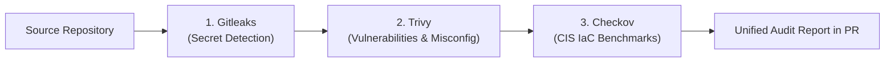
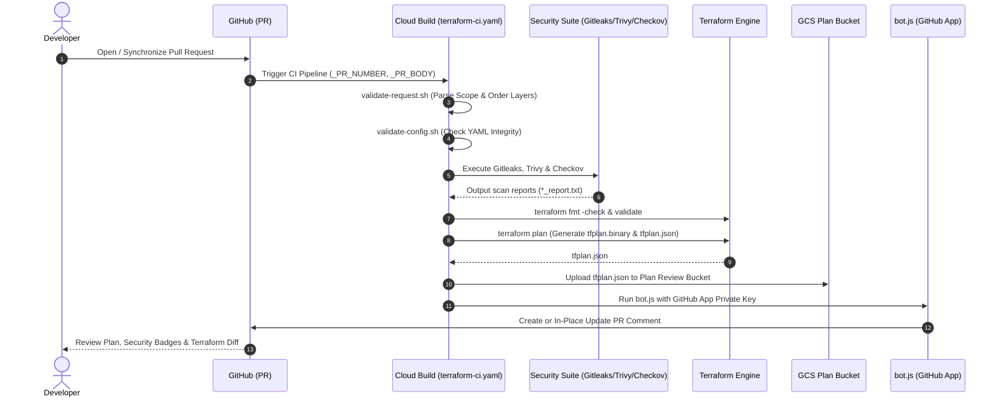
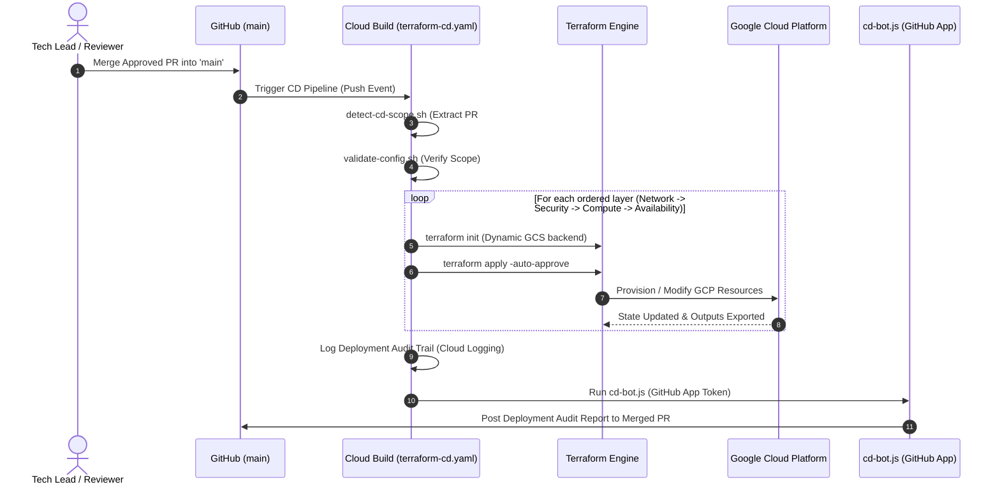

# GCP Platform Foundation - CI/CD Pipeline Architecture

This directory contains the production-grade **Google Cloud Build CI/CD pipelines** and automation scripts designed for orchestrating tiered **Terraform Infrastructure as Code (IaC)** on Google Cloud Platform (GCP).

---

## Table of Contents

- [Architectural Overview](#architectural-overview)
- [Pipeline Architecture & Triggers](#pipeline-architecture--triggers)
  - [1. Continuous Integration (CI) — `terraform-ci.yaml`](#1-continuous-integration-ci--terraform-ciyaml)
  - [2. Continuous Deployment (CD) — `terraform-cd.yaml`](#2-continuous-deployment-cd--terraform-cdyaml)
- [Core Concepts & Design Patterns](#core-concepts--design-patterns)
  - [Config-as-Data & Dynamic Scope Detection](#config-as-data--dynamic-scope-detection)
  - [Architectural Deployment Sequence & Dependency Ordering](#architectural-deployment-sequence--dependency-ordering)
  - [Multi-Layer Security & IaC Governance](#multi-layer-security--iac-governance)
  - [Dynamic GCS Remote State Management](#dynamic-gcs-remote-state-management)
  - [Fail-Fast Execution Strategy](#fail-fast-execution-strategy)
  - [GitHub App Bot Integration & In-Place PR Reporting](#github-app-bot-integration--in-place-pr-reporting)
  - [Secret Manager Integration & Zero-Trust Authentication](#secret-manager-integration--zero-trust-authentication)
- [Directory Structure](#directory-structure)
- [Scripts Integration Map](#scripts-integration-map)
- [End-to-End Workflow Diagrams](#end-to-end-workflow-diagrams)
- [Pipeline Configuration & Substitutions Reference](#pipeline-configuration--substitutions-reference)
- [Troubleshooting & Best Practices](#troubleshooting--best-practices)

---

## Architectural Overview

The CI/CD subsystem implements an automated, secure GitOps workflow for managing multi-tier GCP infrastructure across multiple environments (`dev`, `qat`, `prod`). 

Rather than executing monolithic Terraform runs across the entire repository or creating redundant pipeline files for each tier, the system employs **Config-as-Data** and **Dynamic Scope Discovery**. Changes declared in YAML configuration files or requested through Pull Request metadata trigger scoped, ordered executions.

```
                      ┌──────────────────────────────────────────────┐
                      │              Developer GitOps                │
                      │   (Pull Request / Merge to 'main' Branch)    │
                      └──────────────────────┬───────────────────────┘
                                             │
                      ┌──────────────────────▼───────────────────────┐
                      │      Google Cloud Build Orchestrator         │
                      │  (Managed Serverless Execution Environment)  │
                      └──────┬───────────────────────────────┬───────┘
                             │                               │
             Pull Request    │                               │   Merge to 'main'
             Event           ▼                               ▼   Event
┌──────────────────────────────────────────┐   ┌──────────────────────────────────────────┐
│      1. CI Pipeline (terraform-ci.yaml)   │   │      2. CD Pipeline (terraform-cd.yaml)   │
│  - PR Scope Resolution                   │   │  - Merge Scope Detection (Git diff)      │
│  - Config Integrity Validation           │   │  - Config Integrity Validation           │
│  - Gitleaks (Secret Detection)           │   │  - Sequential Terraform Apply (set -e)   │
│  - Trivy (Vulnerabilities & Misconfig)   │   │  - GCS Remote State Update               │
│  - Terraform Format & Validate           │   │  - Cloud Logging Deployment Audit        │
│  - Checkov (CIS IaC Compliance)          │   │  - GitHub App Deployment Audit Bot       │
│  - Terraform Plan & JSON Archival (GCS)  │   │                                          │
│  - GitHub App Interactive Bot Comment    │   │                                          │
└──────────────────────────────────────────┘   └──────────────────────────────────────────┘
```

---

## Pipeline Architecture & Triggers

### 1. Continuous Integration (CI) — [`terraform-ci.yaml`](file:///d:/GCP-DevOps-WorkSpace/gcp-platform-foundation-terraform/cloudbuild-pipelines/terraform-ci.yaml)

- **Trigger Event**: Pull Request creation or synchronization targeting the `main` branch.
- **Timeout**: Default 10 minutes (`600s`).
- **Goal**: Validate syntax, enforce security guardrails, generate Terraform plans, and present an actionable audit report on the PR before merging.

#### Execution Pipeline Steps:

1. **`parse-pr-scope`**:
   - Queries the GitHub API for the PR description or falls back to `pr_body.txt`.
   - Executes [`validate-request.sh`](file:///d:/GCP-DevOps-WorkSpace/gcp-platform-foundation-terraform/cloudbuild-pipelines/scripts/validate-request.sh) (pure Bash) to extract target `environment` and `infrastructure` layers, verifying physical paths and emitting `deployment_scope.json`.
2. **`validate-configs`**:
   - Runs [`validate-config.sh`](file:///d:/GCP-DevOps-WorkSpace/gcp-platform-foundation-terraform/cloudbuild-pipelines/scripts/validate-config.sh) against each target configuration YAML (e.g., `environments/dev/network.yaml`) to verify file existence and non-empty status.
3. **`secret-scan-gitleaks`**:
   - Runs `zricethezav/gitleaks:latest` across repository commits and working tree, capturing logs to `gitleaks_report.txt`.
4. **`vuln-scan-trivy`**:
   - Runs `aquasec/trivy:latest` filesystem scanner (`fs --scanners vuln,misconfig --severity HIGH,CRITICAL`) and writes to `trivy_report.txt`.
5. **`terraform-validate`**:
   - Runs `terraform fmt -check`, generates a dynamic backend file (`<name>-<env>-backend.hcl`), executes `terraform init`, and runs `terraform validate` across all targets.
6. **`iac-scan-checkov`**:
   - Runs `bridgecrew/checkov:latest` against target directories for GCP CIS Benchmark violations, outputting to `checkov_report.txt`.
7. **`terraform-plan`**:
   - Executes `terraform plan -var="environment=${ENV}" -out=tfplan.binary` and converts the plan to structured JSON via `terraform show -json tfplan.binary > tfplan.json`.
8. **`upload-plan-to-gcs`**:
   - Stores the generated `tfplan.json` in the Plan Review bucket: `gs://${_PLAN_BUCKET}/tf-plan-review/${_PR_NUMBER}/${SHORT_SHA}/<name>-<env>-tfplan.json`.
9. **`post-pr-comment-bot`**:
   - Runs [`bot.js`](file:///d:/GCP-DevOps-WorkSpace/gcp-platform-foundation-terraform/cloudbuild-pipelines/scripts/bot.js) inside `node:20-alpine`, signs a JWT using the GitHub App Private Key from Secret Manager, parses the scan reports and `tfplan.json`, and updates/creates the PR review comment.

---

### 2. Continuous Deployment (CD) — [`terraform-cd.yaml`](file:///d:/GCP-DevOps-WorkSpace/gcp-platform-foundation-terraform/cloudbuild-pipelines/terraform-cd.yaml)

- **Trigger Event**: Direct push / merged Pull Request into the `main` branch.
- **Timeout**: 30 minutes (`1800s`).
- **Goal**: Sequentially apply Terraform changes to live GCP infrastructure following strict platform tier dependencies and record deployment provenance.

#### Execution Pipeline Steps:

1. **`detect-scope-from-pr`**:
   - Executes [`detect-cd-scope.sh`](file:///d:/GCP-DevOps-WorkSpace/gcp-platform-foundation-terraform/cloudbuild-pipelines/scripts/detect-cd-scope.sh).
   - Extracts the merged PR number (`#<NUM>`) from the merge commit message and inspects modified files (`git diff-tree`) to find changed `environments/<env>/<infra>.yaml` configurations without requiring GitHub API credentials.
   - Outputs an ordered `deployment_scope.json` with `action: "apply"`.
2. **`validate-configs`**:
   - Runs [`validate-config.sh`](file:///d:/GCP-DevOps-WorkSpace/gcp-platform-foundation-terraform/cloudbuild-pipelines/scripts/validate-config.sh) to ensure the generated deployment scope is non-empty.
3. **`terraform-apply-sequential`**:
   - Runs in `hashicorp/terraform:1.6` with `set -e` (fail-fast).
   - Iterates through target layers in strict architectural order:
     1. Generates the environment-specific backend file (`<name>-<env>-backend.hcl`).
     2. Runs `terraform init -backend-config="..."`.
     3. Runs `terraform apply -var="environment=${ENV}" -auto-approve -input=false`.
     4. Captures Terraform output variables.
4. **`deployment-audit-log`**:
   - Emits structured deployment audit records (status, environment, PR number, commit SHA, build ID, timestamp) to Cloud Logging.
5. **`post-cd-audit-comment`**:
   - Runs [`cd-bot.js`](file:///d:/GCP-DevOps-WorkSpace/gcp-platform-foundation-terraform/cloudbuild-pipelines/scripts/cd-bot.js) inside `node:20-alpine` to post the final deployment status and outputs back to the original merged PR on GitHub.

---

## Core Concepts & Design Patterns

### Config-as-Data & Dynamic Scope Detection

Instead of maintaining hardcoded environment paths inside Terraform or bash scripts:
1. Environment parameters reside in `environments/<env>/<layer>.yaml` (e.g. `environments/dev/network.yaml`).
2. Pull Request descriptions declare the intended deployment scope:
   ```yaml
   environment: dev
   infrastructure:
     - network
     - security
   ```
3. [`validate-request.sh`](file:///d:/GCP-DevOps-WorkSpace/gcp-platform-foundation-terraform/cloudbuild-pipelines/scripts/validate-request.sh) resolves these into a unified JSON contract (`deployment_scope.json`) that subsequent pipeline steps iterate over.

### Architectural Deployment Sequence & Dependency Ordering

Platform foundation layers have strict cross-tier dependencies. Both [`validate-request.sh`](file:///d:/GCP-DevOps-WorkSpace/gcp-platform-foundation-terraform/cloudbuild-pipelines/scripts/validate-request.sh) and [`detect-cd-scope.sh`](file:///d:/GCP-DevOps-WorkSpace/gcp-platform-foundation-terraform/cloudbuild-pipelines/scripts/detect-cd-scope.sh) enforce the following execution hierarchy:

| Tier | Directory | Component | Dependencies |
| :---: | :--- | :--- | :--- |
| **0** | `0-bootstrap-infrastructure` | Project APIs, State Buckets, Cloud Build SA, IAM | None (One-time bootstrap) |
| **1** | `1-network-infrastructure` | VPC, Subnets, Cloud Router, Cloud NAT, Firewall | Tier 0 APIs & State |
| **2** | `2-security-infrastructure` | Cloud Armor Security Policies, SSL Policies | Tier 1 Network |
| **3** | `3-compute-infrastructure` | Instance Templates, MIGs, Compute Disks | Tier 1 Subnets & Tier 2 Security |
| **4** | `4-availability-infrastructure` | External Application Load Balancers, Health Checks | Tier 3 Compute & Tier 2 Security |

### Multi-Layer Security & IaC Governance

The CI pipeline runs a three-tier automated security gate before any Terraform plan is reviewed:



1. **Gitleaks**: Scans commits and uncommitted diffs for API keys, private keys, GCP service account tokens, and hardcoded secrets (`gitleaks detect --source=. --verbose --redact`).
2. **Trivy**: Scans the filesystem for known CVE vulnerabilities and cloud misconfigurations (`trivy fs --scanners vuln,misconfig --severity HIGH,CRITICAL`).
3. **Checkov**: Validates Terraform code against Google Cloud CIS Benchmarks and security policies (`checkov -d <dir> --framework terraform --soft-fail-on LOW,MEDIUM`).

### Dynamic GCS Remote State Management

Instead of static backend configurations, the pipelines dynamically construct backend configuration files on the fly during each build step:

```bash
echo "bucket = \"${_STATE_BUCKET}\"" > "${DIR}/${NAME}-${ENV}-backend.hcl"
echo "prefix = \"${ENV}/${NAME}\"" >> "${DIR}/${NAME}-${ENV}-backend.hcl"

terraform -chdir="${DIR}" init -backend-config="${NAME}-${ENV}-backend.hcl" -input=false
```

This ensures:
- Full state isolation across environments (`dev/network`, `qat/network`, `prod/network`).
- Zero hardcoded bucket names in repository `.tf` files.
- Safe backend state locking in Google Cloud Storage.

### Fail-Fast Execution Strategy

In the Continuous Deployment pipeline (`terraform-cd.yaml`), sequential execution is protected by `set -e`:
- If Layer 1 (`network`) fails to apply, the pipeline **immediately terminates**.
- Downstream layers (`security`, `compute`, `availability`) are never executed on an unstable or partially-applied network topology.

### GitHub App Bot Integration & In-Place PR Reporting

Rather than relying on personal access tokens (PAT) or generating separate PR comments on every commit push:
- Pipeline steps 9 (CI) and 5 (CD) use a **GitHub App identity** (`node:20-alpine`).
- The bot authenticates by generating a temporary RS256 JWT signed with an RSA private key loaded from **Google Secret Manager**.
- It checks for existing bot comments on the PR:
  - If a comment exists, it performs an in-place **`PATCH`** update to refresh the table.
  - If no comment exists, it performs a **`POST`** creation.
- The PR report renders interactive badges, security audit tables, failed CIS check remediation guides, and resource modification tables (<kbd>➕ CREATE</kbd>, <kbd>🔄 UPDATE</kbd>, <kbd>🗑️ DESTROY</kbd>, <kbd>⚠️ RECREATE</kbd>).

### Secret Manager Integration & Zero-Trust Authentication

No sensitive credentials, API tokens, or private keys are stored in plaintext repository files or Cloud Build substitution variables:
```yaml
availableSecrets:
  secretManager:
    - versionName: projects/$PROJECT_ID/secrets/github-app-private-key/versions/latest
      env: 'GITHUB_APP_PRIVATE_KEY'
```
The Cloud Build Service Account (`sa-cloudbuild-terraform`) is granted `roles/secretmanager.secretAccessor` exclusively on required secrets.

---

## Directory Structure

```text
cloudbuild-pipelines/
├── README.md                          # Main CI/CD Pipeline documentation (this file)
├── terraform-ci.yaml                  # Cloud Build CI Pipeline (PR Validation & Planning)
├── terraform-cd.yaml                  # Cloud Build CD Pipeline (Sequential Apply on Merge)
└── scripts/
    ├── README.md                      # Detailed script and bot documentation
    ├── validate-request.sh            # Pure Bash PR request parser (generates deployment_scope.json)
    ├── validate-config.sh             # Configuration YAML integrity & non-empty validator
    ├── detect-cd-scope.sh             # Pure Bash CD scope detector from Git merge commits
    ├── bot.js                         # Node.js GitHub App PR audit reporter (Zero-mock data)
    ├── cd-bot.js                      # Node.js GitHub App CD deployment audit reporter
    └── post-pr-comment.sh             # Standalone Bash/PAT fallback PR comment publisher
```

---

## Scripts Integration Map

| Script / Bot | Called By Step in `terraform-ci.yaml` | Called By Step in `terraform-cd.yaml` | Responsibility |
| :--- | :---: | :---: | :--- |
| **[`validate-request.sh`](file:///d:/GCP-DevOps-WorkSpace/gcp-platform-foundation-terraform/cloudbuild-pipelines/scripts/validate-request.sh)** | Step 1 (`parse-pr-scope`) | — | Parses PR payload, validates environment/tiers, emits `deployment_scope.json`. |
| **[`detect-cd-scope.sh`](file:///d:/GCP-DevOps-WorkSpace/gcp-platform-foundation-terraform/cloudbuild-pipelines/scripts/detect-cd-scope.sh)** | — | Step 1 (`detect-scope-from-pr`) | Extracts PR number & changed YAMLs via `git diff-tree`, generates CD scope. |
| **[`validate-config.sh`](file:///d:/GCP-DevOps-WorkSpace/gcp-platform-foundation-terraform/cloudbuild-pipelines/scripts/validate-config.sh)** | Step 2 (`validate-configs`) | Step 2 (`validate-configs`) | Validates target configuration files are present and non-empty. |
| **[`bot.js`](file:///d:/GCP-DevOps-WorkSpace/gcp-platform-foundation-terraform/cloudbuild-pipelines/scripts/bot.js)** | Step 9 (`post-pr-comment-bot`) | — | Parses scanner reports & `tfplan.json`, posts/updates formatted PR review comment. |
| **[`cd-bot.js`](file:///d:/GCP-DevOps-WorkSpace/gcp-platform-foundation-terraform/cloudbuild-pipelines/scripts/cd-bot.js)** | — | Step 5 (`post-cd-audit-comment`) | Posts deployment audit confirmation and output variables to merged PR. |
| **[`post-pr-comment.sh`](file:///d:/GCP-DevOps-WorkSpace/gcp-platform-foundation-terraform/cloudbuild-pipelines/scripts/post-pr-comment.sh)** | *(Optional Fallback)* | — | Bash/cURL fallback for PR commenting when using PAT instead of GitHub App. |

---

## End-to-End Workflow Diagrams

### Continuous Integration (CI) Flow



---

### Continuous Deployment (CD) Flow



---

## Pipeline Configuration & Substitutions Reference

Both pipelines define substitution variables that can be overridden by Cloud Build Trigger configurations or passed during manual execution:

| Variable | Default Value | Description | Used In |
| :--- | :--- | :--- | :---: |
| `_REPO_OWNER` | `yuva-cloud-devops` | GitHub organization or username owning the repository. | CI & CD |
| `_REPO_NAME` | `gcp-platform-foundation-terraform` | GitHub repository name. | CI & CD |
| `_PR_NUMBER` | `1` | Pull Request number (populated dynamically by Cloud Build trigger). | CI |
| `_STATE_BUCKET` | `gcp-remote-backend-tfstate-management-bucket` | GCS bucket storing remote Terraform state files. | CI & CD |
| `_PLAN_BUCKET` | `gcp-tfplans-instancetemplate-strorage-bucket` | GCS bucket storing JSON execution plans for PR review. | CI |
| `_GITHUB_APP_ID` | `5622633` | The App ID of the configured GitHub App bot. | CI & CD |

---

## Troubleshooting & Best Practices

1. **Missing PR Scope**: If a pull request description does not contain a valid `deployment_request:` YAML block, [`validate-request.sh`](file:///d:/GCP-DevOps-WorkSpace/gcp-platform-foundation-terraform/cloudbuild-pipelines/scripts/validate-request.sh) defaults safely to `environment: dev` and `infrastructure: [network]`.
2. **GitHub App Authentication Issues**:
   - Ensure the private key stored in Secret Manager (`projects/$PROJECT_ID/secrets/github-app-private-key/versions/latest`) is in valid PKCS#1 or PKCS#8 PEM format.
   - Verify that the GitHub App is installed on the target repository (`yuva-cloud-devops/gcp-platform-foundation-terraform`) with **Read & Write** permissions on **Pull Requests** and **Issues**.
3. **Checkov CIS Benchmark Policy Failures**:
   - Checkov is configured with `--soft-fail-on LOW,MEDIUM` to allow low-risk items through while surfacing critical warnings in the PR table.
   - For supply chain policies (e.g. `CKV_TF_1`), pin module versions to Git commit hashes or pass `--skip-check` in CI as documented by the bot's remediation guide.
4. **Local Execution**: Refer to [cloudbuild-pipelines/scripts/README.md](file:///d:/GCP-DevOps-WorkSpace/gcp-platform-foundation-terraform/cloudbuild-pipelines/scripts/README.md) for local testing instructions for each shell script and Node.js bot.

