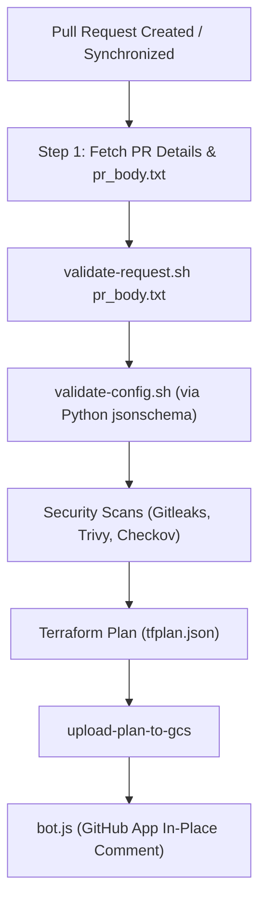
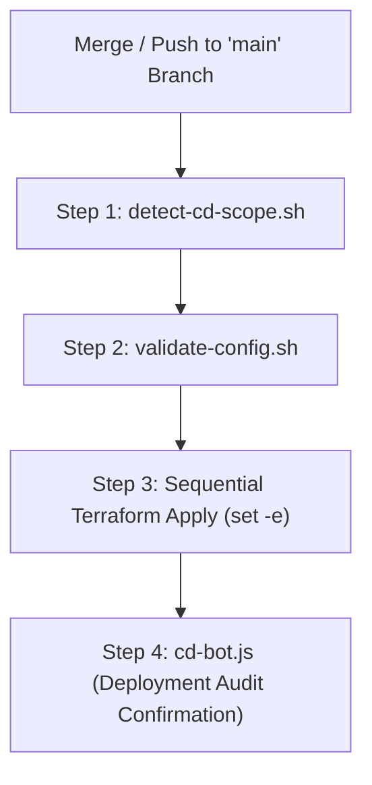

# 🛠️ CI/CD Pipeline Automation Scripts & PR Bots (`cloudbuild-pipelines/scripts/`)

This directory contains the automation scripts, validation utilities, and GitHub App bots powering the **Google Cloud Build CI/CD pipelines** ([`terraform-ci.yaml`](file:///d:/GCP-DevOps-WorkSpace/gcp-platform-foundation-terraform/cloudbuild-pipelines/terraform-ci.yaml) and [`terraform-cd.yaml`](file:///d:/GCP-DevOps-WorkSpace/gcp-platform-foundation-terraform/cloudbuild-pipelines/terraform-cd.yaml)).

---

## 📑 Table of Contents

- [Overview](#overview)
- [Scripts Inventory & Summary](#scripts-inventory--summary)
- [Pipeline Execution Flows](#pipeline-execution-flows)
  - [CI Pipeline Flow](#ci-pipeline-flow)
  - [CD Pipeline Flow](#cd-pipeline-flow)
- [Detailed Script Documentation](#detailed-script-documentation)
  - [1. `validate-request.sh`](#1-validate-requestsh-pr-deployment-request-validator)
  - [2. `detect-cd-scope.sh`](#2-detect-cd-scopesh-cd-scope-detector-from-git--api)
  - [3. `validate-config.sh`](#3-validate-configsh-schema--yaml-validator)
  - [4. `bot.js`](#4-botjs-github-app-ci-plan--security-reporter)
  - [5. `cd-bot.js`](#5-cd-botjs-github-app-cd-deployment-audit-reporter)
  - [6. `post-pr-comment.sh`](#6-post-pr-commentsh-fallback-pat-reporter)
- [Local Development & Testing](#local-development--testing)
- [Prerequisites & Dependencies](#prerequisites--dependencies)

---

## 🏛️ Overview

The automation scripts in this directory decouple Cloud Build step logic from hardcoded paths and repository-specific scripts:
- **Dynamic Scope Detection**: Discovers target environments (`dev`, `qat`, `prod`) and infrastructure layers (`network`, `security`, `compute`, `availability`) from PR descriptions (in CI) or Git merge commits / GitHub API (in CD).
- **Strict Dependency Ordering**: Enforces sequential architectural ordering (`network` ➔ `security` ➔ `compute` ➔ `availability`).
- **Pre-Flight Schema Governance**: Employs Python `jsonschema` to validate all YAML configs against Draft-07 schemas before running Terraform.
- **Actionable GitHub Bot Feedback**: Posts rich, collapsible Markdown tables on GitHub PRs using GitHub App authentication, updating comments in-place on subsequent commits.

---

## 📋 Scripts Inventory & Summary

| Script File | Runtime | Primary Inputs | Outputs / Side Effects | Purpose |
| :--- | :---: | :--- | :--- | :--- |
| **[`validate-request.sh`](file:///d:/GCP-DevOps-WorkSpace/gcp-platform-foundation-terraform/cloudbuild-pipelines/scripts/validate-request.sh)** | Bash 4+ | PR payload file (default: `pr_body.txt`) | `deployment_scope.json` | Pure Bash parser that extracts environment & infrastructure tiers from PR descriptions and outputs CI execution order. |
| **[`detect-cd-scope.sh`](file:///d:/GCP-DevOps-WorkSpace/gcp-platform-foundation-terraform/cloudbuild-pipelines/scripts/detect-cd-scope.sh)** | Bash 4+ | Git history (`HEAD~1` / `HEAD`), GitHub API | `deployment_scope.json` | Detects merged PR number and changed environment YAMLs from Git commits or GitHub App API queries. |
| **[`validate-config.sh`](file:///d:/GCP-DevOps-WorkSpace/gcp-platform-foundation-terraform/cloudbuild-pipelines/scripts/validate-config.sh)** | Python 3 + Bash | Target YAML (`$1`), Optional Schema (`$2`) | Exit code `0` (pass) or `1` (fail) | Validates YAML syntax and schema compliance against `schemas/<layer>.schema.json`. |
| **[`bot.js`](file:///d:/GCP-DevOps-WorkSpace/gcp-platform-foundation-terraform/cloudbuild-pipelines/scripts/bot.js)** | Node.js 18+ | Security reports (`*.txt`), `tfplan.json`, `deployment_scope.json` | GitHub PR Comment (In-Place Update) | Signs GitHub App JWT, parses security scans and Terraform JSON plans, and generates ultra-compact PR comments. |
| **[`cd-bot.js`](file:///d:/GCP-DevOps-WorkSpace/gcp-platform-foundation-terraform/cloudbuild-pipelines/scripts/cd-bot.js)** | Node.js 18+ | `deployment_scope.json`, `outputs.json`, Secret Manager key | GitHub Merged PR Comment | Posts deployment audit confirmation, state paths, and exported Terraform outputs to the merged PR. |
| **[`post-pr-comment.sh`](file:///d:/GCP-DevOps-WorkSpace/gcp-platform-foundation-terraform/cloudbuild-pipelines/scripts/post-pr-comment.sh)** | Bash 4+ | Security reports, `plan_readable.txt`, GitHub PAT | GitHub PR Comment | Standalone fallback for posting PR plan summaries using a Personal Access Token (`GITHUB_TOKEN`). |

---

## 🔄 Pipeline Execution Flows

### CI Pipeline Flow



### CD Pipeline Flow



---

## 🛠️ Detailed Script Documentation

### 1. `validate-request.sh` (PR Deployment Request Validator)
- Reads YAML/JSON deployment request blocks in PR bodies:
  ```json
  ```json
  {
    "deployment_request": {
      "environment": "dev",
      "infrastructure": ["network", "security", "compute", "availability"]
    }
  }
  ```
  ```
- Validates that target folders exist under `environments/<env>/`.
- Sorts layers into dependency order and outputs `deployment_scope.json`.

---

### 2. `detect-cd-scope.sh` (CD Scope Detector)
- Analyzes `git log` and `git diff-tree` on merge commits.
- Uses GitHub App JWT authentication to query the GitHub REST API (`/repos/:owner/:repo/commits/:sha/pulls`) to accurately identify the merged PR number and modified files.

---

### 3. `validate-config.sh` (Schema & YAML Validator)
- Uses Python `jsonschema` to validate environment YAML files against their schemas in `schemas/`.
- Usage:
  ```bash
  ./cloudbuild-pipelines/scripts/validate-config.sh environments/dev/compute.yaml schemas/compute.schema.json
  ```

---

### 4. `bot.js` (GitHub App CI Plan & Security Reporter)
- Authenticates using GitHub App RS256 JWT minted from Secret Manager.
- Parses `gitleaks_report.txt`, `trivy_report.txt`, `checkov_report.txt`, and `tfplan.json`.
- Uses compact Markdown output to fit strictly within GitHub's 65k character limit.
- Looks for existing bot comments matching `<!-- TERRAFORM_CI_COMMENT -->` and updates them in-place.

---

### 5. `cd-bot.js` (GitHub App CD Deployment Audit Reporter)
- Executes post-apply to publish deployment metadata:
  - Applied layer names and target environment.
  - Remote GCS state prefixes.
  - Final Terraform outputs (e.g., Load Balancer IP `8.233.8.109`).

---

## 💻 Local Development & Testing

You can run and test scripts locally before pushing:

```bash
# Test request parsing with a mock payload
./cloudbuild-pipelines/scripts/validate-request.sh pr_body.txt

# Test schema validation
./cloudbuild-pipelines/scripts/validate-config.sh environments/dev/availability.yaml

# Test CD scope detection
./cloudbuild-pipelines/scripts/detect-cd-scope.sh deployment_scope.json
```
