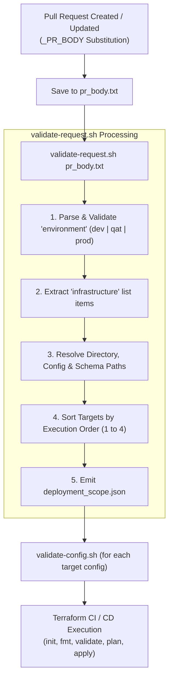

# CI/CD Pipeline Automation Scripts

This directory contains shell utility scripts used by **Google Cloud Build CI/CD pipelines** (`terraform-ci.yaml`, `terraform-cd.yaml`) to parse pull request payloads, determine deployment scopes, validate environment configurations, and orchestrate tiered Terraform executions.

---

## Table of Contents

- [Overview](#overview)
- [Scripts Summary](#scripts-summary)
- [Pipeline Execution Flow](#pipeline-execution-flow)
- [Script Documentation](#script-documentation)
  - [1. `validate-request.sh`](#1-validate-requestsh)
    - [Expected PR Body Format](#expected-pr-body-format)
    - [Infrastructure Mapping Matrix](#infrastructure-mapping-matrix)
    - [Generated Output (`deployment_scope.json`)](#generated-output-deployment_scopejson)
  - [2. `validate-config.sh`](#2-validate-configsh)
- [Local Development & Testing](#local-development--testing)
- [Prerequisites & Dependencies](#prerequisites--dependencies)
- [Extensibility Guide](#extensibility-guide)

---

## Overview

The scripts in this directory decouple the CI/CD pipeline definition from hardcoded repository paths and execution logic. Instead of running Terraform on every directory or requiring separate pipeline definitions for each tier, the pipeline dynamically extracts the requested environment and infrastructure modules from the Pull Request (PR) description, sorts them by dependency order, and drives validation and deployment.

---

## Scripts Summary

| Script Name | Primary Input | Output / Side Effect | Purpose |
| :--- | :--- | :--- | :--- |
| **[`validate-request.sh`](file:///d:/GCP-DevOps-WorkSpace/gcp-platform-foundation-terraform/cloudbuild-pipelines/scripts/validate-request.sh)** | PR Body file (default: `pr_body.txt`) | `deployment_scope.json` | Parses target environment & infrastructure components, validates directories/configs, and outputs sorted execution plan. |
| **[`validate-config.sh`](file:///d:/GCP-DevOps-WorkSpace/gcp-platform-foundation-terraform/cloudbuild-pipelines/scripts/validate-config.sh)** | Target YAML file path | Exit code `0` (Success) or `1` (Failure) | Verifies existence, readability, and non-empty status of environment configuration files. |

---

## Pipeline Execution Flow



---

## Script Documentation

### 1. `validate-request.sh`

**Location**: [`cloudbuild-pipelines/scripts/validate-request.sh`](file:///d:/GCP-DevOps-WorkSpace/gcp-platform-foundation-terraform/cloudbuild-pipelines/scripts/validate-request.sh)  
**Interpreter**: `bash` (runs with `set -euo pipefail`)

#### Purpose
Parses the PR description text (`pr_body.txt`), validates the requested target environment against allowed values (`dev`, `qat`, `prod`), extracts target infrastructure layers, verifies that corresponding project directories and YAML files exist on disk, and emits a structured `deployment_scope.json` file sorted by execution dependency order.

#### Expected PR Body Format

When a pull request is created, the body must include a YAML block specifying the target `environment` and one or more `infrastructure` items:

````markdown
```yaml
environment: dev
infrastructure:
  - network
  - compute
```
````

#### Infrastructure Mapping Matrix

The script maps short component identifiers to directory paths, config paths, JSON schemas, and dependency tiers:

| Component Key | Directory Path (`dir`) | Config Path (`config`) | Schema Path (`schema`) | Order |
| :--- | :--- | :--- | :--- | :---: |
| `network` | `1-network-infrastructure` | `environments/${ENV}/network.yaml` | `schemas/network.schema.json` | **1** |
| `compute` | `2-compute-infrastructure` | `environments/${ENV}/compute.yaml` | `schemas/compute.schema.json` | **2** |
| `security` | `3-security-infrastructure` | `environments/${ENV}/security.yaml` | `schemas/security.schema.json` | **3** |
| `availability` | `4-availability-infrastructure` | `environments/${ENV}/availability.yaml` | `schemas/availability.schema.json` | **4** |

#### Error Conditions
The script will exit with status `1` if:
- The input payload file does not exist.
- The `environment` field is missing or not one of `dev`, `qat`, `prod`.
- No `infrastructure` items are found.
- An unsupported infrastructure component is requested.
- The resolved target directory (e.g., `1-network-infrastructure`) or configuration file (e.g., `environments/dev/network.yaml`) does not exist on disk.

#### Generated Output (`deployment_scope.json`)

```json
{
  "environment": "dev",
  "targets": [
    {
      "name": "network",
      "dir": "1-network-infrastructure",
      "config": "environments/dev/network.yaml",
      "schema": "schemas/network.schema.json",
      "order": 1
    },
    {
      "name": "compute",
      "dir": "2-compute-infrastructure",
      "config": "environments/dev/compute.yaml",
      "schema": "schemas/compute.schema.json",
      "order": 2
    }
  ]
}
```

---

### 2. `validate-config.sh`

**Location**: [`cloudbuild-pipelines/scripts/validate-config.sh`](file:///d:/GCP-DevOps-WorkSpace/gcp-platform-foundation-terraform/cloudbuild-pipelines/scripts/validate-config.sh)  
**Interpreter**: `bash` (runs with `set -euo pipefail`)

#### Purpose
Performs an integrity check on target YAML configuration files before invoking Terraform operations.

#### Arguments
- `$1` (*Required*): Path to the YAML configuration file to validate (e.g. `environments/dev/network.yaml`).

#### Validation Checks
1. **Existence**: Ensures the parameter is non-empty and the file exists (`-f "$CONFIG_FILE"`).
2. **File Size**: Ensures the file is not empty / 0-byte (`-s "$CONFIG_FILE"`).

#### Return Values
- `0`: Validation successful (`✅ Validated configuration file: <path>`).
- `1`: File not found or empty (`❌ Error: ...`).

---

## Local Development & Testing

You can execute and test these scripts locally in Git Bash, WSL, Linux, or macOS.

### 1. Test PR Request Validation

Create a test payload file:
```bash
cat << 'EOF' > test_pr_body.txt
```yaml
environment: dev
infrastructure:
  - network
```
EOF
```

Run the validator:
```bash
chmod +x cloudbuild-pipelines/scripts/*.sh
./cloudbuild-pipelines/scripts/validate-request.sh test_pr_body.txt
```

Verify output:
```bash
cat deployment_scope.json
```

### 2. Test Configuration File Validation

```bash
./cloudbuild-pipelines/scripts/validate-config.sh environments/dev/network.yaml
```

---

## Prerequisites & Dependencies

The scripts rely on standard POSIX utilities and lightweight CLI tools:
- **Bash** (`bash` 4.0+)
- **jq** (`jq` 1.6+) for JSON creation, appending, and sorting.
- **Core Utilities**: `grep`, `awk`, `tr`, `cat`, `cut`.

In Cloud Build containers, `jq` is installed dynamically during step execution (`apt-get install -y jq` or `apk add --no-cache jq`).

---

## Extensibility Guide

To add a new platform tier (e.g. `5-database-infrastructure`):

1. Open [`validate-request.sh`](file:///d:/GCP-DevOps-WorkSpace/gcp-platform-foundation-terraform/cloudbuild-pipelines/scripts/validate-request.sh).
2. Add a new case branch under the `for infra in "${INFRAS[@]}"; do` loop:
   ```bash
   database)
     DIR="5-database-infrastructure"
     CONFIG_FILE="environments/${ENV}/database.yaml"
     SCHEMA_FILE="schemas/database.schema.json"
     ORDER=5
     ;;
   ```
3. Ensure the corresponding directory and `environments/${ENV}/database.yaml` files exist.

