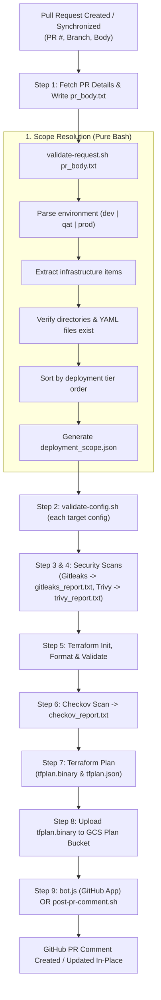

# CI/CD Pipeline Automation Scripts & PR Bot

This directory contains utility scripts and bot automation used by **Google Cloud Build CI/CD pipelines** ([`terraform-ci.yaml`](file:///d:/GCP-DevOps-WorkSpace/gcp-platform-foundation-terraform/cloudbuild-pipelines/terraform-ci.yaml)) to parse pull request payloads, determine deployment scopes, validate environment configurations, and publish rich, dynamic Terraform execution & security compliance reports back to GitHub Pull Requests.

---

## Table of Contents

- [Overview](#overview)
- [Scripts Summary](#scripts-summary)
- [Pipeline Execution Flow](#pipeline-execution-flow)
- [Script & Bot Documentation](#script--bot-documentation)
  - [1. `validate-request.sh` (PR Deployment Request Validator)](#1-validate-requestsh-pr-deployment-request-validator)
    - [Expected PR Body Format](#expected-pr-body-format)
    - [Infrastructure Mapping Matrix](#infrastructure-mapping-matrix)
    - [Generated Output (`deployment_scope.json`)](#generated-output-deployment_scopejson)
  - [2. `validate-config.sh` (Config Integrity Validator)](#2-validate-configsh-config-integrity-validator)
  - [3. `bot.js` (GitHub App Dynamic PR Reporter)](#3-botjs-github-app-dynamic-pr-reporter)
    - [Authentication & JWT Generation](#authentication--jwt-generation)
    - [Dynamic Parsers (Zero Hardcoded Data)](#dynamic-parsers-zero-hardcoded-data)
    - [Environment Variables & Secret Manager Setup](#environment-variables--secret-manager-setup)
  - [4. `post-pr-comment.sh` (Bash / PAT-based PR Reporter)](#4-post-pr-commentsh-bash--pat-based-pr-reporter)
- [Local Development & Testing](#local-development--testing)
- [Prerequisites & Dependencies](#prerequisites--dependencies)
- [Extensibility Guide](#extensibility-guide)

---

## Overview

The scripts in this directory decouple CI/CD pipeline definitions from hardcoded repository paths and execution logic:
- **Dynamic Scope Detection**: Automatically determines which environment (`dev`, `qat`, `prod`) and infrastructure tiers (`network`, `compute`, `security`, `availability`) to plan/apply based on PR body declarations.
- **Ordered Dependency Orchestration**: Arranges platform tiers in strict deployment order (e.g. Network Tier 1 before Compute Tier 2).
- **Comprehensive Security Reporting**: Aggregates output from three distinct security scanners (**Gitleaks**, **Trivy**, and **Checkov**).
- **Actionable PR Feedback**: Publishes detailed, collapsible Markdown tables on GitHub PRs using GitHub App authentication (or PAT tokens), updating previous comments in-place on subsequent commits to prevent PR comment clutter.

---

## Scripts Summary

| File | Runtime | Primary Inputs | Outputs / Side Effects | Purpose |
| :--- | :---: | :--- | :--- | :--- |
| **[`validate-request.sh`](file:///d:/GCP-DevOps-WorkSpace/gcp-platform-foundation-terraform/cloudbuild-pipelines/scripts/validate-request.sh)** | Bash 4+ | PR payload file (default: `pr_body.txt`) | `deployment_scope.json` | Pure Bash parser that extracts environment & infrastructure tiers, validates directory & file existence, and outputs execution order. |
| **[`validate-config.sh`](file:///d:/GCP-DevOps-WorkSpace/gcp-platform-foundation-terraform/cloudbuild-pipelines/scripts/validate-config.sh)** | Bash 4+ | Target YAML path (`$1`) | Exit code `0` or `1` | Validates file existence and verifies that configuration YAML files are not empty (0-byte). |
| **[`bot.js`](file:///d:/GCP-DevOps-WorkSpace/gcp-platform-foundation-terraform/cloudbuild-pipelines/scripts/bot.js)** | Node.js 18+ | Security reports (`*.txt`), `tfplan.json`, `deployment_scope.json` | GitHub PR Comment (Create/Update via GitHub App) | Dynamically parses scan results and Terraform JSON plans, signs GitHub App JWT, and creates or updates rich formatted PR comments. |
| **[`post-pr-comment.sh`](file:///d:/GCP-DevOps-WorkSpace/gcp-platform-foundation-terraform/cloudbuild-pipelines/scripts/post-pr-comment.sh)** | Bash 4+ | Security reports, `plan_readable.txt`, GitHub PAT | GitHub PR Comment (Create/Update via Token) | Standalone Bash alternative to `bot.js` for posting PR plan summaries using a Personal Access Token (`GITHUB_TOKEN`). |

---

## Pipeline Execution Flow



---

## Script & Bot Documentation

### 1. `validate-request.sh` (PR Deployment Request Validator)

**Location**: [`cloudbuild-pipelines/scripts/validate-request.sh`](file:///d:/GCP-DevOps-WorkSpace/gcp-platform-foundation-terraform/cloudbuild-pipelines/scripts/validate-request.sh)  
**Interpreter**: `bash` (runs with `set -euo pipefail`)  
**Design**: **Pure Bash implementation** — requires zero external JSON tooling (`jq`) inside the base container.

#### Purpose
Parses the PR description text, validates the requested target environment against allowed values (`dev`, `qat`, `prod`), extracts target infrastructure layers, verifies that corresponding project directories and YAML files exist on disk, and emits a structured `deployment_scope.json` file sorted by execution dependency order.

#### Expected PR Body Format

When a pull request is created, the body must include a YAML block specifying the target `environment` and one or more `infrastructure` items:

````markdown
```yaml
environment: dev
infrastructure:
  - network
  - compute
```
````

#### Infrastructure Mapping Matrix

The script maps short component identifiers to directory paths, config paths, JSON schemas, and dependency tiers:

| Component Key | Directory Path (`dir`) | Config Path (`config`) | Schema Path (`schema`) | Order |
| :--- | :--- | :--- | :--- | :---: |
| `network` | `1-network-infrastructure` | `environments/${ENV}/network.yaml` | `schemas/network.schema.json` | **1** |
| `compute` | `2-compute-infrastructure` | `environments/${ENV}/compute.yaml` | `schemas/compute.schema.json` | **2** |
| `security` | `3-security-infrastructure` | `environments/${ENV}/security.yaml` | `schemas/security.schema.json` | **3** |
| `availability` | `4-availability-infrastructure` | `environments/${ENV}/availability.yaml` | `schemas/availability.schema.json` | **4** |

#### Error Handling & Validation Rules
- **Missing Payload**: Exits with code `1` if the payload file does not exist.
- **Environment Check**: Exits with code `1` if `environment:` is missing or not one of `dev`, `qat`, `prod`.
- **Empty Scope**: Exits with code `1` if no `- <item>` items are defined under `infrastructure:`.
- **Path Verification**: Checks `[ -d "$DIR" ]` and `[ -f "$CONFIG_FILE" ]` before adding to the execution list.

#### Generated Output (`deployment_scope.json`)

```json
{
  "environment": "dev",
  "targets": [
    {
      "name": "network",
      "dir": "1-network-infrastructure",
      "config": "environments/dev/network.yaml",
      "schema": "schemas/network.schema.json",
      "order": 1
    }
  ]
}
```

---

### 2. `validate-config.sh` (Config Integrity Validator)

**Location**: [`cloudbuild-pipelines/scripts/validate-config.sh`](file:///d:/GCP-DevOps-WorkSpace/gcp-platform-foundation-terraform/cloudbuild-pipelines/scripts/validate-config.sh)  
**Interpreter**: `bash` (runs with `set -euo pipefail`)

#### Purpose
Performs a fast integrity check on target YAML configuration files before initializing Terraform.

#### Arguments
- `$1` (*Required*): Path to the YAML configuration file to validate (e.g. `environments/dev/network.yaml`).

#### Checks Performed
1. **File Existence**: Verifies `$CONFIG_FILE` is non-empty and exists (`-f "$CONFIG_FILE"`).
2. **File Size**: Verifies file size is greater than 0 bytes (`-s "$CONFIG_FILE"`).

---

### 3. `bot.js` (GitHub App Dynamic PR Reporter)

**Location**: [`cloudbuild-pipelines/scripts/bot.js`](file:///d:/GCP-DevOps-WorkSpace/gcp-platform-foundation-terraform/cloudbuild-pipelines/scripts/bot.js)  
**Runtime**: Node.js 18+ (used in `node:20-alpine` container)

#### Purpose
A GitHub App automation bot that parses raw scanner output and structured Terraform plan JSON to generate a production-grade, human-readable PR review comment with zero hardcoded/mock data.

#### Key Features

1. **GitHub App Authentication (JWT & Installation Token)**:
   - Uses built-in `crypto` to sign an RS256 JWT using `GITHUB_APP_PRIVATE_KEY` and `GITHUB_APP_ID`.
   - Obtains the repository installation ID via `GET /repos/{owner}/{repo}/installation`.
   - Generates an ephemeral installation token via `POST /app/installations/{id}/access_tokens`.
2. **In-Place Comment Updating**:
   - Searches for an existing comment containing `Terraform Plan & Compliance Audit Report`.
   - If found, updates it (`PATCH /repos/.../issues/comments/{comment_id}`) to keep PR comment threads clean.
   - If not found, posts a new comment (`POST /repos/.../issues/{pr_number}/comments`).
3. **Structured Terraform Plan Parsing (`tfplan.json`)**:
   - Reads `tfplan.json` produced by `terraform show -json tfplan.binary`.
   - Categorizes resource actions into:
     - <kbd>➕ CREATE</kbd>
     - <kbd>🔄 UPDATE</kbd>
     - <kbd>🗑️ DESTROY</kbd>
     - <kbd>⚠️ RECREATE</kbd>
   - Extracts network attributes: CIDR ranges (`ip_cidr_range`), Region, Private Google Access (`private_ip_google_access`), Routing mode, BGP ASN, Firewall allowed protocols/ports, and Source CIDRs.
   - Summarizes planned output value changes.
4. **Dynamic Security Parsers**:
   - **Gitleaks (`gitleaks_report.txt`)**: Strips ANSI color codes, identifies whether leaks were detected or 0 leaks were found, and extracts commit scan summaries.
   - **Trivy (`trivy_report.txt`)**: Parses critical and high severity vulnerability counts and extracts the report summary block.
   - **Checkov (`checkov_report.txt`)**: Dynamically parses individual CIS benchmark checks (`CKV_*`), splitting into passed checks and failed checks with specific remediation recommendations (e.g., pinning module versions for `CKV_TF_1`).

#### Environment Variables Required

| Variable | Source | Description |
| :--- | :--- | :--- |
| `GITHUB_APP_ID` | Cloud Build Substitution (`_GITHUB_APP_ID`) | The App ID of your registered GitHub App. |
| `GITHUB_APP_PRIVATE_KEY` | Secret Manager (`github-app-private-key`) | RSA private key PEM file for GitHub App authentication. |
| `PR_NUMBER` | Cloud Build Substitution (`_PR_NUMBER`) | Target Pull Request number. |
| `REPO_OWNER` | Cloud Build Substitution (`_REPO_OWNER`) | GitHub organization or username (e.g. `yuva-cloud-devops`). |
| `REPO_NAME` | Cloud Build Substitution (`_REPO_NAME`) | Repository name (e.g. `gcp-platform-foundation-terraform`). |
| `SHORT_SHA` | Cloud Build Built-in (`$SHORT_SHA`) | Short commit SHA being reviewed. |
| `DEPLOYMENT_SCOPE` | File path | Path to `deployment_scope.json` (defaults to `deployment_scope.json`). |

---

### 4. `post-pr-comment.sh` (Bash / PAT-based PR Reporter)

**Location**: [`cloudbuild-pipelines/scripts/post-pr-comment.sh`](file:///d:/GCP-DevOps-WorkSpace/gcp-platform-foundation-terraform/cloudbuild-pipelines/scripts/post-pr-comment.sh)  
**Interpreter**: `bash` (runs with `set -euo pipefail`)

#### Purpose
A pure Bash/cURL alternative to `bot.js` that uses a personal access token (`GITHUB_TOKEN` / `GITHUB_PAT`) or default GitHub Actions token.

#### Features
- Parses `gitleaks_report.txt`, `trivy_report.txt`, and `checkov_report.txt` using grep/sed.
- Extracts plan summary lines and resource operation lists from `plan_readable.txt`.
- Embeds up to 250 lines of formatted Terraform execution plan in a `<details>` collapsible accordion.
- Queries GitHub API to find existing comments and performs `PATCH` or `POST` accordingly.

#### Usage / Parameters
```bash
./cloudbuild-pipelines/scripts/post-pr-comment.sh \
  "<PR_NUMBER>" \
  "<REPO_OWNER>" \
  "<REPO_NAME>" \
  "<GITHUB_TOKEN>" \
  "deployment_scope.json"
```

---

## Local Development & Testing

You can test these scripts locally in Git Bash, WSL, Linux, or macOS.

### 1. Test PR Request Validation (Pure Bash)

Create a sample PR payload:
```bash
cat << 'EOF' > test_pr_body.txt
```yaml
environment: dev
infrastructure:
  - network
```
EOF
```

Run the validator:
```bash
chmod +x cloudbuild-pipelines/scripts/*.sh
./cloudbuild-pipelines/scripts/validate-request.sh test_pr_body.txt
```

Verify output:
```bash
cat deployment_scope.json
```

### 2. Test Configuration Validation

```bash
./cloudbuild-pipelines/scripts/validate-config.sh environments/dev/network.yaml
```

### 3. Test `bot.js` Locally (Requires GitHub App Credentials)

Set up temporary environment variables and execute:
```bash
export GITHUB_APP_ID="<YOUR_APP_ID>"
export GITHUB_APP_PRIVATE_KEY="$(cat path/to/private-key.pem)"
export PR_NUMBER="1"
export REPO_OWNER="yuva-cloud-devops"
export REPO_NAME="gcp-platform-foundation-terraform"
export SHORT_SHA="test1234"

node cloudbuild-pipelines/scripts/bot.js
```

---

## Prerequisites & Dependencies

### For Shell Scripts (`validate-request.sh`, `validate-config.sh`, `post-pr-comment.sh`):
- **Bash 4.0+**
- **Core Utilities**: `grep`, `awk`, `sed`, `tr`, `cat`, `cut`
- **cURL & jq**: Required only for `post-pr-comment.sh`

### For PR Bot (`bot.js`):
- **Node.js 18+** (utilizes native `fetch` and `crypto`)
- No external `npm install` packages needed (zero dependencies)

---

## Extensibility Guide

### Adding a New Infrastructure Tier (e.g. `5-database-infrastructure`):

1. Open [`validate-request.sh`](file:///d:/GCP-DevOps-WorkSpace/gcp-platform-foundation-terraform/cloudbuild-pipelines/scripts/validate-request.sh).
2. Add a new case branch under `for infra in "${INFRAS[@]}"; do`:
   ```bash
   database)
     DIR="5-database-infrastructure"
     CONFIG_FILE="environments/${ENV}/database.yaml"
     SCHEMA_FILE="schemas/database.schema.json"
     ORDER=5
     ;;
   ```
3. Ensure the corresponding directory and `environments/${ENV}/database.yaml` exist.
4. [`bot.js`](file:///d:/GCP-DevOps-WorkSpace/gcp-platform-foundation-terraform/cloudbuild-pipelines/scripts/bot.js) will automatically iterate through all targets in `deployment_scope.json` and parse their plans without any code modifications.
