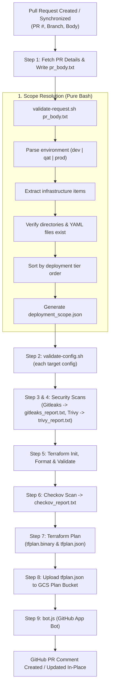
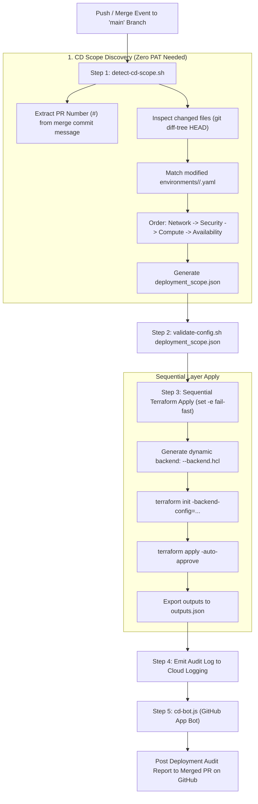

# CI/CD Pipeline Automation Scripts & PR Bots

This directory contains the utility scripts and bot automation used by **Google Cloud Build CI/CD pipelines** ([`terraform-ci.yaml`](file:///d:/GCP-DevOps-WorkSpace/gcp-platform-foundation-terraform/cloudbuild-pipelines/terraform-ci.yaml) and [`terraform-cd.yaml`](file:///d:/GCP-DevOps-WorkSpace/gcp-platform-foundation-terraform/cloudbuild-pipelines/terraform-cd.yaml)) to parse pull request payloads, detect CD deployment scopes, validate configurations, and publish rich, dynamic Terraform execution & audit reports back to GitHub.

---

## Table of Contents

- [Overview](#overview)
- [Scripts Summary](#scripts-summary)
- [Pipeline Execution Flows](#pipeline-execution-flows)
  - [CI Pipeline Flow](#ci-pipeline-flow)
  - [CD Pipeline Flow](#cd-pipeline-flow)
- [Script & Bot Documentation](#script--bot-documentation)
  - [1. `validate-request.sh` (PR Deployment Request Validator)](#1-validate-requestsh-pr-deployment-request-validator)
  - [2. `detect-cd-scope.sh` (CD Scope Detector from Git)](#2-detect-cd-scopesh-cd-scope-detector-from-git)
  - [3. `validate-config.sh` (Config Integrity Validator)](#3-validate-configsh-config-integrity-validator)
  - [4. `bot.js` (GitHub App CI Plan & Security Reporter)](#4-botjs-github-app-ci-plan--security-reporter)
  - [5. `cd-bot.js` (GitHub App CD Deployment Audit Reporter)](#5-cd-botjs-github-app-cd-deployment-audit-reporter)
  - [6. `post-pr-comment.sh` (Bash / PAT Fallback Reporter)](#6-post-pr-commentsh-bash--pat-fallback-reporter)
- [Local Development & Testing](#local-development--testing)
- [Prerequisites & Dependencies](#prerequisites--dependencies)
- [Extensibility Guide](#extensibility-guide)

---

## Overview

The scripts in this directory decouple CI/CD pipeline definitions from hardcoded repository paths and execution logic:
- **Dynamic Scope Detection**: Determines target environments (`dev`, `qat`, `prod`) and infrastructure tiers (`network`, `compute`, `security`, `availability`) from PR descriptions (in CI) or Git merge commits (in CD).
- **Strict Architectural Hierarchy**: Enforces platform dependency ordering (`network` ➔ `security` ➔ `compute` ➔ `availability`).
- **Comprehensive Security Governance**: Aggregates output from three distinct security scanners (**Gitleaks**, **Trivy**, and **Checkov**).
- **Actionable GitHub Feedback**: Publishes detailed, collapsible Markdown tables on GitHub PRs using GitHub App authentication, updating previous comments in-place on subsequent commits.

---

## Scripts Summary

| File | Runtime | Primary Inputs | Outputs / Side Effects | Purpose |
| :--- | :---: | :--- | :--- | :--- |
| **[`validate-request.sh`](file:///d:/GCP-DevOps-WorkSpace/gcp-platform-foundation-terraform/cloudbuild-pipelines/scripts/validate-request.sh)** | Bash 4+ | PR payload file (default: `pr_body.txt`) | `deployment_scope.json` | Pure Bash parser that extracts environment & infrastructure tiers from PR descriptions, verifies paths, and outputs CI execution order. |
| **[`detect-cd-scope.sh`](file:///d:/GCP-DevOps-WorkSpace/gcp-platform-foundation-terraform/cloudbuild-pipelines/scripts/detect-cd-scope.sh)** | Bash 4+ | Git history (`HEAD~1` / `HEAD`), `$1` output file | `deployment_scope.json` | Pure Bash detector that identifies merged PR number and changed environment YAMLs from Git commits (zero GitHub PAT needed). |
| **[`validate-config.sh`](file:///d:/GCP-DevOps-WorkSpace/gcp-platform-foundation-terraform/cloudbuild-pipelines/scripts/validate-config.sh)** | Bash 4+ | Target YAML / JSON path (`$1`) | Exit code `0` or `1` | Validates file existence and verifies that configuration files are not empty (0-byte). |
| **[`bot.js`](file:///d:/GCP-DevOps-WorkSpace/gcp-platform-foundation-terraform/cloudbuild-pipelines/scripts/bot.js)** | Node.js 18+ | Security reports (`*.txt`), `tfplan.json`, `deployment_scope.json` | GitHub PR Comment (Create/Update via GitHub App) | Dynamically parses security scans and Terraform JSON plans, signs GitHub App JWT, and creates/updates rich formatted PR comments. |
| **[`cd-bot.js`](file:///d:/GCP-DevOps-WorkSpace/gcp-platform-foundation-terraform/cloudbuild-pipelines/scripts/cd-bot.js)** | Node.js 18+ | `deployment_scope.json`, `outputs.json`, Secret Manager key | GitHub Merged PR Comment (via GitHub App) | Posts deployment audit confirmation, state paths, and exported Terraform outputs to the merged PR. |
| **[`post-pr-comment.sh`](file:///d:/GCP-DevOps-WorkSpace/gcp-platform-foundation-terraform/cloudbuild-pipelines/scripts/post-pr-comment.sh)** | Bash 4+ | Security reports, `plan_readable.txt`, GitHub PAT | GitHub PR Comment (Create/Update via Token) | Standalone Bash/cURL fallback for posting PR plan summaries using a Personal Access Token (`GITHUB_TOKEN`). |

---

## Pipeline Execution Flows

### CI Pipeline Flow



---

### CD Pipeline Flow



---

## Script & Bot Documentation

### 1. `validate-request.sh` (PR Deployment Request Validator)

**Location**: [`cloudbuild-pipelines/scripts/validate-request.sh`](file:///d:/GCP-DevOps-WorkSpace/gcp-platform-foundation-terraform/cloudbuild-pipelines/scripts/validate-request.sh)  
**Interpreter**: `bash` (runs with `set -euo pipefail`)  
**Design**: **Pure Bash implementation** — requires zero external JSON tooling (`jq`) inside the base container.

#### Purpose
Parses the PR description text, validates the requested target environment against allowed values (`dev`, `qat`, `prod`), extracts target infrastructure layers, verifies that corresponding project directories and YAML files exist on disk, and emits a structured `deployment_scope.json` file sorted by execution dependency order.

#### Expected PR Body Format

```yaml
deployment_request:
  environment: dev
  infrastructure:
    - network
    - security
```

#### Infrastructure Mapping Matrix

| Component Key | Directory Path (`dir`) | Config Path (`config`) | Schema Path (`schema`) | Order |
| :--- | :--- | :--- | :--- | :---: |
| `network` | `1-network-infrastructure` | `environments/${ENV}/network.yaml` | `schemas/network.schema.json` | **1** |
| `compute` | `3-compute-infrastructure` | `environments/${ENV}/compute.yaml` | `schemas/compute.schema.json` | **2** |
| `security` | `2-security-infrastructure` | `environments/${ENV}/security.yaml` | `schemas/security.schema.json` | **3** |
| `availability` | `4-availability-infrastructure` | `environments/${ENV}/availability.yaml` | `schemas/availability.schema.json` | **4** |

---

### 2. `detect-cd-scope.sh` (CD Scope Detector from Git)

**Location**: [`cloudbuild-pipelines/scripts/detect-cd-scope.sh`](file:///d:/GCP-DevOps-WorkSpace/gcp-platform-foundation-terraform/cloudbuild-pipelines/scripts/detect-cd-scope.sh)  
**Interpreter**: `bash` (runs with `set -euo pipefail`)

#### Purpose
Detects the merged PR number and affected infrastructure layers from Git history during CD execution on `main`. Requires **zero GitHub API tokens or PATs**.

#### How It Works
1. **PR Number Extraction**: Reads the latest commit message via `git log -1 --pretty=%B` and extracts the PR reference (e.g. `Merge pull request #4 from ...` ➔ `#4`).
2. **Changed Configuration Detection**: Uses `git diff-tree --no-commit-id --name-only -r HEAD` to find all modified files matching `environments/<env>/<infra>.yaml`.
3. **Hierarchy Enforcement**: Filters and sorts detected components according to the architectural deployment hierarchy: `network` ➔ `security` ➔ `compute` ➔ `availability`.
4. **Scope Generation**: Emits `deployment_scope.json` with `action: "apply"`.

---

### 3. `validate-config.sh` (Config Integrity Validator)

**Location**: [`cloudbuild-pipelines/scripts/validate-config.sh`](file:///d:/GCP-DevOps-WorkSpace/gcp-platform-foundation-terraform/cloudbuild-pipelines/scripts/validate-config.sh)  
**Interpreter**: `bash` (runs with `set -euo pipefail`)

#### Purpose
Performs a fast integrity check on target YAML or JSON configuration files before initializing Terraform.

#### Checks Performed
1. **File Existence**: Verifies `$CONFIG_FILE` is non-empty and exists (`-f "$CONFIG_FILE"`).
2. **File Size**: Verifies file size is greater than 0 bytes (`-s "$CONFIG_FILE"`).

---

### 4. `bot.js` (GitHub App CI Plan & Security Reporter)

**Location**: [`cloudbuild-pipelines/scripts/bot.js`](file:///d:/GCP-DevOps-WorkSpace/gcp-platform-foundation-terraform/cloudbuild-pipelines/scripts/bot.js)  
**Runtime**: Node.js 18+ (used in `node:20-alpine` container)

#### Key Features
1. **GitHub App Authentication (JWT & Installation Token)**: Signs an RS256 JWT using `GITHUB_APP_PRIVATE_KEY` and `GITHUB_APP_ID`, then acquires an ephemeral installation access token.
2. **In-Place Comment Updating**: Searches for existing bot comments matching `Terraform Plan & Compliance Audit Report` and performs a `PATCH` update to eliminate comment spam on subsequent commits.
3. **Structured Terraform JSON Plan Parsing (`tfplan.json`)**: Parses resource changes into <kbd>➕ CREATE</kbd>, <kbd>🔄 UPDATE</kbd>, <kbd>🗑️ DESTROY</kbd>, and <kbd>⚠️ RECREATE</kbd> tables, extracting CIDR ranges, regions, PGA, BGP ASN, and firewall rules.
4. **Dynamic Security Parsers**: Extracts detailed summaries from `gitleaks_report.txt`, `trivy_report.txt`, and individual CIS checks from `checkov_report.txt` (with remediation advice).

---

### 5. `cd-bot.js` (GitHub App CD Deployment Audit Reporter)

**Location**: [`cloudbuild-pipelines/scripts/cd-bot.js`](file:///d:/GCP-DevOps-WorkSpace/gcp-platform-foundation-terraform/cloudbuild-pipelines/scripts/cd-bot.js)  
**Runtime**: Node.js 18+ (used in `node:20-alpine` container)

#### Purpose
Posts a deployment audit confirmation back to the merged PR after `terraform-cd.yaml` successfully applies changes to Google Cloud.

#### Features
- Authenticates securely via GitHub App JWT.
- Reports deployment status: 🟢 **DEPLOYMENT SUCCESSFUL**.
- Displays GCS remote state paths (`gs://<bucket>/<env>/<layer>/default.tfstate`).
- Embeds Terraform outputs (e.g. VPC IDs, Subnet CIDRs, Router IPs) in collapsible `<details>` blocks.
- Records provenance metadata: Merged PR number, Commit SHA, Cloud Build ID, and Timestamp.

---

### 6. `post-pr-comment.sh` (Bash / PAT Fallback Reporter)

**Location**: [`cloudbuild-pipelines/scripts/post-pr-comment.sh`](file:///d:/GCP-DevOps-WorkSpace/gcp-platform-foundation-terraform/cloudbuild-pipelines/scripts/post-pr-comment.sh)  
**Interpreter**: `bash` (runs with `set -euo pipefail`)

#### Purpose
A standalone Bash/cURL alternative to `bot.js` for posting PR plan summaries when using a GitHub Personal Access Token (`GITHUB_TOKEN` / `GITHUB_PAT`) instead of a GitHub App.

---

## Local Development & Testing

You can test these scripts locally in Git Bash, WSL, Linux, or macOS.

### 1. Test PR Request Validation (Pure Bash)

```bash
cat << 'EOF' > test_pr_body.txt
deployment_request:
  environment: dev
  infrastructure:
    - network
EOF

chmod +x cloudbuild-pipelines/scripts/*.sh
./cloudbuild-pipelines/scripts/validate-request.sh test_pr_body.txt
cat deployment_scope.json
```

### 2. Test CD Scope Detection from Git

```bash
./cloudbuild-pipelines/scripts/detect-cd-scope.sh "deployment_scope.json" "yuva-cloud-devops" "gcp-platform-foundation-terraform"
cat deployment_scope.json
```

### 3. Test Configuration Validation

```bash
./cloudbuild-pipelines/scripts/validate-config.sh environments/dev/network.yaml
```

### 4. Test `bot.js` Locally (Requires GitHub App Credentials)

```bash
export GITHUB_APP_ID="<YOUR_APP_ID>"
export GITHUB_APP_PRIVATE_KEY="$(cat path/to/private-key.pem)"
export PR_NUMBER="1"
export REPO_OWNER="yuva-cloud-devops"
export REPO_NAME="gcp-platform-foundation-terraform"
export SHORT_SHA="test1234"

node cloudbuild-pipelines/scripts/bot.js
```

---

## Prerequisites & Dependencies

### For Shell Scripts (`validate-request.sh`, `detect-cd-scope.sh`, `validate-config.sh`, `post-pr-comment.sh`):
- **Bash 4.0+**
- **Git** (`git diff-tree`, `git log`)
- **Core Utilities**: `grep`, `awk`, `sed`, `tr`, `cat`, `cut`
- **cURL & jq**: Used in `detect-cd-scope.sh` and `post-pr-comment.sh`

### For PR Bots (`bot.js`, `cd-bot.js`):
- **Node.js 18+** (utilizes native `fetch` and `crypto` — zero external npm packages required)

---

## Extensibility Guide

### Adding a New Infrastructure Tier (e.g. `5-database-infrastructure`):

1. **Update [`validate-request.sh`](file:///d:/GCP-DevOps-WorkSpace/gcp-platform-foundation-terraform/cloudbuild-pipelines/scripts/validate-request.sh)**:
   ```bash
   database)
     DIR="5-database-infrastructure"
     CONFIG_FILE="environments/${ENV}/database.yaml"
     SCHEMA_FILE="schemas/database.schema.json"
     ORDER=5
     ;;
   ```

2. **Update [`detect-cd-scope.sh`](file:///d:/GCP-DevOps-WorkSpace/gcp-platform-foundation-terraform/cloudbuild-pipelines/scripts/detect-cd-scope.sh)**:
   ```bash
   ORDERED_HIERARCHY=("network" "security" "compute" "availability" "database")
   # ...
   database) DIR="5-database-infrastructure" ;;
   ```

3. Ensure the corresponding directory and `environments/${ENV}/database.yaml` exist. Both CI and CD pipelines and bots will dynamically handle the new tier without further code changes.
