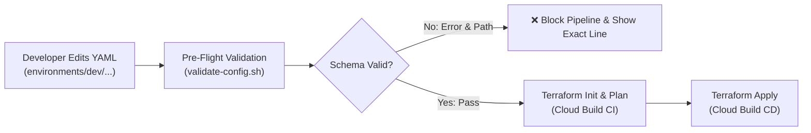

# 📋 Schema Governance & Validation (`schemas/`)

This directory contains the **JSON Schema (Draft-07) specifications** that define and enforce the configuration contracts for all YAML files across the platform.

By incorporating pre-flight schema validation into the GitOps pipeline, misconfigurations, missing keys, invalid types, and typographical errors are caught **before** Terraform executes any API calls or remote state locks.

---

## 🗂️ Schema Inventory

| Schema File | Target YAML File | Description & Scope |
| :--- | :--- | :--- |
| [`bootstrap.schema.json`](file:///d:/GCP-DevOps-WorkSpace/gcp-platform-foundation-terraform/schemas/bootstrap.schema.json) | `environments/bootstrap.yaml` | Validates Project ID, baseline APIs, GCS state/plan buckets, and Cloud Build SA roles. |
| [`network.schema.json`](file:///d:/GCP-DevOps-WorkSpace/gcp-platform-foundation-terraform/schemas/network.schema.json) | `environments/<env>/network.yaml` | Validates VPC definitions, CIDR subnet masks, Cloud Routers, NAT configs, and firewall rules. |
| [`security.schema.json`](file:///d:/GCP-DevOps-WorkSpace/gcp-platform-foundation-terraform/schemas/security.schema.json) | `environments/<env>/security.yaml` | Validates Cloud Armor WAF rules, priorities, IAM service accounts, and role assignments. |
| [`compute.schema.json`](file:///d:/GCP-DevOps-WorkSpace/gcp-platform-foundation-terraform/schemas/compute.schema.json) | `environments/<env>/compute.yaml` | Validates Instance Templates, OS images, startup scripts, and regional Autoscaled MIGs. |
| [`availability.schema.json`](file:///d:/GCP-DevOps-WorkSpace/gcp-platform-foundation-terraform/schemas/availability.schema.json) | `environments/<env>/availability.yaml` | Validates Global External ALB, HTTP/S proxy options, backend services, health checks, and locality policies. |
| [`deployment-request.schema.json`](file:///d:/GCP-DevOps-WorkSpace/gcp-platform-foundation-terraform/schemas/deployment-request.schema.json) | CI/CD Deployment Payloads | Validates automated PR and manual deployment triggers and layer selection. |

---

## ⚙️ How Schema Validation Works



The validation engine uses Python's `jsonschema` library via `cloudbuild-pipelines/scripts/validate-config.sh`.

```python
# Validation Execution Logic (Simplified)
from jsonschema import validate, ValidationError
import yaml, json

config_data = yaml.safe_load(open("environments/dev/network.yaml"))
schema_data = json.load(open("schemas/network.schema.json"))

validate(instance=config_data, schema=schema_data)
```

---

## 🛡️ Key Validation Capabilities

### 1. Type & Range Enforcement
- Ensures integer fields like ports, health check intervals, and timeouts are positive numbers within sensible operational bounds:
  ```json
  "timeout_sec": {
    "type": "integer",
    "minimum": 1,
    "maximum": 300,
    "description": "Request timeout in seconds"
  }
  ```

### 2. Enum & Strict Choices
- Restricts load balancer schemes, locality policies, and balancing modes to valid Google Cloud values:
  ```json
  "locality_lb_policy": {
    "type": "string",
    "enum": ["ROUND_ROBIN", "LEAST_REQUEST", "RING_HASH", "RANDOM", "ORIGINAL_DESTINATION"]
  }
  ```

### 3. Regex Pattern Matching
- Validates CIDR notations, Git commit SHAs, and naming conventions:
  ```json
  "ip_cidr_range": {
    "type": "string",
    "pattern": "^([0-9]{1,3}\\.){3}[0-9]{1,3}/[0-9]{1,2}$"
  }
  ```

### 4. Required Field Integrity
- Enforces mandatory architectural blocks (e.g., preventing a load balancer without a health check or a backend definition).

---

## 🚀 Running Validations

### Validate a Single Config File:
```bash
# Explicit schema file path
./cloudbuild-pipelines/scripts/validate-config.sh environments/dev/availability.yaml schemas/availability.schema.json

# Auto-detected schema based on filename
./cloudbuild-pipelines/scripts/validate-config.sh environments/dev/compute.yaml
```

### Validate All Environments in Batch:
```bash
# Bash loop over all YAML configurations
for env in dev qat prod; do
  for config in environments/${env}/*.yaml; do
    ./cloudbuild-pipelines/scripts/validate-config.sh "$config"
  done
done

# Validate root bootstrap
./cloudbuild-pipelines/scripts/validate-config.sh environments/bootstrap.yaml schemas/bootstrap.schema.json
```

---

## 🔍 Example Error Output

If an invalid key or type is provided in a YAML file:

```text
🔍 Validating 'environments/dev/availability.yaml' against schema 'schemas/availability.schema.json'...
❌ Schema Validation Failed in 'environments/dev/availability.yaml' at [availability -> load_balancer -> backend -> timeout_sec]: 'thirty' is not of type 'integer'
```

The error message pinpoints the exact JSON path and provides actionable feedback.

---

## ✍️ Authoring & Modifying Schemas

When adding new parameters to an infrastructure layer:
1. Open the corresponding `schemas/<layer>.schema.json`.
2. Define the new property with `type`, `description`, and any `enum` or `pattern` rules.
3. If mandatory, add the property name to the parent `required: [...]` array.
4. Test existing YAML files against the updated schema using `validate-config.sh` before committing.
